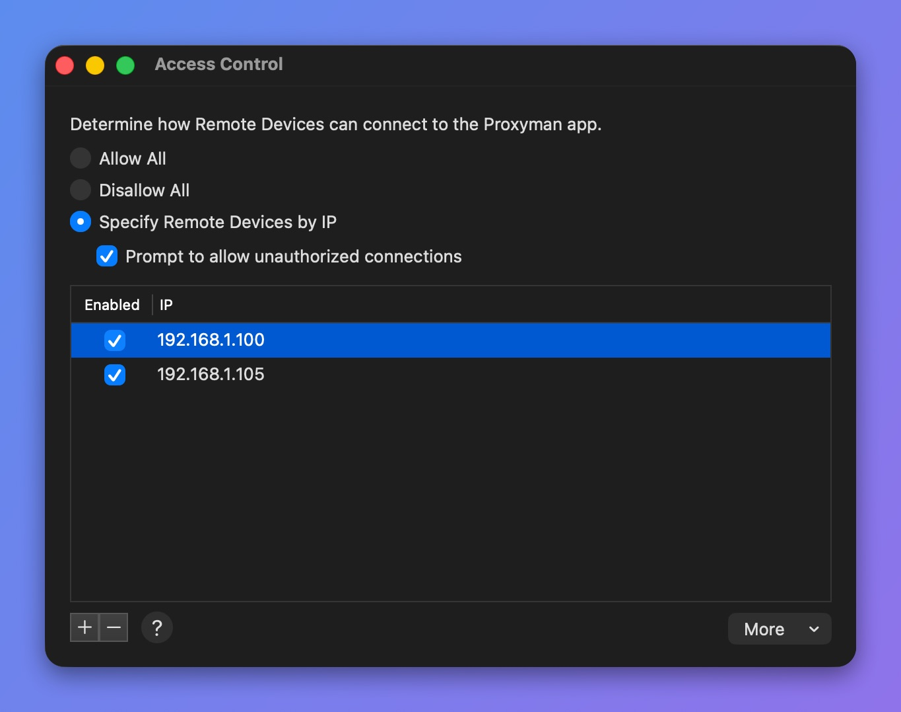

# Access Control

## 1. What's it?

Access Control is an advanced feature that lets you define how remote devices (iPhone, Android, other computers) can connect to the Proxyman app. It's designed for enterprise users who need better security.

Open it from the **Tools** menu -> **Proxy Settings** -> **Access Control…**

<table><thead><tr><th width="169">Mode</th><th>Description</th></tr></thead><tbody><tr><td>Allow All</td><td>All remote connections can connect to Proxyman (Default).</td></tr><tr><td>Disallow All</td><td>No remote connections are allowed to connect to Proxyman.</td></tr><tr><td>Specify Remote Devices by IP</td><td>Define which devices (by IP address) can connect to the Proxyman app.</td></tr></tbody></table>

<figure><figcaption><p>Access Control window</p></figcaption></figure>

When **Prompt to allow unauthorized connections** is checked, Proxyman asks you to allow or deny a device that is not on the list.

<figure><figcaption><p>Prompt to allow unauthorized connections</p></figcaption></figure>

## 2. Override the Access Control mode by Command Lines

From Proxyman 4.4.0, you can override the Access Control mode with the following commands.

It's useful if your company wants to enforce a mode without using the app's UI.

```
$ defaults write ~/Library/Preferences/com.proxyman.NSProxy.plist accessControlModeString "allowAll"
$ defaults write ~/Library/Preferences/com.proxyman.NSProxy.plist accessControlModeString "disallowAll"
$ defaults write ~/Library/Preferences/com.proxyman.NSProxy.plist accessControlModeString "specificIP"
```
