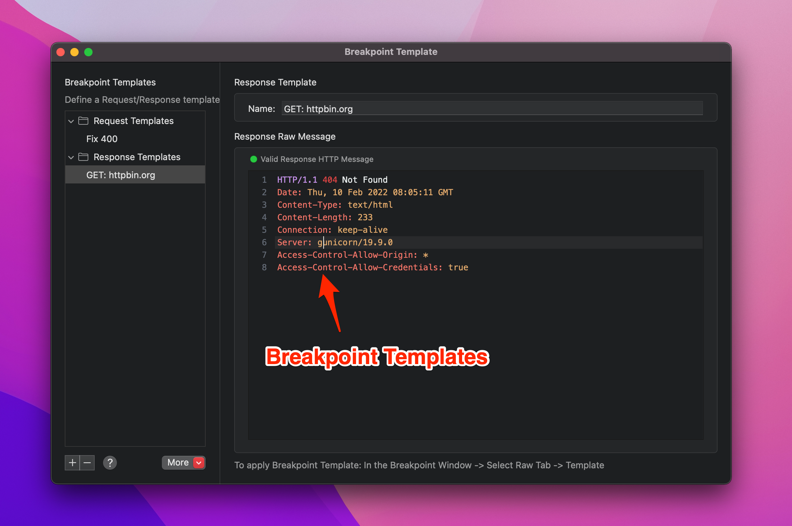
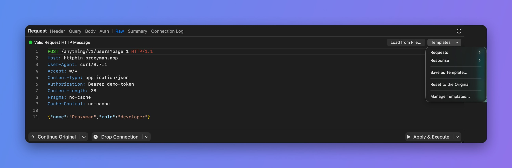

# HTTP Message Templates

## 1. What's it?

You can create an HTTP Message Template for the Breakpoint tool and reuse it later.

* Create a new HTTP Message Template for a Request: HTTP Method, URL, Headers
* Create a template for a Response: Status Code, Headers
* Boost your productivity when using the [Breakpoint tool](breakpoint.md#1.-whats-it).

## 2. How to create a new template?

### Create a new one

1. **Tools** menu -> **Breakpoint** -> **Breakpoint Templates…**
2. Press ⌘N to create a Request template, or ⇧⌘N to create a Response template.
3. Define your Request/Response template.

### Use the existing one

1. Create a Breakpoint rule and make sure your request/response hits the Breakpoint.
2. Click the **Raw** tab -> **Templates** -> **Save as Template...**
3. Enter a name for the template. Done.

## 3. How to use it?

1. When a request/response hits a Breakpoint, click the **Raw** tab.
2. Click **Templates** -> Request/Response -> select your template.
3. Proxyman replaces the current data with the template.

<figure><figcaption>
Templates menu in the Breakpoint Raw tab
</figcaption></figure>

## Learn more

* [How to change HTTP Response Status Code, Header, Or the Body for Testing](https://proxyman.com/posts/change-response-status-code-header-for-testing)
