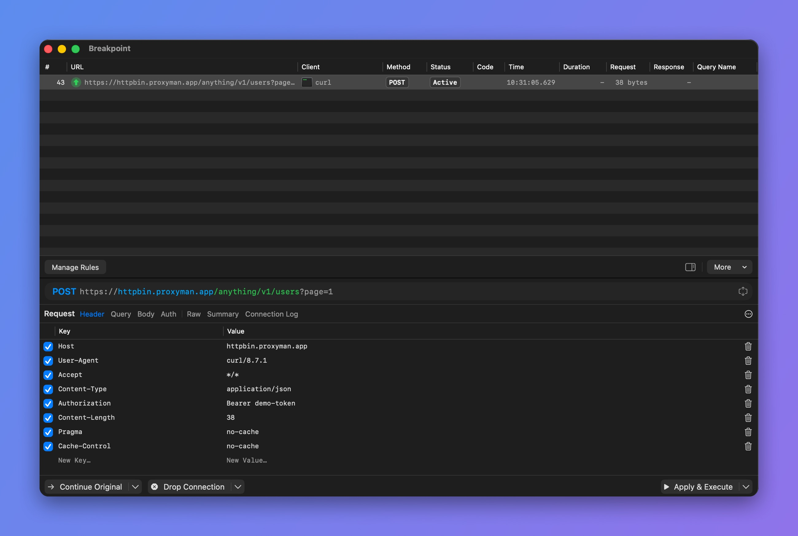
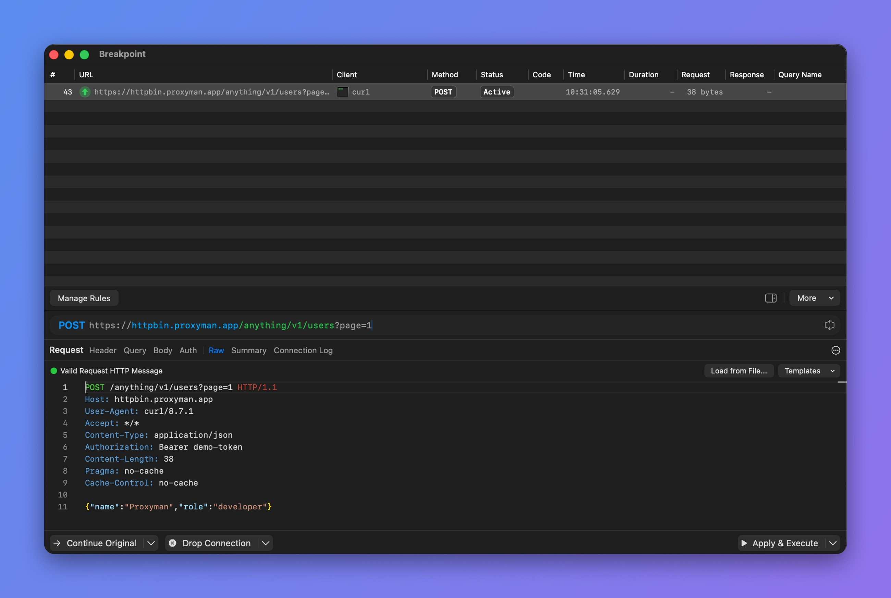

# Breakpoint

## 1. What's it?

Breakpoint is a handy tool to help developers edit the content of the Request and Response **on the fly**.

You can set a breakpoint on the **Request**, the **Response**, or both.

<figure><figcaption>
Create a Breakpoint rule
</figcaption></figure>


If you're using the [Atlantis Framework](../atlantis/atlantis-for-ios.md), you can't use Breakpoint. Please use a normal proxy instead.


## Video


Modify requests and responses with Breakpoint


## 2. Main features

The Breakpoint tool stops an outgoing request or an incoming response, so you can modify its data.

* Modify the Request URL, including the Scheme, Host, Path, Port, HTTP Method
* Modify HTTP Headers of Request/Response
* Modify Query or Form entry from Requests.
* Modify Authorization/Cookie/Set-Cookie Headers.
* Modify HTTP Body of Request/Response
* Change Response HTTP Status Code.

<figure><figcaption>
Modify the headers, URL, status code, and body
</figcaption></figure>

### Raw HTTP Message

From Proxyman macOS 6.12.0 or later, you can switch to the Raw tab to modify the Request/Response HTTP message. It lets you edit all the data in one place.

<figure><figcaption>
Edit the raw HTTP message
</figcaption></figure>

### Breakpoint Actions

| Action                 | Meaning                                                                                                                      |
| ---------------------- | ---------------------------------------------------------------------------------------------------------------------------- |
| Continue Original (⌘.) | Ignore your changes and continue the Request/Response with the original data                                                 |
| Drop Connection (⌘\\)  | Abort the breakpoint and stop the connection. Use the arrow next to it -> **Abort Mode** to return a 429 or 503 status instead |
| Apply & Execute (⌘⏎)   | Send the Request/Response with your changes                                                                                  |


Check out the Breakpoint tutorial: [Use Breakpoint to intercept and edit requests and responses on an iOS app](https://proxyman.com/posts/2019-09-15-Use-Breakpoint-to-intercept-and-edit-request-response-on-iOS-app)


## 3. Breakpoint by the Scripting Tool ✅

If you would like to modify requests automatically, use the [Scripting](../scripting/script.md#1-whats-it) tool. It gets the same result as Breakpoint, but in a more flexible way, by writing JavaScript code.

Please check out the [Scripting snippet code](../scripting/snippet-code.md#2-common-on-request-and-response) to see how to use Scripting for Breakpoint.

## 4. Breakpoint with GraphQL Requests

From Proxyman 2.27.0+, Breakpoint can work with GraphQL requests by a specific QueryName. Please check out the following GraphQL document.


[graphql.md](graphql.md)


## 5. How to use

You can create a Breakpoint rule this way:

1. Make sure Proxyman can capture your HTTPS request first.
2. Right-click on the request -> **Tools** -> **Breakpoint…**
3. Proxyman opens the Breakpoint rule window and fills in the Matching Rule.
4. Select Breakpoint on Request, Response, or both.
5. Click **Add** to create the rule.
6. Send the request again. Proxyman opens the Breakpoint window, and you can modify the data.
7. Click **Apply & Execute** to send the request/response.

## Learn more

* [Modify HTTP Request/Response with Proxyman Breakpoint Tool](https://proxyman.com/posts/2021-12-31-Modify-URL-Request-With-Breakpoint)
* [How to change HTTP Response Status Code, Header, Or the Body for Testing](https://proxyman.com/posts/change-response-status-code-header-for-testing)
* [Manipulate GraphQL Request with Breakpoint Tool](https://proxyman.com/posts/2023-03-16-GraphQL-Request-With-Breakpoint)
