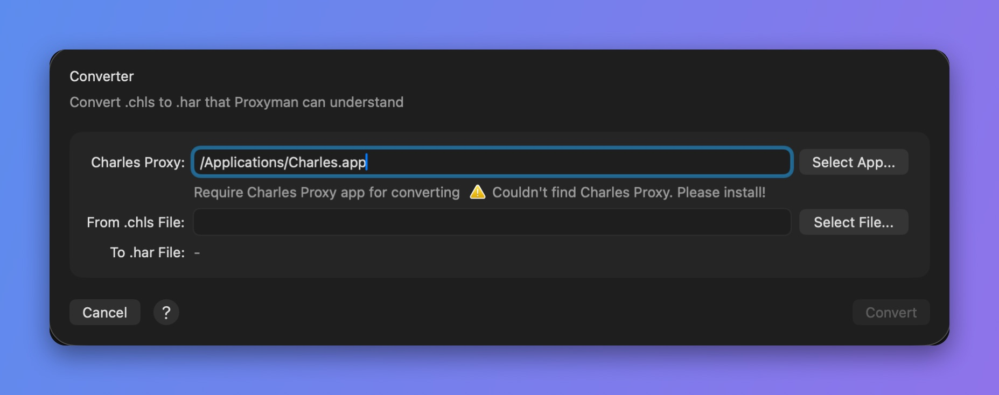

# Charles Proxy Converter

## 1. What's it?

Proxyman can convert `chls` files from the Charles Proxy app to the `har` format, which Proxyman can read.


Charles Proxy must be installed on your Mac to convert `chls` files.


You can also convert files manually from the **File** menu -> **Convert** -> **From .chls to .har**.

<figure><figcaption><p>Convert .chls to .har</p></figcaption></figure>

## 2. How does it work?

Proxyman uses the [Charles Proxy command-line convert tool](https://www.charlesproxy.com/documentation/tools/command-line-tools/) to convert `.chls` files to `.har` files, which Proxyman can read.

1.  When you open a `chls` file, Proxyman looks for the Charles Proxy app by its bundle ID:

    `com.xk72.Charles`
2. Proxyman converts the file with the `convert` command:

```
$ /Applications/Charles.app/Contents/MacOS/Charles convert ~/Desktop/input.chls ~/Desktop/output.har

```

3\. The output is a `har` file. In this example, it's saved to your Desktop folder.

## 3. How to use?

There are several ways to open `chls` files:

* Open the `chls` file directly (double-click the file, or use **Open With** in Finder)
* Drag and drop the file into the Proxyman app
* **File** -> **Open…** and select the `chls` file

## Learn more

* [Migrate from Charles to Proxyman](https://proxyman.com/posts/2020-07-03-Migrate_From_Charles_To_Proxyman)
