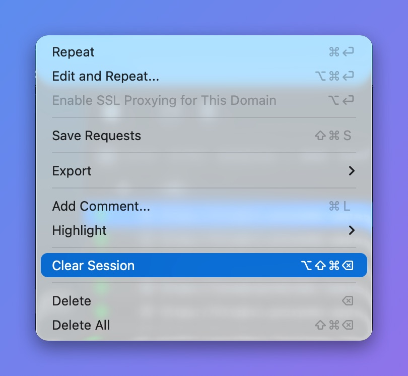

# Clear Session

Clear the current working session, including all Requests, Domains, and Clients.

## What's for?

* Start a fresh session without quitting the app
* Release unneeded memory

## How to use

* **Flow** menu -> **Clear Session** (⌥⇧⌘⌫)

<figure><figcaption>
Clear Session in the Flow menu
</figcaption></figure>
