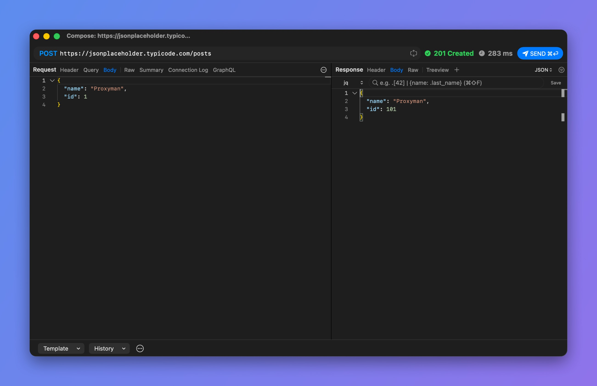
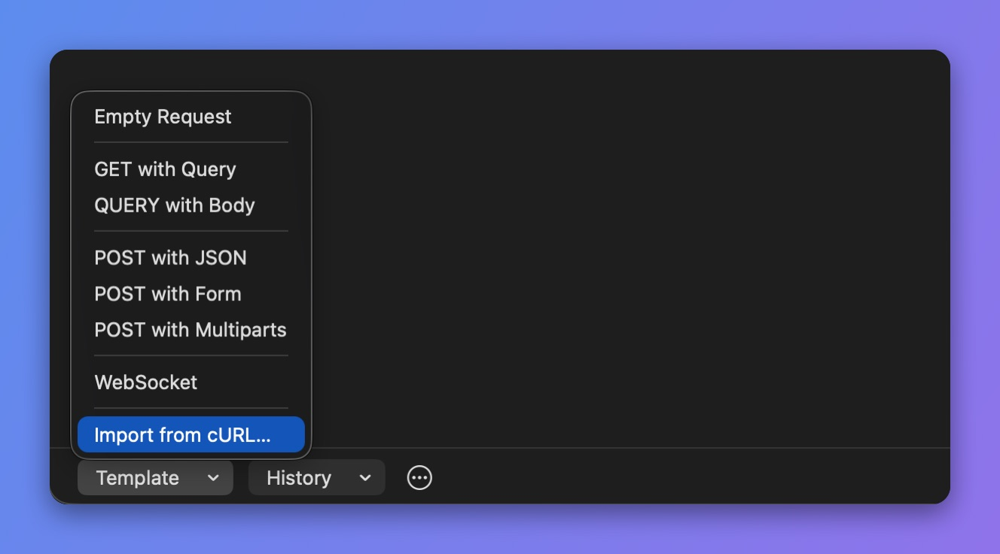
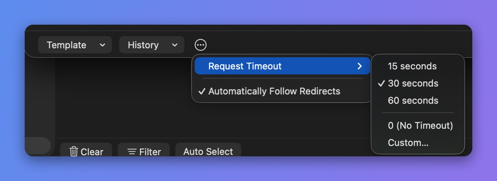

# Compose new Request

## 1. What's it?

The Compose tool helps developers:

* Compose an HTTP/HTTPS request and send it to your service. It's similar to Paw, Insomnia, and Postman.
* Quickly test your APIs without your client app.
* Supports Header, Query, URL, Form, and JSON Body.
* Supports Raw Message.
* Supports multipart body.
* Preset templates, such as Empty Request, GET with Query, and POST with JSON or Form.


You can reuse your request data for new requests. Please check out the [Edit & Repeat](edit-and-repeat.md) page.


## 2. How to use

You can open the tool by either:

* Click the Compose button on the main toolbar
* **Tools** -> **Compose Request…** (⌥⌘C)

1. Enter the URL
2. Select the HTTP Method
3. Modify the Header, Query, Body, or Raw Message
4. Click the **Send** button.

<figure><figcaption>
Send a POST request with a JSON body
</figcaption></figure>

## 3. Template

Click the **Template** button at the bottom of the Compose window to start from a preset:

* Empty Request
* GET with Query
* QUERY with Body
* POST with JSON
* POST with Form
* POST with Multiparts
* WebSocket
* Import from cURL…

<figure><figcaption>
Compose templates
</figcaption></figure>

## 4. Import from cURL

You can import a cURL command, for example one copied from the Network tab in Google Chrome, and send it with the Compose tool. Click **Template** -> **Import from cURL…**.


You can also paste your cURL command into the URL field. Proxyman tries to parse it.


## 5. History Request

From Proxyman macOS 5.24.0, Proxyman stores your requests and responses in the **History** list.

* ✅ Useful to preview your previous Request/Response

## 6. Settings

* **Request Timeout**: Click the **⋯** button at the bottom of the Compose window -> **Request Timeout**. Pick 15, 30, or 60 seconds, a custom value, or **0 (No Timeout)**. The same timeout applies to [repeated requests](repeat.md). Available on Proxyman 4.13.0 or later.

<figure><figcaption>
Set the request timeout
</figcaption></figure>

## Learn more

* [Proxyman now supports the HTTP QUERY method](https://proxyman.com/posts/2026-07-11-Proxyman-now-supports-HTTP-QUERY-method)
