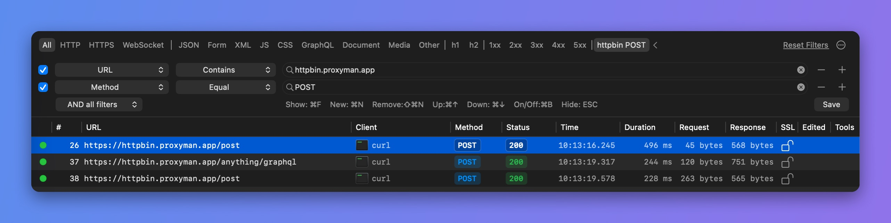
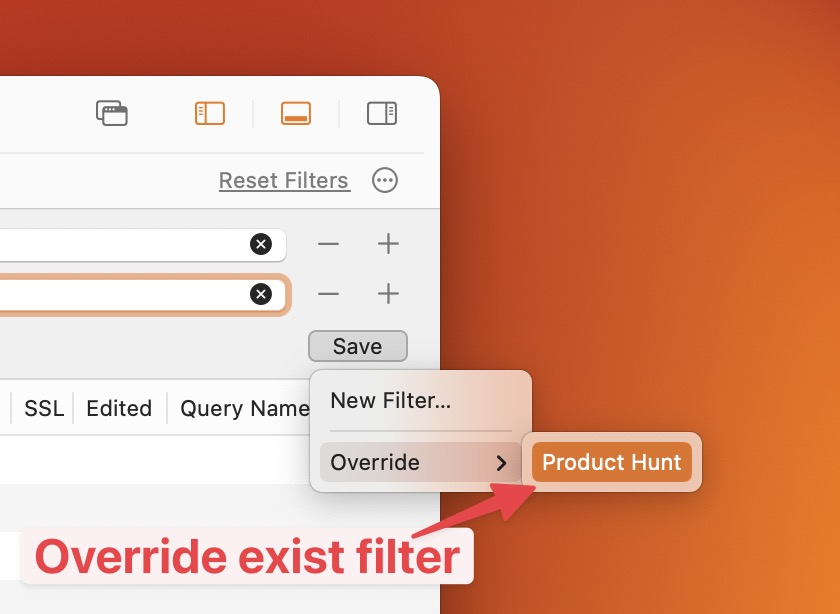
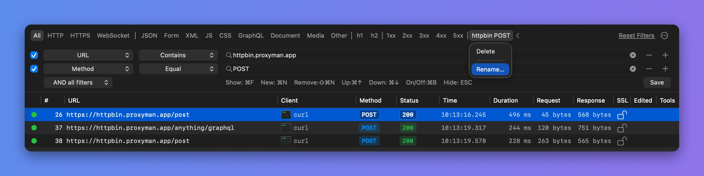

# Custom Filters

## 1. What's it?

From Proxyman 4.11.0 or later, you can save your current filter settings as a custom filter and use it again later.

* Create a custom filter button on the filter bar from your current filter settings
* Manage the filter buttons: create, override, delete, and rename
* Save time ✅

## 2. How to use

### Create new filter

1. Set up your filter (single or [multiple filters](multiple-filters.md))
2. Click the **Save** button -> **New Filter…** -> enter a name
3. The new filter is added to the filter bar.

<figure><figcaption>
Create new custom filter
</figcaption></figure>

### Override

1. Change your filter settings
2. Click the **Save** button -> **Override** -> select the filter you want to override

<figure><figcaption>
Override an existing filter
</figcaption></figure>

### Delete or Rename

1. Right-click on the filter button
2. Select **Delete** or **Rename…**

<figure><figcaption>
Delete or rename a custom filter
</figcaption></figure>
