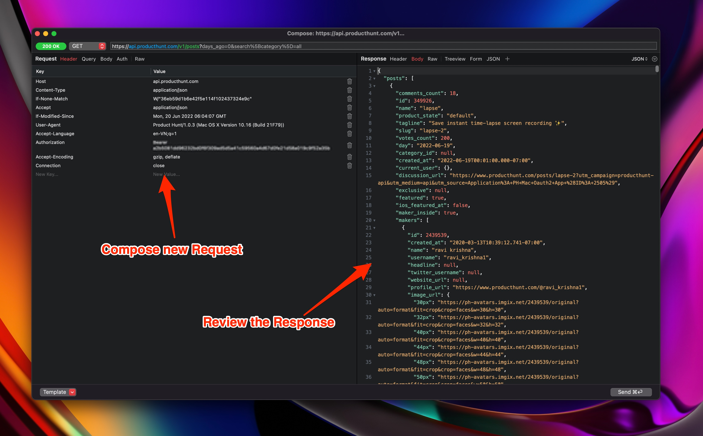

# Edit & Repeat

## 1. What's it?

Edit & Repeat is a handy tool to test an endpoint directly in the Proxyman app, without making a new request from your browser or client app.

* Quickly change the **Query**, **Header**, or **Body** of the selected request and test the response from the server.
* Easily reproduce a server bug with a different set of parameters.
* Supports Form and JSON formats.
* Edit the Raw Message.
* Review the response data on the right panel (Proxyman 3.6.0+).

## 2. How to use it?

1. Select your request -> Right-click -> **Edit and Repeat…** (⌥⌘⏎)
2. Proxyman keeps the request data (Header, URL, Query, Body), so it's ready to edit.

