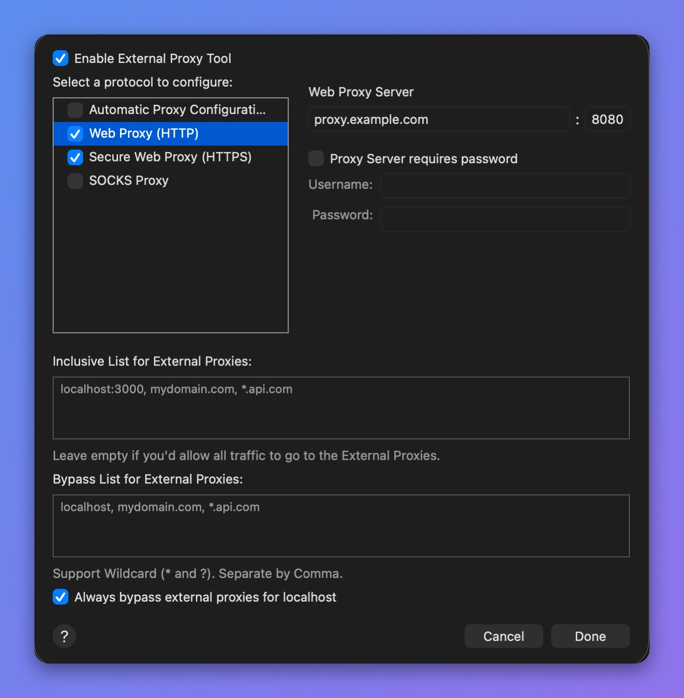

# External Proxy

## 1. What's it?

Some companies have a central proxy server, and all outgoing requests must go through it to reach the Internet.&#x20;

In this case, you may have to set up Proxyman to send all connections to the External Proxy.

## 2. Benefits

* Send all traffic to your company's proxy server.
* Define hosts or domains that bypass the External Proxy.
* Supports HTTP/HTTPS/SOCKS Proxy.
* Supports PAC Proxy (Automatic Proxy Configuration) (Proxyman 3.2.0+)

## 3. How to use

* **Tools** menu -> **Proxy Settings** -> **External Proxy Settings…**
* You can set up an **HTTP, HTTPS, or SOCKS Proxy** that points to your external proxy server.
* If you have a **PAC URL**, you can use it in Automatic Proxy Configuration.
* Proxyman also supports **Basic Authentication**.
* To turn the External Proxy on or off, use **Tools** -> **Proxy Settings** -> **Use External Proxy** (⌥⌘E).

<figure><figcaption>
External Proxy settings
</figcaption></figure>


External SOCKS Proxy with authentication is not supported.&#x20;


## 4. Bypass Proxy

* You can define hosts/domains that bypass the external proxy. Separate each host with a comma. Wildcards (\* or ?) are supported.
* By default, Proxyman sends all localhost traffic directly, not through the external proxy. This is the **"Always bypass external proxies for localhost"** checkbox, which is on by default. Uncheck it if you want localhost traffic to go through the external proxy too.


Localhost traffic is traffic from localhost, 127.0.0.1, or 0.0.0.0 on any port.

