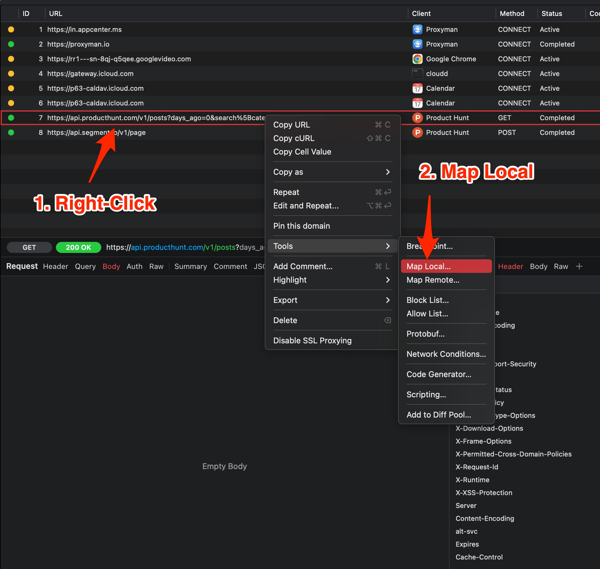

# Map Local (File)

## 1. What's it?

The Map Local tool lets you use the content of a local file as the HTTP response to your requests.


You can do Map Local for **GraphQL** with the Scripting Tool ([Snippet Code](../scripting/snippet-code.md#map-local-with-graphql))

You can combine **Map Local with Breakpoint** to modify the content on the fly (2.16.0+)


## Video


Mock API responses with Map Local


## 2. Benefits

* Define a response with a Status Code, Headers, and Body, and map it to a given request. You can test edge cases without waiting for a server update.
* **Mock a fake API with a local file**: Try out test APIs that are not in production yet.&#x20;


### With an HTTP Message

1. Right-click on your request in the main table -> **Tools** -> **Map Local…**. Proxyman creates a new rule with the current response.
2. Change the Status Code, Headers, and JSON Body as you like.
3. Done.
4. Send your request again. The new response is mapped.

### With a Local File

* Click the **Select Local File** button and select any file. Supports Text, JSON, Binary, and Image files.

### With \<FILE\_URL> flag

* Map to a given file and still set the Status Code and Response Headers.
* Works with JSON, Text, Binary, Image, etc.
* Make sure to set the `Content-Type` header, so your client can read the response properly.

```json
HTTP/1.1 200 OK
Content-Type: application/json

<FILE_URL="~/Desktop/myjson.json">
```

## 3. How to use

1. Right-click on the request (which already has a response) -> **Tools** -> **Map Local…**. Proxyman creates a rule with the current response body. Proxyman saves the file in its own Map Local folder. To see or change this folder, click **More** in the Map Local window -> **Default Local File Folder**.
2. Change the response body directly in the editor.
3. Make a request and check the new response body.

<figure><figcaption><p>Create a Map Local rule with the current response</p></figcaption></figure>

## 4. Map Local with GraphQL Requests

From Proxyman 2.27.0+, Map Local can work with GraphQL requests by a specific QueryName. Please check out the following GraphQL document.


[graphql.md](graphql.md)


## 5. Map Local with Scripting Tool ✅&#x20;

If you would like to do Map Local with **complicated rules,** check out [Scripting](../scripting/script.md#1-whats-it), since it's easier to get the same result.

Please check out this [Snippet Code](../scripting/snippet-code.md#2-common-on-request-and-response) to see how to map a local file with JavaScript code.

## Learn more

* [How to manipulate HTTP response using Proxyman Map Local Tool](https://proxyman.com/posts/2019-08-03-map-local-feature)
* [How to map a Local Response for GraphQL Requests?](https://proxyman.com/posts/2021-01-24-How-To-Map_Response_For_GraphQL_Requests)
