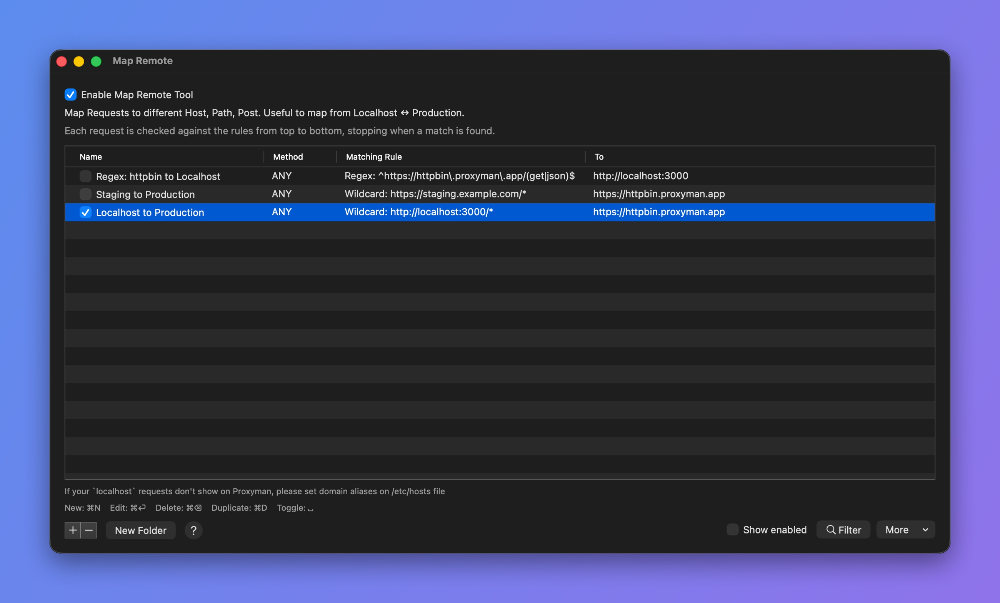
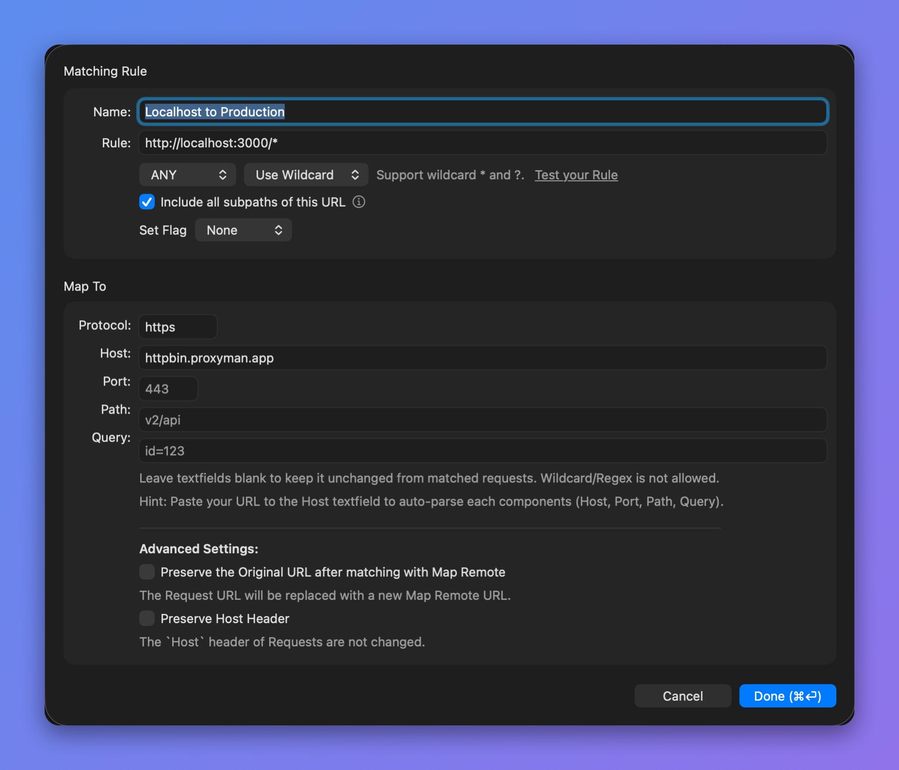
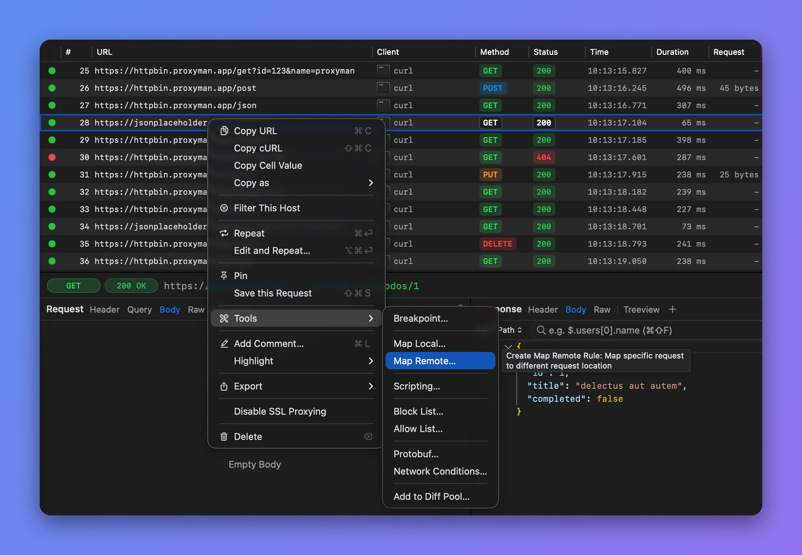

# Map Remote

## 1. What's it?

Map Remote (**⌥⌘R**) changes the location of an HTTP request to a new destination server, based on your rules. Your client gets the response from the new server as if nothing changed.

Map Remote also supports mapping from HTTP to HTTPS and vice versa.

<figure><figcaption>
Map Remote rules
</figcaption></figure>


Check out common [Map Remote Config](map-remote.md#7.-common-usages) when mapping from HTTP <-> HTTPS.



From Proxyman 4.3.0: Map Remote supports Websocket and Secure Websocket.


## 2. Benefits

* Use Production endpoints on your Development website for certain endpoints, without changing the source code
* Use Development endpoints on your Production website
* Send certain request URLs to different destinations
* Replace request components, such as Protocol, Host, Port, Path, or Query, on the fly


To boost your productivity, you can use the [Scripting feature](../scripting/script.md#1-whats-it) to get the same result as Map Remote by writing simple JavaScript code.

For instance, [Snippet code to change Production to Localhost server](../scripting/snippet-code.md#change-request-destination-schema-host-port-path)


## 3. Map Remote with GraphQL Requests

From Proxyman 2.27.0+, Map Remote can work with GraphQL requests by a specific QueryName. Please check out the following GraphQL document.


[graphql.md](graphql.md)


## 4. Using Scripting as Map Remote ✅

If a Map Remote rule is hard to set up, you can do it more easily with the [Scripting Tool](../scripting/script.md#1-whats-it).

Please check out [Map Remote Snippet Code](../scripting/snippet-code.md#8-map-remote-with-scripting) to learn how to use Scripting to achieve the same result as Map Remote.

For instance, it's easy to do the following with Scripting:

* Map v1 to v2 endpoints
* Map Production to Localhost
* Map Localhost to Production
* ...

## 5. Matching Rule


Proxyman supports [Regular Expression](https://developer.apple.com/documentation/foundation/nsregularexpression#1965590) and Wildcard from version 2.3.0. Check out [how to use Wildcard and Regex](../basic-features/regex.md).


We can define matching rules by using [Wildcard or Regular Expression](../basic-features/regex.md).

For matched requests, Proxyman attempts to:

* Replace the Protocol, Host, Port, Path, and Query, if they are set
* If a component is empty, it won't change that component of the matched request

<figure><figcaption>
Map Remote rule editor
</figcaption></figure>


* Leave a text field blank to keep that part unchanged from the matched request
* Wildcards are not allowed in the Map To fields


### Debugging

To find which Map Remote rule matches your URL, open the request's Summary tab:

1. Select your request
2. **Summary** tab -> **Debugging Tools**
3. Check the mapped URL

### Preserve Host Header

By default, Proxyman overrides the Host header to match the new host in Map Remote. This is needed for most requests to succeed.

If you would like to keep the original Host header, check the "Preserve Host Header" checkbox when you create a new entry. Proxyman will keep the Host value.

## 6. How to use

* Right-click on the selected request -> **Tools** -> **Map Remote…**. Proxyman fills in the needed data from the selected request.

<figure> Map Remote... highlighted"><figcaption>
Create a Map Remote rule from a request
</figcaption></figure>

## 7. Common Usages

### 7.1 Map Localhost (HTTP) to Production (HTTPS)

**Result:**

| Original URL                                        | To URL                                            |
| --------------------------------------------------- | ------------------------------------------------- |
| http://localhost:3000                               | https://proxyman.io                               |
| http://localhost:3000/pricing                       | https://proxyman.io/pricing                       |
| http://localhost:3000/v1/user?id=123\&name=proxyman | https://proxyman.io/v1/user?id=123\&name=proxyman |
| **POST** http://localhost:3000/login                | **POST** https://proxyman.io/login                |

### 7.2 Map Production (HTTPS) to localhost (HTTP)

| Original URL                                      | To URL                                              |
| ------------------------------------------------- | --------------------------------------------------- |
| https://proxyman.io                               | http://localhost:3000                               |
| https://proxyman.io/v1/user?id=123\&name=proxyman | http://localhost:3000/v1/user?id=123\&name=proxyman |
| **POST** https://proxyman.io/login                | **POST** http://localhost:3000/login                |

### 7.3 Map certain URL to another host

* Rule: **https://proxyman.io/v1/user** (for instance)
* Select **Any** and **Wildcard**
* **Un-Check Include all subpaths of this URL:** Un-check means it doesn't map other subpaths

**Map To:**

* Protocol: **https**
* Host: New Host (e.g. staging.proxyman.io)
* Port: **443** (your local port)
* Leave Path and Query Empty

**Result:**

| Original URL                                      | To URL                                                    |
| ------------------------------------------------- | --------------------------------------------------------- |
| https://proxyman.io                               | https://proxyman.io (does not map the rule)               |
| https://proxyman.io/v2/setting                    | https://proxyman.io/v2/setting (does not map the rule)    |
| https://proxyman.io/v1/user?id=123\&name=proxyman | https://staging.proxyman.io/v1/user?id=123\&name=proxyman |

### 7.4 Map Websocket from localhost to Production

| Original URL                  | To URL                              |
| ----------------------------- | ----------------------------------- |
| ws://localhost:4000           | wss://ws.postman-echo.com           |
| ws://localhost:4000/websocket | wss://ws.postman-echo.com/websocket |

### 7.5 Map Websocket from Production to Localhost

| Original URL                        | To URL                        |
| ----------------------------------- | ----------------------------- |
| wss://ws.postman-echo.com           | ws://localhost:3000           |
| wss://ws.postman-echo.com/websocket | ws://localhost:3000/websocket |

## Learn more

* [Switch API endpoint from Production to localhost environment for testing](https://proxyman.com/posts/2025-01-10-switch-api-endpoint-from-localhost-to-production-environment)
