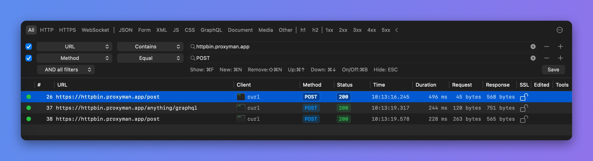

# Multiple Filters

## 1. What's it?

From build 2.22.0+, you can combine many filters at one time.

* Filter requests and responses with complex criteria, quickly and easily
* Proxyman remembers your last filter settings
* Handy shortcuts
* Many filter types: URL, Host, Query String, Request Header, Response Header, Request Body, Response Body, Status Code, Method, Client, IP Address, GraphQL, Color, Comment, Duration, and Body Size
* Combine all filters with AND / OR

<figure><figcaption>
Combine two filters with AND
</figcaption></figure>

## 2. Shortcut

| Shortcut | Description                                  |
| -------- | -------------------------------------------- |
| ⌘F       | Show the filter and focus on the last one    |
| ⌘N       | Clone a new filter                           |
| ⇧⌘N      | Remove the current filter                    |
| ⌘↑       | Focus on the previous filter                 |
| ⌘↓       | Focus on the next filter                     |
| ESC      | Hide the filter                              |


You can add up to 10 filters.

The free version allows only 1 filter.


## Learn more

* [Multiple Filters: a useful tip to boost your productivity](https://proxyman.com/posts/2021-04-08-Use_Multiple_Filters)
