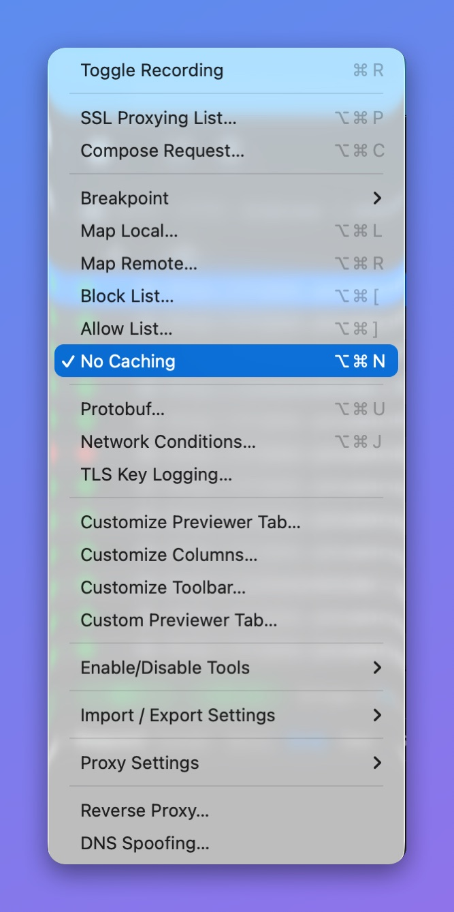
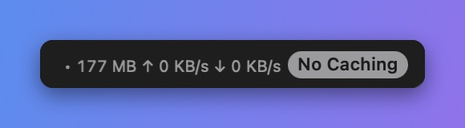

# No Caching

## 1. What's it?

No Caching prevents the server or client from caching your requests and responses, so you always get the latest change from the server.

The No Caching tool affects all HTTP requests and responses, and HTTPS traffic that has SSL Proxying enabled.

## 2. What's for?

* When you would like to **see the latest HTTP Response changes** from the server or client and ignore all caching layers.

## 3. How it works

The No Caching tool changes every request and response by adding or removing the caching HTTP headers in the following table.

| HTTP Message | Remove                                       | Add                                                  |
| ------------ | -------------------------------------------- | ---------------------------------------------------- |
| Request      | **If-Modified-Since** and **If-None-Match**  | **Pragma: no-cache** and **Cache-control: no-cache** |
| Response     | **Expires**, **Last-Modified,** and **ETag** | **Expires: 0** and **Cache-Control: no-cache**       |

## 4. How to use

* Enable it in **Tools** menu -> **No Caching**

<figure><figcaption>
Tools menu > No Caching
</figcaption></figure>

* When it's on, a **No Caching** badge shows at the bottom right of the main window.

<figure><figcaption>
No Caching badge
</figcaption></figure>


**⌥⌘N:** Toggle the No Caching Tool.

