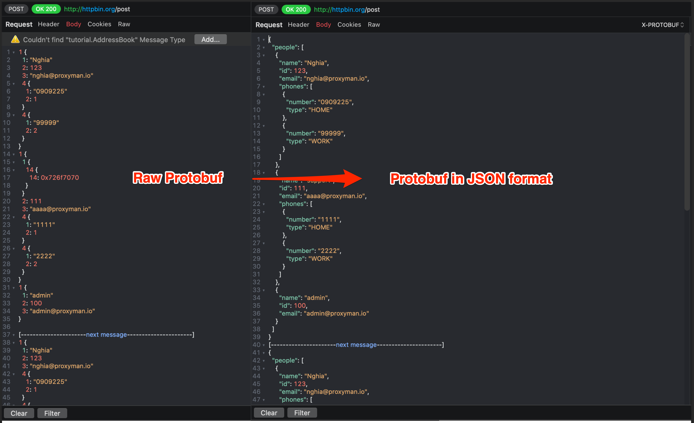
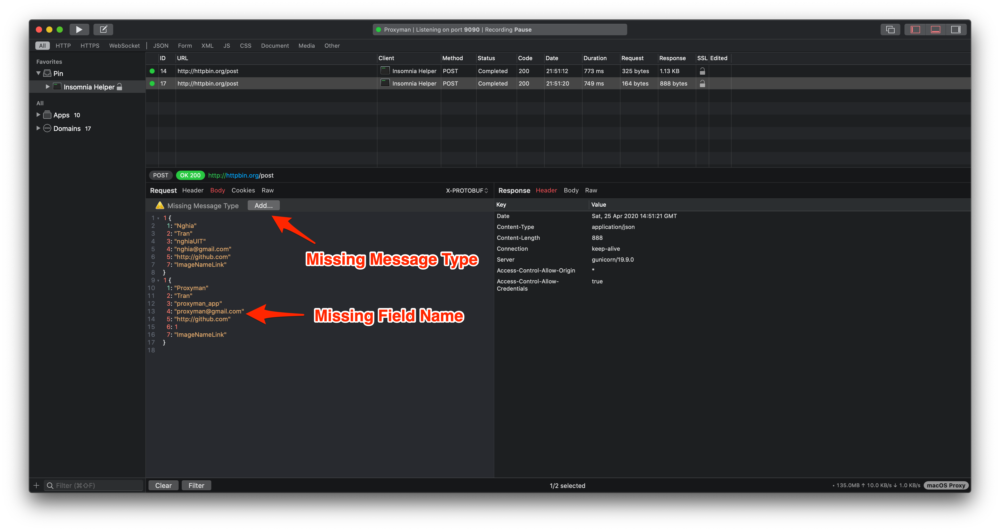

# Protobuf

## 1. Protobuf

* Proxyman macOS can decode the Protobuf body of your HTTP/HTTPS requests and responses with a given Protobuf desc file
* Decode Protobuf binary and show it as plain text
* Supports a Single Message or multiple Delimited Messages in a single Protobuf binary
* Import a desc file and read all its Message Types to decode Protobuf binary
* Decode [Protobuf from Websocket](websocket.md#websocket-with-protobuf-payload)



## 2. Protobuf File Descriptor (\*.desc)

Proxyman requires a File Descriptor (\*.desc) to properly parse the Protobuf Data.

There are a few ways to get the File Descriptor:

### 1. Ask your colleagues.

If your company uses Protobuf, there's a good chance that your colleagues already have this file, especially the Backend and Frontend teams.

It might be one or multiple descriptor files.

### 2. Generate from \*.proto file

If you have many \*.proto files, you can generate one \*.desc file with the following command.


```bash
# Install protobuf cli if need
brew install protobuf

# Create `input` folder on the Desktop
# Copy all proto files to the `input` folder

# Generate 1 descriptor file with multiple proto files
protoc --descriptor_set_out=output.desc --include_imports -I=/Users/<your_name>/Desktop/input /Users/<your_name>/Desktop/input/*.proto

# Done
# output.desc
```


Once you have the Descriptor File, import it to Proxyman:

* **Tools** menu -> **Protobuf…** -> click the **Protobuf Schema...** button
* Click the **+** button and select the **output.desc** file


Proxyman 3.6.0+ only accepts **File Descriptor (\*.desc)** for better Protobuf parsing.

If you have **\*.proto** files, you can convert them to **\*.desc**. See [Generate from \*.proto file](#2.-generate-from-.proto-file) above.



Proxyman automatically imports all common types from **Google Protobuf**, such as Timestamp, Struct, Value, Enum, Method, etc.

Proxyman supports both **proto2** and **proto3** syntax. [Read more](https://developers.google.com/protocol-buffers/docs/proto3)


## 3. Protobuf Config

Before using Protobuf, you have to set which Message Type Proxyman should use to parse the Protobuf data.

The following table describes the settings:

| Name                                | Description                                                                                                                                                         |
| ----------------------------------- | ------------------------------------------------------------------------------------------------------------------------------------------------------------------- |
| Schema                              | Add a `.desc` file if needed                                                                                                                                        |
| Message Type                        | The Class name of the root object in Protobuf binary. **Must include Package name**                                                                                 |
| Payload Type: **Auto**              | Auto detect if the Protobuf Binary is encoded as a Single Message or [Delimited Message](https://developers.google.com/protocol-buffers/docs/techniques#streaming)   |
| Payload Type: **Single Message**    | Single Message in a Protobuf Binary                                                                                                                                 |
| Payload Type: **Delimited List**    | Multiple Messages in a Protobuf Binary (Length-Prefix)                                                                                                              |

<figure><figcaption><p>Decode Protobuf HTTPS Response with Proxyman</p></figcaption></figure>

## 4. How to use?

There are **two** ways to parse Protobuf properly with named fields:

* Define Protobuf Rules
* Read from Content-Type Header

### 4.1 Define Protobuf Rule

1. Your Protobuf request should have a Content-Type header: `Content-Type: application/x-protobuf` or `Content-Type: application/protobuf`
2. Proxyman detects the Protobuf payload and shows a warning that it can't parse it properly because the message type is missing. Click **Add** to open Protobuf Settings.

Alternatively, you can right-click on your request -> **Tools** -> **Protobuf…**



3\. In the Protobuf rule window, select the Message Type for this Request/Response (add a desc file if needed).


If the Request and Response use different Protobuf Message Types, select the \`Use different Message Type for Request / Response\` checkbox.


4\. Click **Add** and see the body in JSON format.

### 4.2 Read from Content-Type Header

You can **dynamically** provide the Protobuf Config from `Content-Type`

For example: Your `Content-Type` in the Request or Response might look like:

`Content-Type: application/x-protobuf; messageType="tutorial.Address"; delimited=true`

`Content-Type: application/x-protobuf; messageType="com.proxyman.User"; delimited=false`

This tells Proxyman the Message Type and the payload encoding of the Protobuf body.


## 5. ✅ Protobuf With Websocket (from macOS 6.5.0 or later)

* Decode a single binary WebSocket frame: Read [websocket.md](websocket.md "mention")
* You can create a Protobuf rule for WebSocket. Use the Request Message Type for client messages, and the Response Message Type for server messages.

## 6. Troubleshooting

### 6.1 Some name fields are missing

Some field names can be missing when their definitions are not in your Protobuf File Descriptor. Your descriptor might be out of date.

**Solution**:

* Remove the old Protobuf Schema and add the latest descriptor file from your server.
* If you're using Proxyman 3.5.2 or older, please update to Proxyman 3.6.0 or later. Then, use File Descriptor (\*.desc) for better results.

## Learn more

* [How to capture WebSocket and decode Protobuf message](https://proxyman.com/posts/how-to-capture-websocket-with-protobuf-message)
* [Proxyman vs mitmproxy: Decode Protobuf WebSocket Messages](https://proxyman.com/posts/2026-07-21-Proxyman-vs-mitmproxy-Protobuf-WebSocket)
