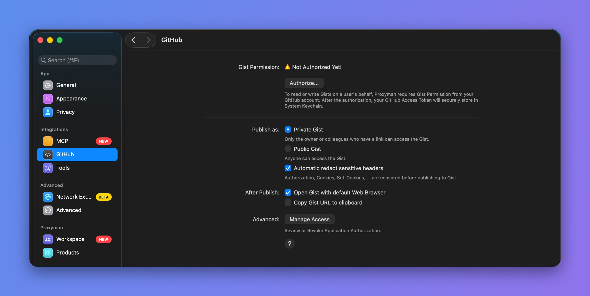
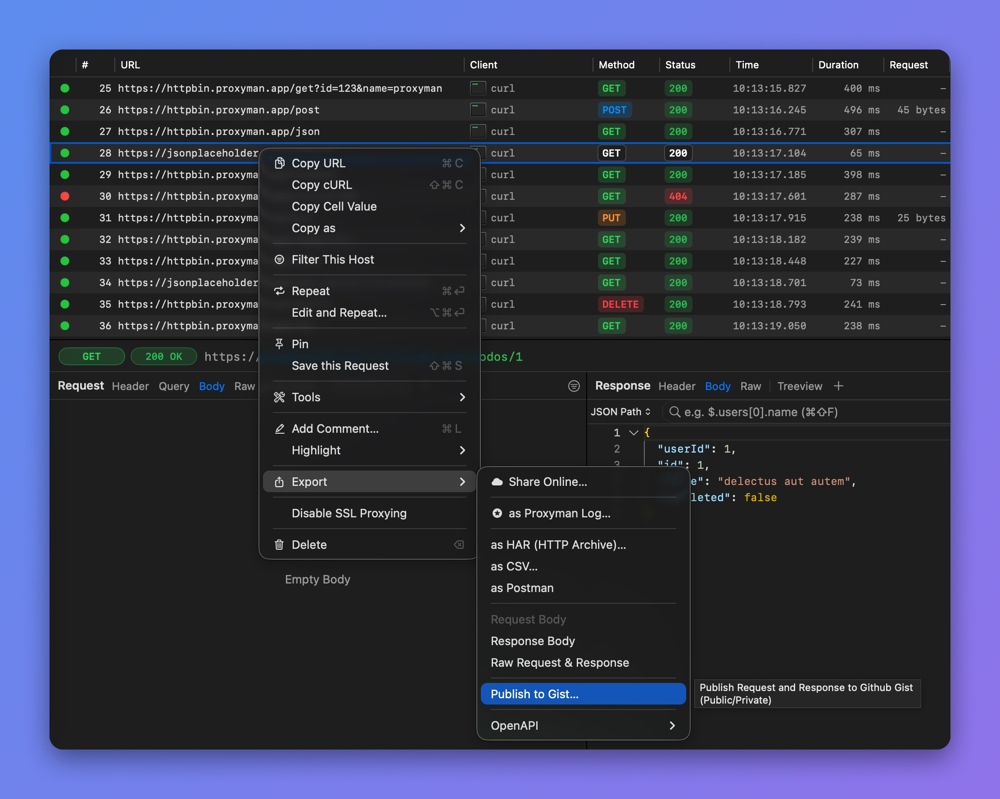

# Publish to Gist

## 1. What's it?

From Proxyman 2.28.0+, you can publish request and response data to GitHub Gist.

* Proxyman needs the "Read/Write Gist" permission to publish a Gist on your behalf.
* The first time, Proxyman opens the GitHub authorization page.

## 2. Benefit

* **Instantly** create a Gist from the selected requests and responses, and **quickly** share it with your colleagues.
* Supports Private and Public Gists.
* Only requires the **"Read/Write Gist"** permission. It doesn't ask for your email, username, or other permissions.
* The GitHub access token is stored securely in the Keychain.

Here is what a published Gist looks like: [example Proxyman Gist](https://gist.github.com/NghiaTranUIT/e116a60e286c917a5cbfd61aff32194c)

To choose between a private and a public Gist, open **Proxyman** -> **Settings** -> **GitHub**.

<figure><figcaption>
GitHub Gist settings
</figcaption></figure>

## 3. How to use

1. Select your requests on the main table view
2. Right-click to open the context menu -> **Export** -> **Publish to Gist…**

<figure> Publish to Gist... highlighted"><figcaption>
Export > Publish to Gist
</figcaption></figure>
