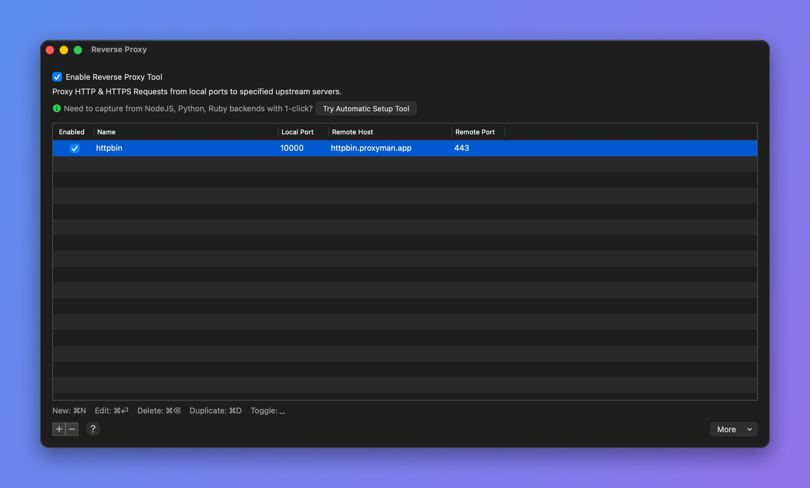
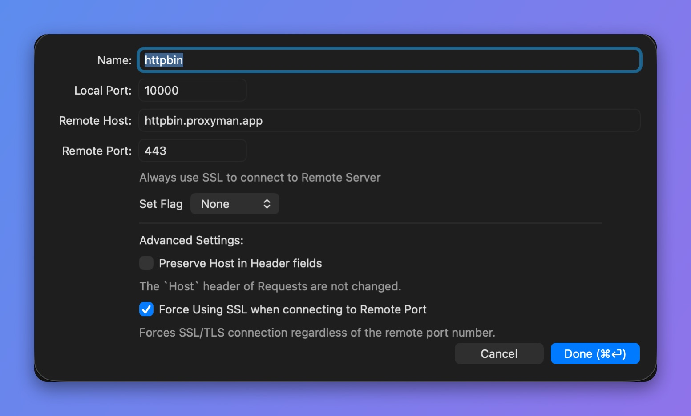

# Reverse Proxy

## 1. What's it?

Reverse Proxy creates a **local web server** that transparently forwards your traffic to a remote server. This way, Proxyman can capture and log your traffic.

Reverse Proxy is useful when you are working on a client that doesn't support an HTTP/HTTPS proxy, or when the HTTP proxy config is too complicated.

For instance, most command-line apps don't respect the system HTTP/HTTPS proxy, so Proxyman can't capture their traffic. To fix it, you can either:

* Explicitly configure an HTTP/HTTPS proxy. It can be complicated and depends on the network library you are using. Read [I couldn't see any requests from 3rd-party network libraries](../troubleshooting/couldnt-see-any-requests-from-3rd-party-network-libraries.md) to learn more.
* Use Reverse Proxy.

Reverse Proxy is available on Proxyman 2.29.0+.

## 2. Benefit

* Connect your client to the Proxyman local web server, and Proxyman forwards your traffic to the remote host. No need to set up an HTTP/HTTPS proxy on your client.
* Import Reverse Proxy settings from Charles Proxy.
* Preserve the Host header.
* Proxyman automatically selects an available port when you create a new entry.
* Use Breakpoint, Map Local, and Scripting with Reverse Proxy traffic 💯.

## 3. How to use

1. Open the **Tools** menu -> **Reverse Proxy…**
2. Create a new entry and enter a Remote Host and Remote Port. Proxyman selects the Local Port automatically. You can change it to a different port, but it must be available.
3. Save.
4. In your client app, change the URL to http://localhost:\<local\_port> (e.g. http://localhost:10000)
5. Make a request and inspect the traffic in the Proxyman app.

<figure><figcaption>
Reverse Proxy window
</figcaption></figure>

<figure><figcaption>
Reverse Proxy entry
</figcaption></figure>


Proxyman performs the SSL handshake with your remote server if the Remote Port is 443. Otherwise, it treats the remote server as a plain HTTP web server.

From Proxyman 5.17.0, check **Force Using SSL when connecting to Remote Port** to use SSL/TLS with any remote port.



**Preserve Host in Header fields** keeps the original Host value. Use it with caution, because your remote server can reject the request if the Host value doesn't match.


## Learn more

* [How to use Reverse Proxy to capture HTTP/HTTPS from apps that don't use an HTTP proxy](https://proxyman.com/posts/2023-03-22-How-to-use-Reverse-Proxy)
