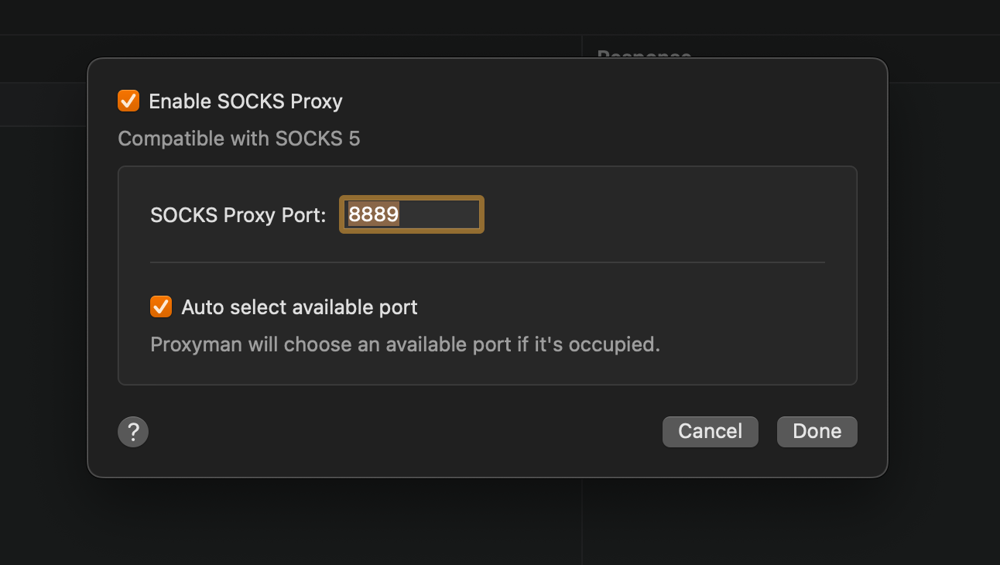

# SOCKS Proxy

## 1. What's it?

From Proxyman 4.9.0, Proxyman supports a SOCKS proxy in addition to the normal HTTP/HTTPS proxy.

* Supports HTTPS over the SOCKS proxy: all debugging tools (e.g. Map Local, Breakpoint, ...) still work.
* Compatible with SOCKS 5


Proxyman doesn't automatically override the system SOCKS proxy setting at launch. You have to enable it manually if needed.


## 2. How to use it?

1. Open the **Tools** menu -> **Proxy Settings** -> **SOCKS Proxy Settings…** and check **Enable SOCKS Proxy**
2. By default, Proxyman listens on port 8889. If the port is in use, **Auto select available port** picks a different one.
3. On your client: set the SOCKS proxy to 127.0.0.1 at port 8889

<figure><figcaption>
SOCKS Proxy
</figcaption></figure>
