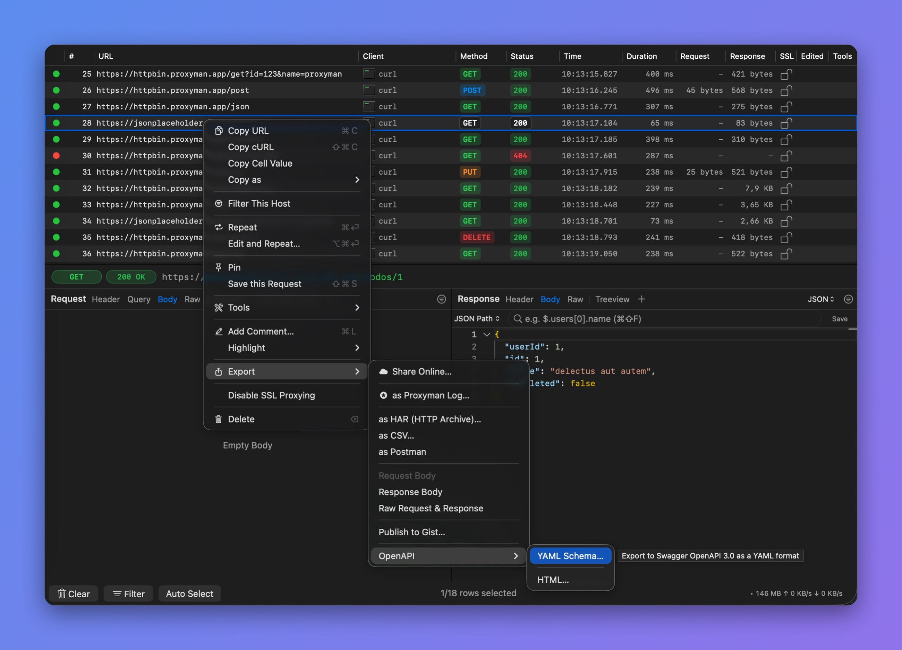

# Swagger OpenAPI

## 1. OpenAPI

From Proxyman v5.14.0 or later, Proxyman can export your requests and responses to an OpenAPI 3.0 YAML file or an HTML page.

* Supports YAML format
* Supports HTML in the Swagger OpenAPI style
* Built into Proxyman, no need for any external dependencies.

<figure><figcaption>
Export your requests and responses to an OpenAPI HTML page
</figcaption></figure>

## 2. How to use

1. Capture HTTPS requests with Proxyman. Follow the setup guide for your device:

* [iOS devices (iPhone, iPad)](../debug-devices/ios-device.md)
* [iOS Simulator](../debug-devices/ios-simulator.md)
* [Android devices](../debug-devices/android-device/#id-1.-android-setup-guide)
* [Android Emulator](../debug-devices/android-device/automatic-script-for-android-emulator.md)
* [macOS (Web Browser)](../debug-devices/macos.md)

Make sure Proxyman can capture and decrypt your HTTPS requests and responses.

<figure> OpenAPI open, showing YAML Schema... and HTML..."><figcaption>
Export > OpenAPI
</figcaption></figure>

2. Select your requests on the main table -> right-click -> **Export** -> **OpenAPI** -> select **YAML Schema…** or **HTML…**
3. Done :white\_check\_mark:

## Learn more

* [Generate OpenAPI 3.0 for reverse engineering REST APIs in a few clicks](https://proxyman.com/posts/2025-01-09-Generate-OpenAPI-YAML)
* [Proxyman vs mitmproxy: Generate OpenAPI from captured traffic](https://proxyman.com/posts/2026-07-21-Proxyman-vs-mitmproxy-Generate-OpenAPI)
