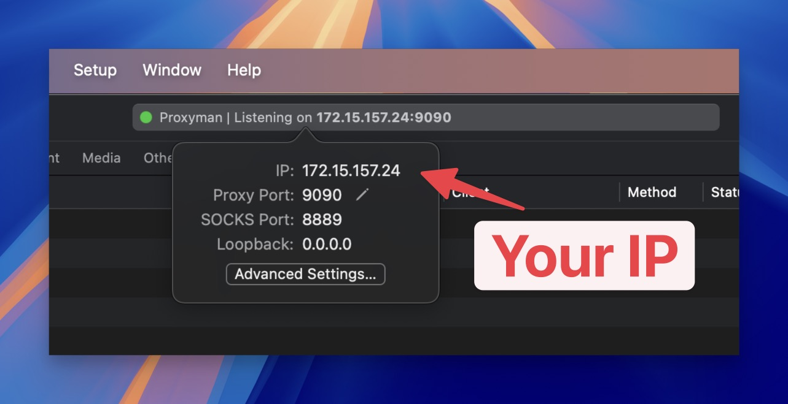

# WebSocket

## 1. What's it?

Proxyman can capture WebSocket (WS) and Secure WebSocket (WSS) traffic and lets you preview it easily.

* Capture WS/WSS from iOS Physical devices and iOS Simulator (Required [Atlantis framework](https://github.com/ProxymanApp/atlantis))
* Capture WS/WSS from Web Browser and Mac applications.
* Capture WS/WSS from Android Physical devices or Android Emulators.
* Pretty-print WebSocket messages.
* Filter All / Sent / Received messages.
* See the content in JSON / Tree Preview / HEX format.
* Customize Columns: Frame, Length, Data, Time, ...
* Auto-decode binary messages to JSON if possible.
* Open WebSocket messages in external editors, such as Sublime or VS Code.

## 2. Capture WS/WSS from Web Browsers

### Localhost websocket

Proxyman can capture a localhost WebSocket, such as ws://localhost:3000, from Google Chrome with [Automatic Setup](../automatic-setup/automatic-setup.md).

1. Go to the **Setup** menu -> **Automatic Setup…**
2. Select Google Chrome (New Profile or Current Profile). A new Google Chrome window opens.
3. Open your localhost WebSocket page in this window. Proxyman will capture it.

### Production websocket

Proxyman automatically captures your WS/WSS traffic from Google Chrome, without any setup.

1. Open Proxyman and Google Chrome
2. Make some WS/WSS traffic, for example on [https://echo.websocket.org/.ws](https://echo.websocket.org/.ws)
3. Inspect the WS/WSS data in Proxyman

<figure><figcaption><p>Proxyman captures WebSocket traffic</p></figcaption></figure>

### Websocket with Protobuf Payload

From Proxyman macOS 6.5.0 or later, Proxyman can decode Protobuf in your WebSocket messages.

1. Make sure Proxyman can capture your WebSocket traffic first
2. Right-click on a WebSocket Protobuf message -> **Protobuf** -> **Decode Raw Text…** or **Decode with Message Type…**

* **Raw mode**: Useful if you don't have a Protobuf desc file.
* **Message Type**: Use a Message Type from your Protobuf desc file.

<figure><figcaption><p>Decode WebSocket payload with Protobuf</p></figcaption></figure>

## 3. Capture WS/WSS from iOS

If your iOS app uses **URLSessionWebSocketTask** or iOS WebSocket libraries, such as Starscream or SocketRocket, Proxyman might not be able to capture WS/WSS traffic.

* **Reason**: This is by Apple's design. **URLSessionWebSocketTask** doesn't respect the System HTTP Proxy. All WS/WSS traffic goes directly to the Internet, so Proxyman or Charles Proxy can't capture it.
* Example App: [https://github.com/ProxymanApp/websocket-example-ios-app](https://github.com/ProxymanApp/websocket-example-ios-app)

### ✅ Solution 1 (Recommended for iOS 17 or later)

1. Follow the setup guide for your [iOS Devices](../debug-devices/ios-device.md) or [iOS Simulators](../debug-devices/ios-simulator.md). Make sure the certificate is installed and trusted on your device.
2. In Proxyman: **Tools** -> **Proxy Settings** -> **SOCKS Proxy Settings…** -> enable it. Take note of the port.
3. In the main Proxyman window, take note of the current IP in the toolbar.

<figure><figcaption><p>Get Proxyman current IP</p></figcaption></figure>

4. In your app: Configure a SOCKS proxy. Make sure it's only on for debug builds, for example with a switch. You don't want this setting in your release build.

* For NWConnection


```swift
let parameters = webSocketURL.scheme == "wss" ? NWParameters.tls : NWParameters.tcp

let options = NWProtocolWebSocket.Options()
options.autoReplyPing = true

parameters.defaultProtocolStack.applicationProtocols.insert(options, at: 0)

if #available(iOS 17.0, *) {
    let socksv5Proxy = NWEndpoint.hostPort(host: "x.x.x.x", port: 8889) //  Please replace x.x.x.x with a real Proxyman IP
    let config = ProxyConfiguration.init(socksv5Proxy: socksv5Proxy)
    let context = NWParameters.PrivacyContext(description: "my socksv5Proxy")
    context.proxyConfigurations = [config]

    parameters.setPrivacyContext(context)
}

let connection = NWConnection(to: .url(webSocketURL), using: parameters)
connection.start(queue: .main)
```


* For URLSession and URLSessionWebSocketTask


```swift
private lazy var urlSession: URLSession = {
    let config = URLSessionConfiguration.default
    if #available(iOS 17.0, *) {
        let socksv5Proxy = NWEndpoint.hostPort(host: "x.x.x.x", port: 8889) //  Please replace x.x.x.x with a real Proxyman IP
        let proxyConfig = ProxyConfiguration.init(socksv5Proxy: socksv5Proxy)
        config.proxyConfigurations = [proxyConfig]
    }

    return URLSession(configuration: config, delegate: nil, delegateQueue: nil)
}()
```


5. Done ✅

<figure><figcaption><p>Capture WebSocket from iOS with Proxyman</p></figcaption></figure>

* Credit to [**FranklinSamboni**](https://github.com/FranklinSamboni) **->** [https://github.com/ProxymanApp/Proxyman/issues/586#issuecomment-2125082129](https://github.com/ProxymanApp/Proxyman/issues/586#issuecomment-2125082129)
* Tutorial: [How to intercept and debug WebSocket from iOS simulators or devices](https://proxyman.com/posts/2019-10-18-WebSocket-Debugging)

### ✅ Solution 2

Use [Atlantis Framework](https://github.com/ProxymanApp/atlantis#features) (developed by Proxyman) to capture WS/WSS **URLSessionWebSocketTask** traffic from iOS.

Read more in the [Atlantis WS/WSS traffic guide](https://github.com/ProxymanApp/atlantis#wswss-traffic).

## 4. Capture WebSockets from your Web Browser (Chrome, Safari, etc)

* Proxyman can capture WS/WSS from a web browser out of the box. No need to configure anything.
* How to use: Open Google Chrome -> Visit your website that makes a WS/WSS connection -> Open Proxyman -> Find your WebSocket domains -> On the Response panel, click **Enable SSL Proxying** for these domains. Reload your website in the browser. Proxyman will capture and decrypt WS/WSS ✅

## 5. Capture Websocket from NodeJS, Golang, Python Server

* Proxyman can capture WS/WSS from your NodeJS, Golang, Python, and Ruby server.
* How to use: Read [automatic-setup.md](../automatic-setup/automatic-setup.md "mention") to start your server in the Terminal it opens -> Make a WS/WSS connection -> Proxyman automatically captures and decrypts it ✅

## 6. Map Websocket from Localhost <-> Production

You can map WebSocket traffic from localhost <-> Production. Please check out the [Map Remote Tool](map-remote.md#7.4-map-websocket-from-localhost-to-production).

## Learn more

* [How to capture WebSocket and decode Protobuf message](https://proxyman.com/posts/how-to-capture-websocket-with-protobuf-message)
* [Proxyman vs mitmproxy: Decode Protobuf WebSocket Messages](https://proxyman.com/posts/2026-07-21-Proxyman-vs-mitmproxy-Protobuf-WebSocket)
