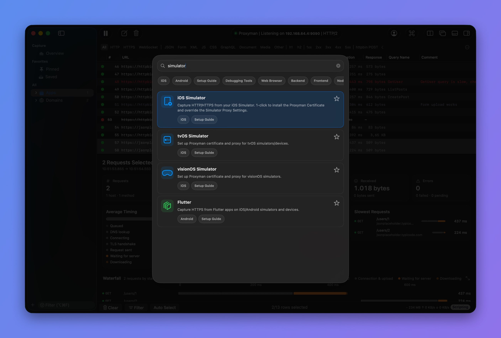

# Command Palette

## 1. What's it?

The global Command Palette helps you:

* Quickly search debugging tools
* Turn debugging tools on or off
* Open setup guides for iOS devices, iOS Simulators, Android devices, and Android Emulators&#x20;
* Pin your most-used actions

<figure><figcaption>
Search the Command Palette
</figcaption></figure>


Press ⌘P, or select **View** → **Show Command Palette**, to open the Command Palette. In Proxyman 6.0.0 to 6.10.0, the shortcut is ⌘⇧P.



Command Palette is available on Proxyman for macOS 6.0.0 or later.


## 2. Missing your shortcut?

If you can't find your shortcut in the Command Palette, please request it on our [GitHub public issue tracker](https://github.com/ProxymanApp/Proxyman/issues).

## Learn more

* [Useful shortcuts that boost your productivity](https://proxyman.com/posts/2019-08-20-Useful-shortcuts-that-boost-your-productivity)
