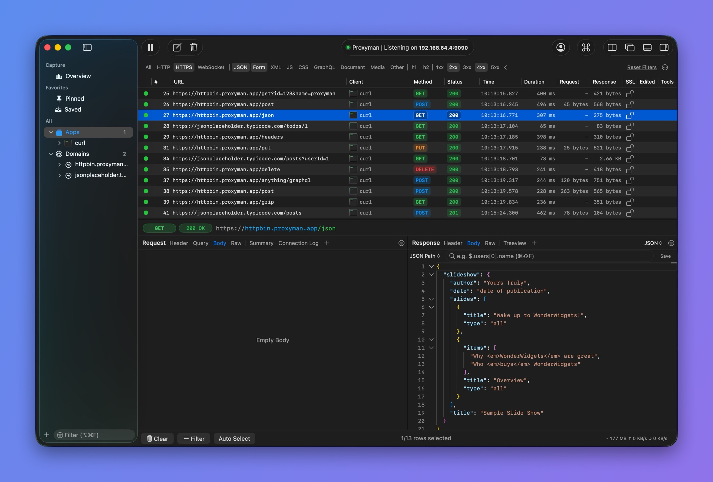
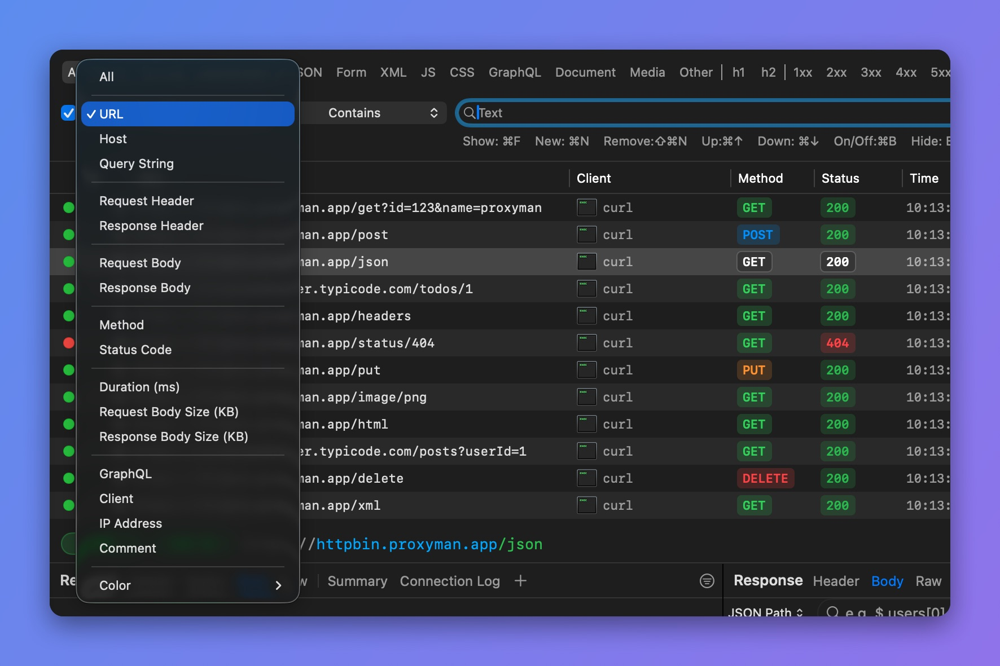
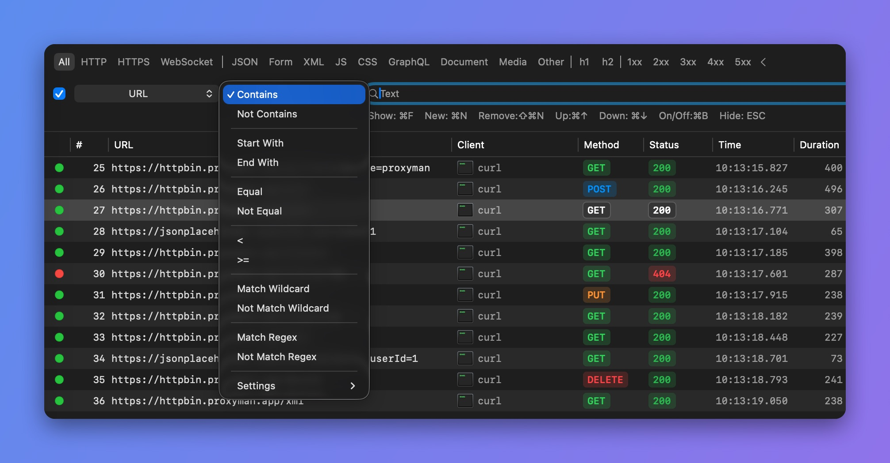

# Content Filter

Proxyman offers the Primary and Secondary Filters to quickly find the requests or responses you're looking for.


**⌘F**: Open the Filter Bar

**ESC**: Close the Filter Bar


<figure><figcaption>
Select several filters at once
</figcaption></figure>

<figure><figcaption>
Choose what to filter
</figcaption></figure>

<figure><figcaption>
Choose how to match
</figcaption></figure>

## Primary Filter

| Filter    | Description                                                     |
| --------- | --------------------------------------------------------------- |
| All       | All Requests and Responses                                      |
| HTTP      | Only HTTP                                                       |
| HTTPS     | Only HTTPS                                                      |
| WebSocket | Only WebSocket and Secure WebSocket                             |
| JSON      | Content-Type is application/json or JSON contents               |
| Form      | Only Form Body in Request / Response                            |
| XML       | Only XML                                                        |
| JS        | Only JavaScript content                                         |
| CSS       | Only CSS content                                                |
| GraphQL   | GraphQL requests (the URL contains `/graphql`)                  |
| Document  | Document content: HTML, ...                                     |
| Media     | Image, audio and video content: PNG, JPG, GIF, ...              |
| Other     | Other content that doesn't match any of the above               |
| h1        | Only HTTP/1.x requests                                          |
| h2        | Only [HTTP/2](http2.md) requests                                |

## Status Filters

| Filter | Description                  |
| ------ | ---------------------------- |
| 1xx    | Status codes from 100 to 199 |
| 2xx    | Status codes from 200 to 299 |
| 3xx    | Status codes from 300 to 399 |
| 4xx    | Status codes from 400 to 499 |
| 5xx    | Status codes 500 and above   |


Hold the ⌘ key and click to select multiple types.


## Secondary Filter

### Content

* URL
* Host
* Query String
* Request Header
* Response Header
* Request Body
* Response Body
* Method
* Status Code
* Duration (ms)
* Request Body Size (KB)
* Response Body Size (KB)
* GraphQL
* Client
* IP Address
* Comment
* Color

### Matching

* Contains
* Not Contains
* Start With
* End With
* Equal
* Not Equal
* `<` (less than, for numbers)
* `>=` (greater than or equal, for numbers)
* Match Wildcard
* Not Match Wildcard
* Match Regex
* Not Match Regex

## Header, Query, Auth, Form Filter

From Proxyman 2.34.0+, you can quickly filter the Header, Query, Auth, and Form content of the selected request and response.

1. Click the view (e.g. the Header tab of the Request)
2. Press ⌘F or right-click → **Show Filter** to open the filter

## Learn more

* [Use Multiple Filters to find HTTP requests faster](https://proxyman.com/posts/2021-04-08-Use_Multiple_Filters)
