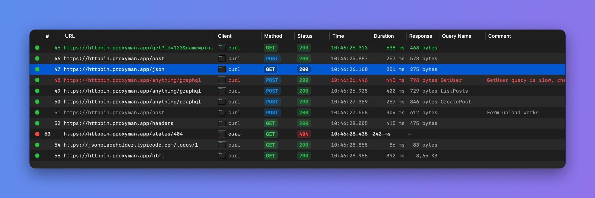

# Custom Header Column

## 1. What's it?

The Custom Header Column feature lets you add your own columns to the main table view. It's similar to the [custom columns in Chrome DevTools](https://developer.chrome.com/docs/devtools/network/reference#custom-columns).

## 2. Benefit

* Show a request or response header as a column in the table.
* **Tell requests apart when they have the same URL but different headers.**
* Resize, sort, and reorder the columns.
* Proxyman remembers your columns and restores them in your next session.

## 3. Custom Column

You can create a custom column from:

* ✅ Request or response header, e.g. Content-Type, X-Key, ...
* ✅ Query parameter of the request, e.g. name, id, ...
* ✅ JSON body with jq or JSON Path, e.g. $.data.user.name (Proxyman 6.17.0 or later)

<figure><figcaption></figcaption></figure>

## 4. How to use it?

1. Open **Tools** → **Customize Columns…**
2. Click the **+** button under the Request or Response list.
3. Choose Header, Query, or JSON Body. Enter the name or expression, then click **Add**.

<figure><figcaption></figcaption></figure>

To learn how to query JSON data with JSON Path or jq, read:

* [**JSON Path**](jsonpaths.md)
* [**jq**](jq.md)

## 5. Built-in GraphQL Query Column

Proxyman can show the query name of each GraphQL request in the **Query Name** column. Right-click the table header and select **Query Name (GraphQL)** to show it.

<figure><figcaption>
GraphQL Query Name column
</figcaption></figure>

## Learn more

* [Manage header columns on the main table view](https://proxyman.com/posts/2022-06-18-Tips-Manage-custom-columns-on-the-main-table-view)
