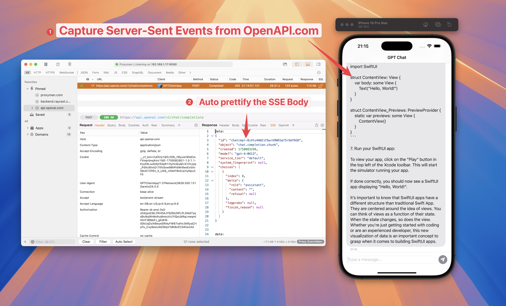
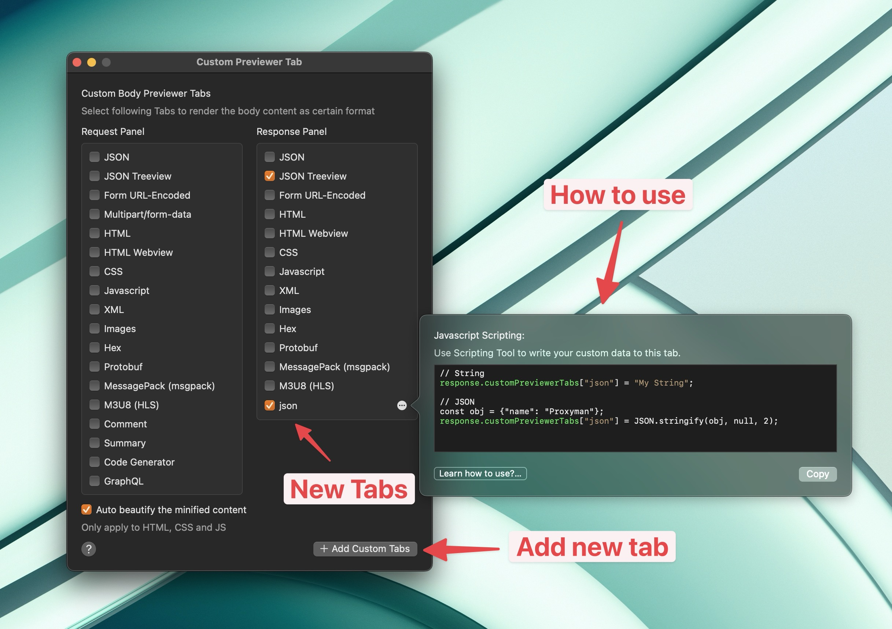
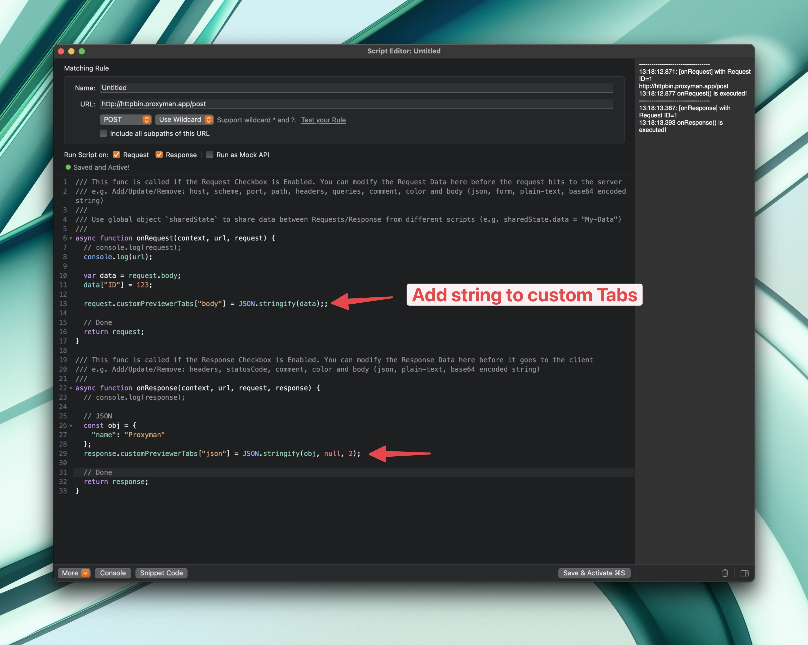
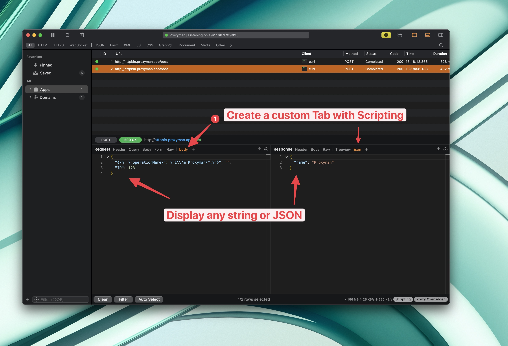
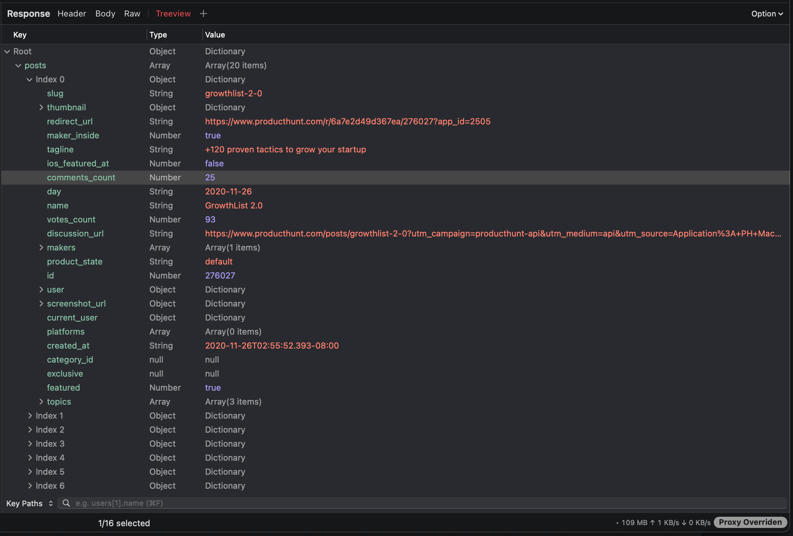
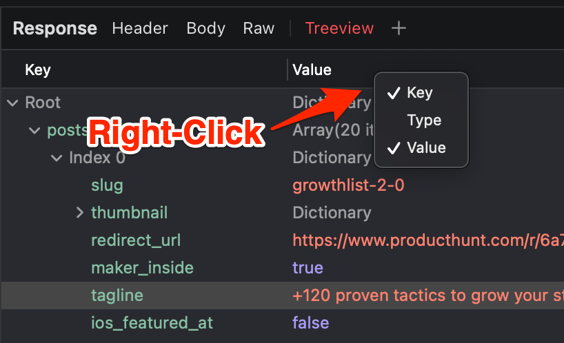
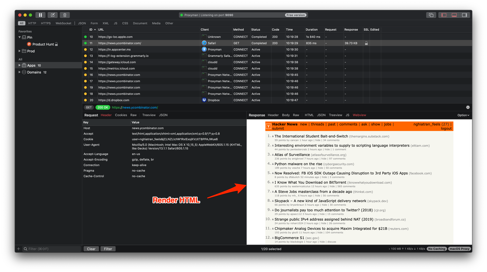

# Custom Previewer Tab

## 1. What's it?

Custom Previewer Tabs let you add extra tabs to the Request and Response panels. Each tab always renders the content in one format.

This handy tool helps in the following cases:

* Format the BODY as **JSON**, but the Content-Type isn't `application/json`
* Format the body as **Protobuf**, but the Content-Type isn't `application/x-protobuf`
* Render an HTML page in a Web View
* **Beautify** the minified files (HTML, CSS, JS)
* Multipart/form-data
* Try to format the body as the selected type regardless of the `Content-Type`
* Convert MessagePack (msgpack) to JSON
* [Code Generator](../advanced-features/code-generator.md) to Swift, Node, Javascript, cURL, ...
* GraphQL Query Prettier
* [Connection Log](connection-log.md) to inspect DNS, TCP, TLS, and HTTP details

<figure><figcaption>
Select Custom Tabs for Request / Response Panel
</figcaption></figure>


The selected custom tabs are added to the right side of the Request or Response view&#x20;


<figure><figcaption>
Display Custom Tabs
</figcaption></figure>

## 2. How to use it?

To open the Custom Previewer Tab window:

1. Click the "+" button on the Request/Response tab bar, or go to **Tools** → **Custom Previewer Tab…**
2. Check or uncheck a checkbox to show or hide your custom tab
3. The new tab appears on the Request or Response panel ✅

### 2.1 Server-Sent Events and OpenAI Tabs

From Proxyman 5.22.0 or later, Proxyman supports:

* **SSE** tab for Server-Sent Events from OpenAI endpoints: Auto-prettify the inline JSON of each data event
* **OpenAI** tab: Auto-merge the streamed content and show the final result, similar to the output in your chat view.

<figure><figcaption>
Capture OpenAI Endpoints
</figcaption></figure>

### 2.2 Connection Log

* **Connection Log** shows connection info for the selected request, including DNS lookups, TCP connections, TLS negotiation, certificates, and HTTP headers.
* Click **+** in the Request tab bar. Under **Request**, check **Connection Log** to show it or uncheck it to hide it.
* The tab appears next to **Summary** in the Request panel. It is enabled by default, and Proxyman remembers your choice.
* See the [HTTP/2 guide](http2.md) for a sample log, or the [Connection Log guide](connection-log.md) for all fields.

<!-- IMAGE PLACEHOLDER: Custom Previewer Tab with Connection Log checked under Request. -->

## 3. ⚡️ Advanced: Create a custom Tab with the Scripting Tool

* ✅ Show your own data on your tab
* Useful when you want to decode your body or show part of the body in your own tab

### How to use

1. Click the "+" button on the Request/Response tab bar, or go to **Tools** → **Custom Previewer Tab…**
2. Click the **Add Custom Tabs** button
3. Select the Request or Response panel and set a name for your tab

<figure><figcaption>
Create a new custom tab
</figcaption></figure>

4. Click the "..." button to show the JavaScript code

<figure><figcaption>
Show the Javascript Code
</figcaption></figure>

5. Open **Scripting** → **Script List…**, create a new [script](../scripting/script.md), and use this code to display your own data

<figure><figcaption>
Write your code to display data
</figcaption></figure>

6. Done

<figure><figcaption>
Display your data on a new tab
</figcaption></figure>

## 4. Examples

### Force render JSON TreeView

Proxyman supports JSON Tree View for better visualization

You can show or hide a column by right-clicking the column header

### Force render HTML Page

### Beautify the Javascript files

## Learn more

* [Debug OpenAI Server-Sent Events with Proxyman](https://proxyman.com/posts/debug-server-sent-event-openapi-endpoint-with-proxyman)
* [Preview multipart/form-data bodies from HTTP requests and responses](https://proxyman.com/posts/2021-06-24-preview-multipart-formdata)
