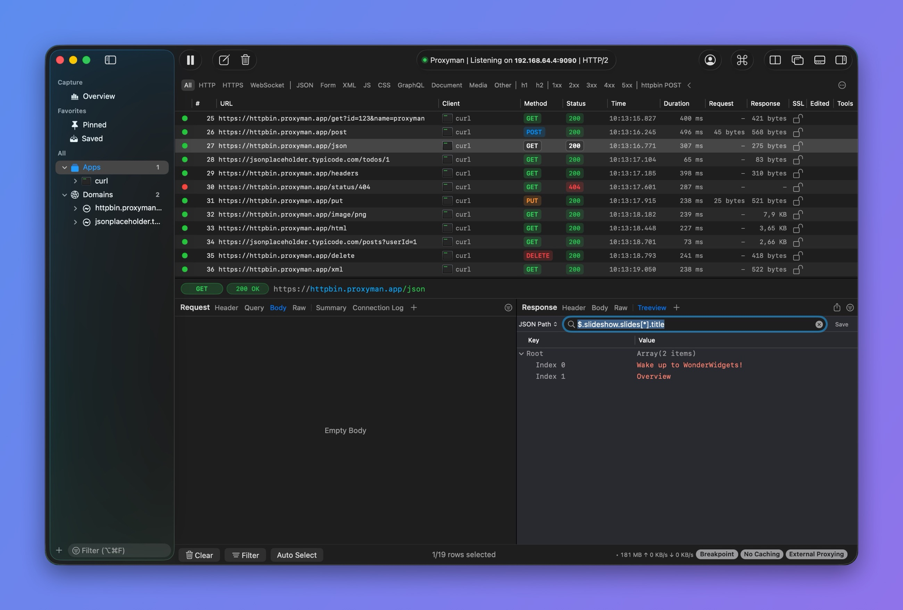
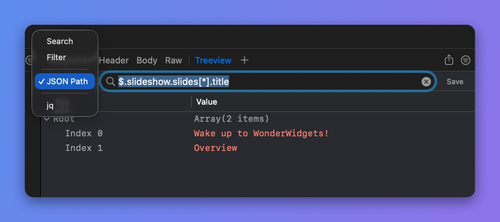

# Filter JSON Response

You can quickly filter a JSON response in these ways:

## 1. Filter on JSON Previewer

* Press **⌘F** in the Body tab to search
* Supports Regex
* Jump to the next match

## 2. JSONPath

Proxyman supports [JSONPath](https://github.com/json-path/JsonPath#path-examples) to quickly query data in a JSON document.

<figure><figcaption>
Filter JSON with JSON Path
</figcaption></figure>

Read the JSONPath page to learn the syntax.


[jsonpaths.md](jsonpaths.md)


You can also filter JSON with jq. Read the [jq](jq.md) page.

## 3. Search in the Treeview

* Press **⌘F** in the Treeview tab and choose a mode: Search, Filter, JSON Path, or jq.
* **Search** highlights the keys and values that contain the search text.

## 4. Filter by Keys or Values

* **Filter** shows only the nodes whose key or value contains the search text.

<figure><figcaption>
Pick a filter mode
</figcaption></figure>
