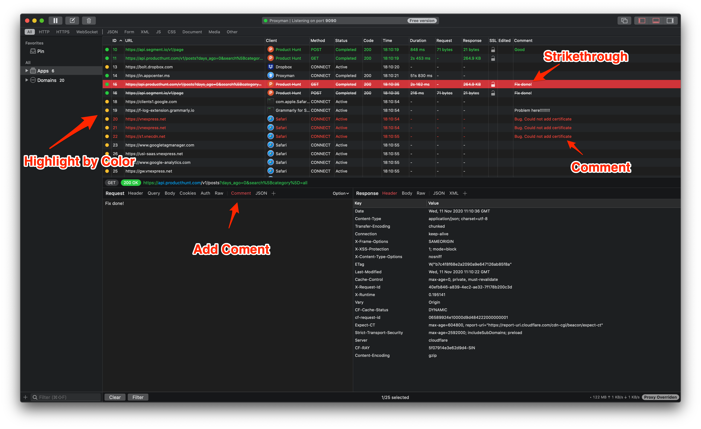

# Highlight by Color and Add Comment

## 1. What's it?

You can:

* **Highlight** one or more requests with a **color** (Red, Orange, Yellow, Green, Teal, Blue, Indigo, Purple, Pink, Brown, Gray)
* Add ~~Strikethrough~~
* Add a comment
* Filter by color or comment (⌘F)
* Export with colors and comments. Colors are kept only in the Proxyman Log format.

## 2. Benefit?

* Mark failed or successful requests with eye-catching colors
* Add comments during development
* Share them with your colleagues (color and comment)
* Quickly filter requests by color or comment

## 3. How to use

1. Right-click a request
2. Select **Highlight** and choose a color

To add a comment, right-click a request and select **Add Comment…** (⌘L).

<figure><figcaption></figcaption></figure>
