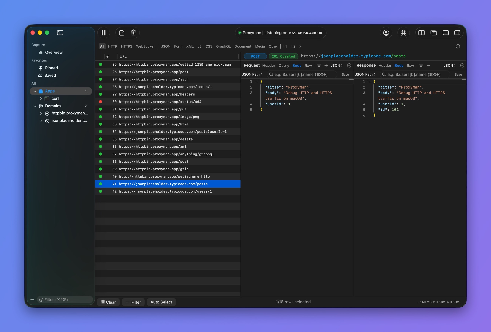

# Horizontal/Vertical/Window Layout

To compare two traffic lists in the same tab, use [Split View](split-view.md). To organize traffic across tabs, use [Tab View](multiple-tabs.md). The controls below change the Request and Response inspector layout.

You can change the layout of the Request and Response panels to make more room for the content.

* **Detachable Window**: Move the Request and Response panels to a separate window
* **Vertical**: Show the Request and Response panels on the right of the request list
* **Horizontal**: Show the Request and Response panels below the request list

<figure><figcaption>
Layout buttons in the toolbar
</figcaption></figure>

<figure><figcaption>
Vertical layout
</figcaption></figure>

You can also use these shortcuts or the **View** menu:

| Shortcut | View menu                    | Description       |
| -------- | ---------------------------- | ----------------- |
| ⌃⌘↑      | Detach Content Windows       | Detachable Window |
| ⌃⌘[      | Toggle Source List Panel     | Toggle Left Panel |
| ⌃⌘\\     | Toggle Dock to Right Window  | Vertical Mode     |
| ⌃⌘]      | Toggle Dock to Bottom Window | Horizontal Mode   |
