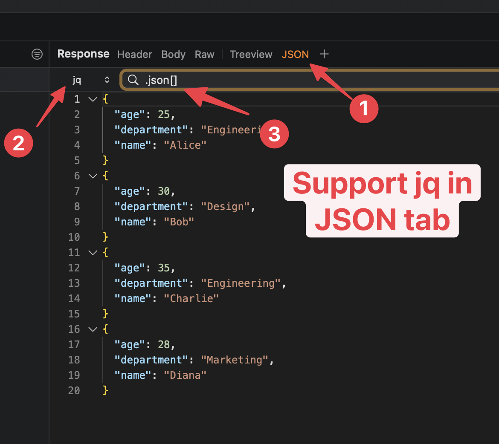

# JQ

## 1. What's it?

* jq is a small language for JSON data. It works like sed does for text: you can slice, filter, map, and transform JSON data.
* Available on Proxyman 5.24.0 or later


- You can use the jq filter in the JSON tab and the Treeview tab. To add the JSON tab, click the + button on the Request or Response toolbar and select JSON.


<figure><figcaption></figcaption></figure>

## 2. Syntax

* Read the [jq manual](https://jqlang.org/manual/#basic-filters) to learn how to write jq filters.
* You can also use jq to create a [custom column](custom-header-column.md) from a JSON body.
