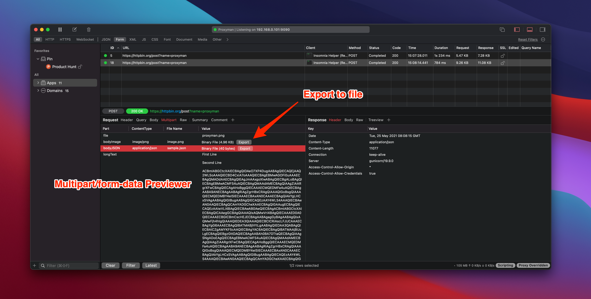

# Multipart Form-Data Previewer

## 1. What's it?

From Proxyman 2.27.0, Proxyman shows a multipart/form-data body as a table in the **Multipart** tab of the Request panel.

## 2. Benefit

* Display each part of the multipart/form-data body
* Preview a part or save it to a file

## Learn more

* [Preview multipart/form-data body from HTTP request and response](https://proxyman.com/posts/2021-06-24-preview-multipart-formdata)
