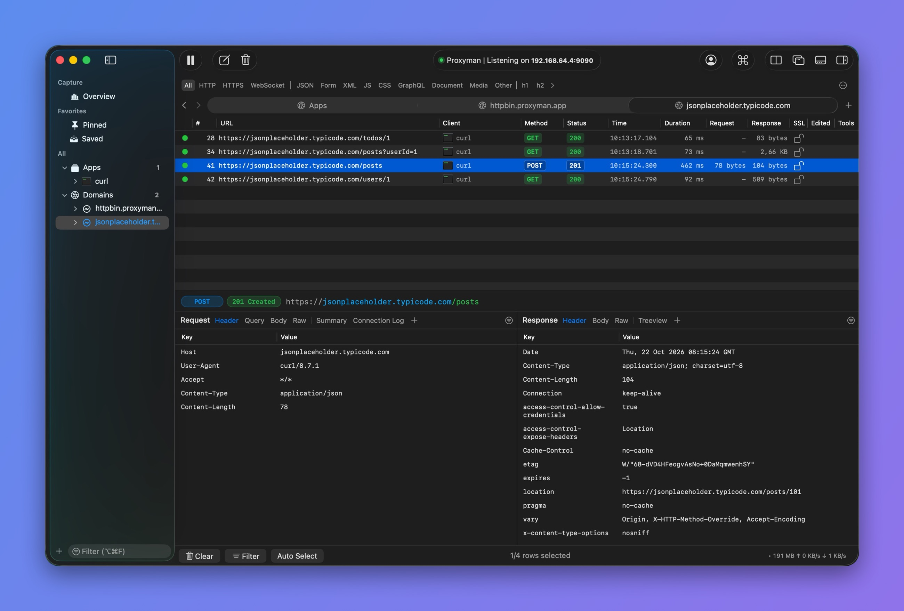
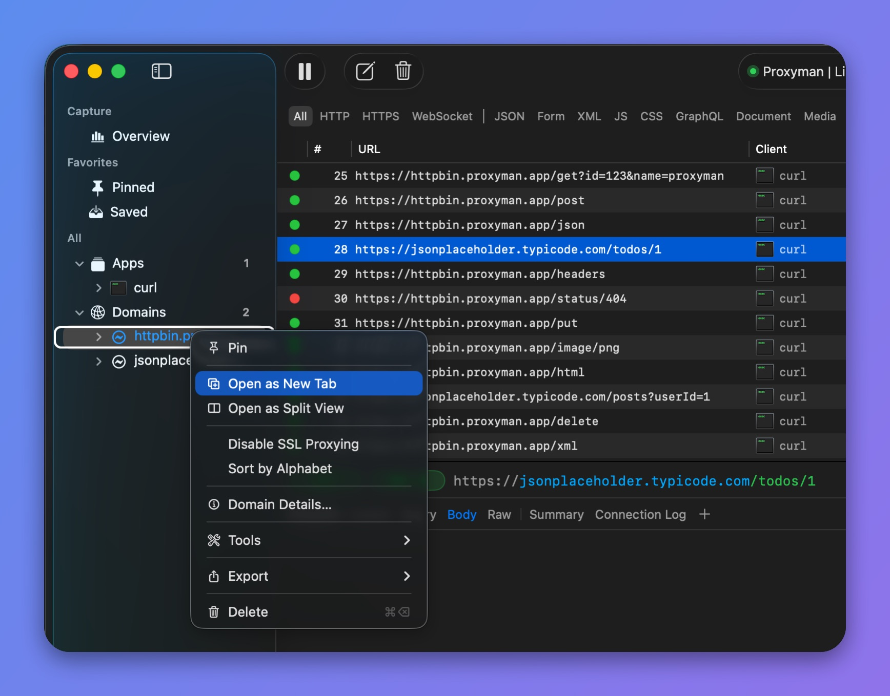
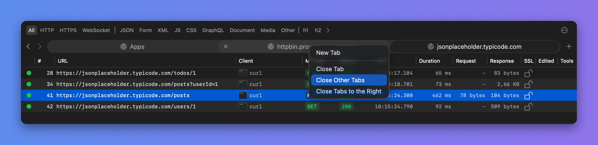

# Tab View

## 1. What's it?

Tab View lets you keep several traffic views open in one Proxyman window. The new tab bar in v26.0.0 follows familiar Safari-style controls, with tabs you can switch, reorder, and close.

Each tab keeps its own selected source, filters, and request selection while you move between tabs. Live tabs share the same incoming capture.


Tab View requires Proxyman PRO. The new Safari-style tab bar is available in Proxyman v26.0.0 or later for macOS.


<figure><figcaption>
Tab View with three tabs
</figcaption></figure>

## 2. Benefits

* Keep different apps, domains, or endpoints in separate views.
* Switch between investigations without rebuilding your filters.
* Drag tabs into an order that matches your workflow.
* Open [Split View](split-view.md) inside a tab when you need two panes at once.

## 3. How to open a tab?

* Press **⌘T** to open a new tab.
* Click the **+** button in the tab bar.
* Right-click an app or domain in the sidebar and choose **Open as New Tab**.

Select the source and filters you want in the new tab. Other tabs keep their own view settings.

<figure><figcaption>
Open a domain as a new tab
</figcaption></figure>

## 4. Switch and organize tabs

* Click a tab to select it.
* Drag a tab left or right to reorder it.
* Use the tab list menu to find a tab when there are too many to fit.
* Use the keyboard shortcuts below to move between tabs.

The sidebar follows the active view. When a tab has Split View open, click the pane you want to work with before choosing an app or domain.

## 5. Close tabs

Click a tab's close button, or right-click a tab and choose:

* **Close Tab** to close that tab.
* **Close Other Tabs** to keep that tab and close the others.
* **Close Tabs to the Right** to close the tabs after it.

Press **⌘W** to close the current tab when the main traffic window is active. Closing the last tab closes that window.

<figure><figcaption>
Close tabs from the tab menu
</figcaption></figure>

## 6. Keyboard shortcuts

| Shortcut | Action |
| --- | --- |
| ⌘T | Open a new tab |
| ⌘W | Close the current tab in the main traffic window |
| ⌘⇧1–9 | Select the first through ninth tab |
| ⌘⇧] | Select the next tab |
| ⌘⇧[ | Select the previous tab |
| Control-Tab | Select the next tab |
| Control-Shift-Tab | Select the previous tab |


Use **⌘⇧1–9** for numbered tab selection. Proxyman uses **⌘1–6** for request color shortcuts, so numbered tab selection differs from Safari.


## 7. Related guides

* [Split View](split-view.md)
* [Content Filter](content-filter.md)
* [Horizontal/Vertical/Window Layout](horizontal-vertical-layout.md)
* [License](../license.md)

## Learn more

* [HTTP/2 is finally here in Proxyman v26.0.0](https://proxyman.com/posts/2026-09-19-http2-is-finally-here) (introduces Tab View and Split View)
