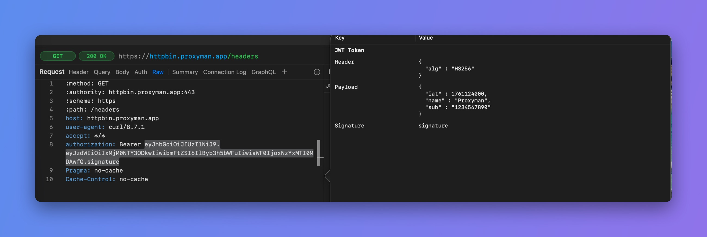
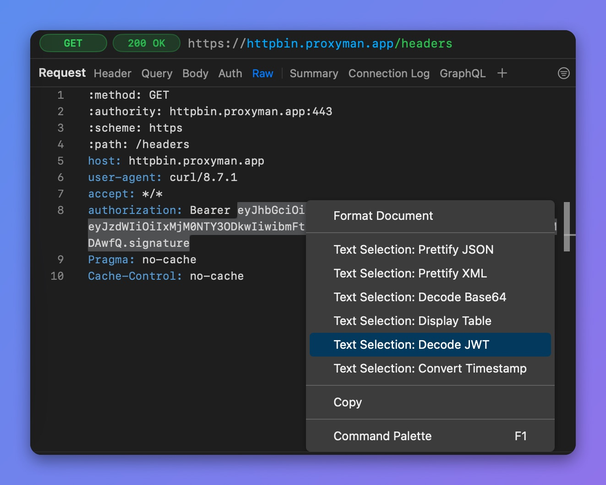

# Quick Preview

## 1. What is it?

Quick Preview lets you preview selected text anywhere in the app.

* Beautify inline JSON
* Decode Base64 strings
* Display key & value text as a table
* Decode JWT tokens
* In the Body and Raw tabs, you can also prettify XML and convert timestamps

<figure><figcaption>
Decode a JWT with Quick Preview
</figcaption></figure>

## 2. How to use it?

1. Select any text in the app, e.g. in the Body tab or the Raw tab&#x20;
2. Right-click to show the context menu
3. Choose a **Text Selection** mode, for example **Text Selection: Decode Base64**. In other text views, the modes are under **Text Selection: View as**.

<figure><figcaption>
Quick Preview on the Raw tab
</figcaption></figure>
