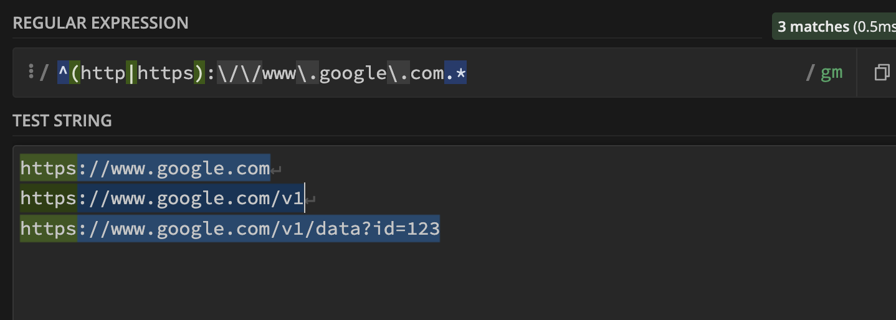

# Regex (Regular Expression)

## 1. What's it?

From version 2.3.0, Proxyman supports **Wildcard** and **Regex** (match whole words) when you define matching rules for all debugging tools:

* [Map Local](../advanced-features/map-local.md)
* [Map Remote](../advanced-features/map-remote.md)
* [Block List](../advanced-features/blacklist.md) and [Allow List](../advanced-features/whitelist.md)
* [Breakpoint](../advanced-features/breakpoint.md)
* [Protocol Buffers (Protobuf)](../advanced-features/protobuf.md)
* [Reverse Proxy](../advanced-features/reverse-proxy.md)
* [Network Conditions](../advanced-features/network-throttling.md)
* ...

It helps you define exactly which requests trigger the tool.

## 2. Test your URL (New feature 🎉)

From Proxyman v4.8.0, you can quickly test your rule (Wildcard or Regex).

* Quickly test and try out your Wildcard or Regex rule.
* **Save time**: You don't need to go back and forth to check your URL.
* Make fewer mistakes.

<figure><figcaption></figcaption></figure>

#### How to use it?

1. Open any debugging tool (Breakpoint, Map Local, ...) and create a new rule.
2. Click the **Test your Rule** button. The Test Rules window opens.
3. Add your rule and the URLs you want to check.

* :white\_check\_mark: Matched: Your URL matches your rule.
* :warning: Not Matched: Your URL doesn't match your rule. You might need to rewrite your Wildcard or Regex rule.

## 3. Wildcard

Proxyman supports two simple Wildcard characters: `*` and `?`

| Wildcard | Purpose                                                              |
| -------- | -------------------------------------------------------------------- |
| `*`      | The asterisk in a wildcard matches any character zero or more times. |
| `?`      | A question mark matches a single character once.                     |

For instance:

* http://proxyman.io/v1/\*
* https://myserver.com/v?/\*

## 4. Regex

Proxyman also supports Regex.&#x20;

* Make sure your regex **matches the whole URL**.
* A **partial match** counts as not matching.
* Make sure you **escape characters** properly: slash (/), dot (.), etc.

For instance:

| Regex                                                                        | Matched URL Examples                                                                             |
| ---------------------------------------------------------------------------- | ------------------------------------------------------------------------------------------------ |
| https:\\/\\/proxyman\\.io.\*                                                 | 
https://proxyman.io https://proxyman.io/v1/data?id=123 https://proxyman.io/pricing
  |
| ^(http\|https):\\/\\/www\\.google\\.com.\*                                   | 
http://www.google.com http://www.google.com/user?id=proxyman https://www.google.com
 |
| ^(http\|https)?:\\/\\/www\\.google\\.com\\/v\[0-9]?\\/build\\?query=proxyman | 
http://www.google.com/v1/build?query=proxyman www.google.com/v2/build?query=proxyman
   |

You can use [regex101](https://regex101.com/) to check that your regex matches the whole URL.


Proxyman uses Apple's NSRegularExpression. Check the [**Regex** **metacharacters, operators and flags**](https://developer.apple.com/documentation/foundation/nsregularexpression#1965590) in the Apple Developer documentation to see which ones are supported.



Check your regex on [regex101.com](https://regex101.com) and make sure it fully matches the given URL.


* Select **Use Regex** when you create a rule.


With regular expressions, `?` and `*` mean something different than in wildcards. The wildcard `?` is the regex `.` and the wildcard `*` is the regex `.*`

