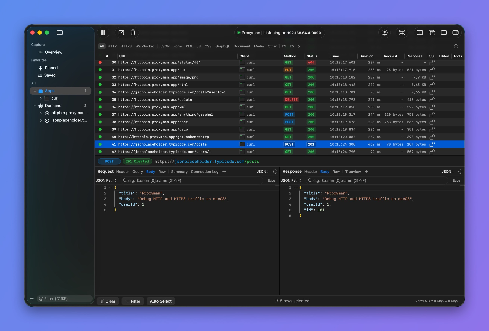
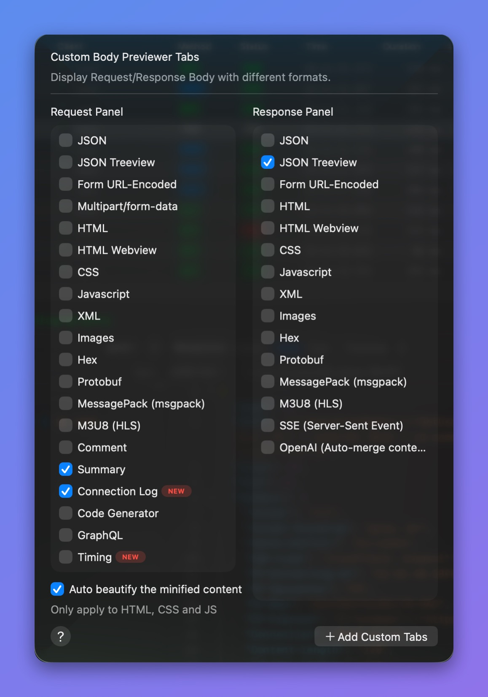
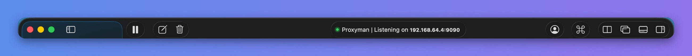

# Request / Response Previewer

After installing the [Certificate](../debug-devices/macos.md) and enabling [SSL Proxying](ssl-proxying.md) on domains or apps, your network traffic shows up immediately in the Proxyman window. The window has three main areas:

* The Source List on the left panel&#x20;
* The Flow List on the middle panel&#x20;
* The Flow Content on the right panel

<figure><figcaption>
Proxyman main window
</figcaption></figure>

## Body Content Previewer

Depending on the content of the request or response, Proxyman automatically shows it in separate tabs:

* **Header**: All headers (key-value table)
* **Cookies**: The **Cookie** header of the request
* **Set-Cookie**: The Set-Cookie header of the response
* **Auth**: The **Authorization** header
* **Body**: The body of the message. Proxyman automatically formats and beautifies the body based on the **Content-Type**, such as JSON, PNG, GIF, Raw Data, ...
* **Query**: All query parameters of the request
* **Raw**: The raw HTTP message
* [Protobuf](../advanced-features/protobuf.md) Message
* MessagePack
* [Multipart/form-data](multipart-form-data-previewer.md)

## Custom Previewer Tab

You can choose which previewer tabs you would like to see:

* Custom tabs stay on the Request/Response panel
* Proxyman tries to decode and beautify the content in the selected format


[custom-previewer-tab.md](custom-previewer-tab.md)


<figure><figcaption>
Choose your previewer tabs
</figcaption></figure>

## Layout mode

There are two ways to arrange the Request / Response panels: [Vertical or Horizontal layout](horizontal-vertical-layout.md).

## Customize Workspace

Use the layout buttons in the top-right corner of the app to arrange the content the way you like:

1. Collapse/Expand the Source List panel&#x20;
2. Open the Request/Response panel in a new window
3. Show the Request/Response panel in Horizontal layout
4. Show the Request/Response panel in Vertical layout

<figure><figcaption>
Layout buttons in the toolbar
</figcaption></figure>

## Shortcuts

All sections support **Copy (⌘C)** and multiple selection.

Read more in our [Proxyman keyboard shortcuts](https://proxyman.com/posts/2019-08-20-Useful-shortcuts-that-boost-your-productivity) blog post.

## **Body Previewer**&#x20;

The Body previewer automatically beautifies the content and offers handy extra features:

* **Tree View**: Show the JSON in Tree View mode
* **Hex**: Show the body in Hex format
* **Export only body**: Export the body content to a file. Useful for raw or binary data
* **Open With**: Open the body content in your favorite editor. **Sublime Text** is mine 😍

## JSON Tree View mode

Proxyman has a native JSON Tree View mode for JSON bodies. It lets you:

* Search JSON by [JSON Path](jsonpaths.md)
* Copy a JSON node, like in Google Chrome DevTools

## Learn more

* [Preview multipart/form-data bodies from HTTP requests and responses](https://proxyman.com/posts/2021-06-24-preview-multipart-formdata)
