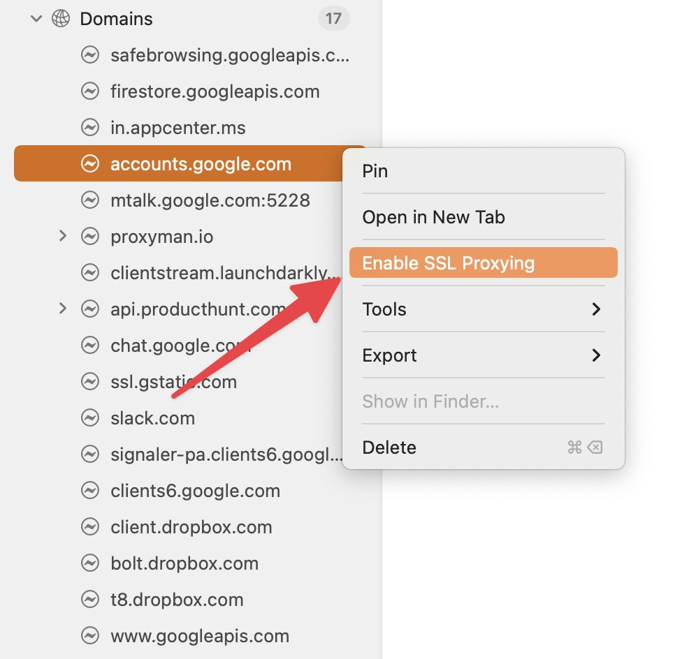
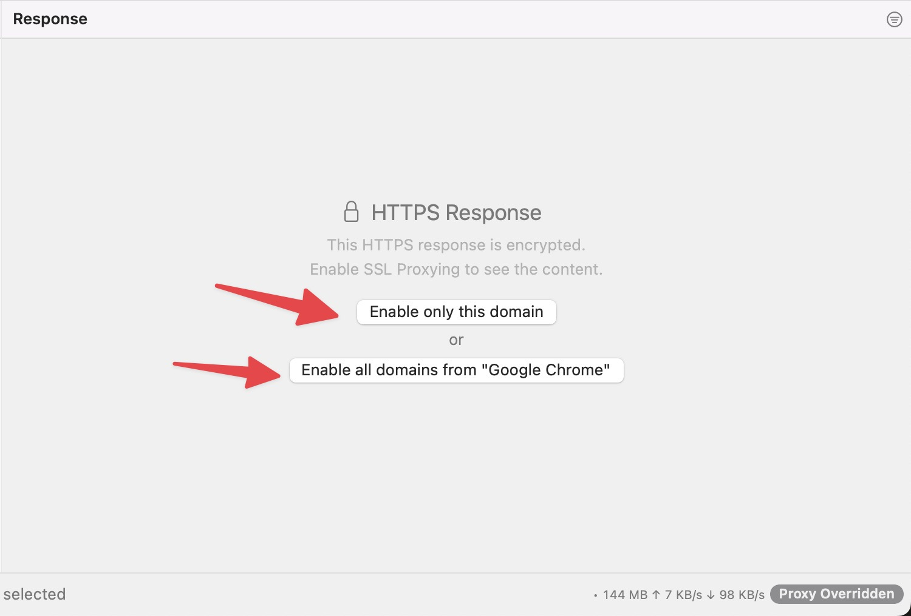

# SSL Proxying

SSL Proxying tells Proxyman which apps and domains to decrypt, so you can read their HTTPS requests and responses in plain text.

For HTTP/2 traffic on macOS, also enable **Use HTTP/2** in Settings. See the [HTTP/2 guide](http2.md) for setup and protocol checks. Certificate trust and SSL Proxying are still required to inspect HTTPS content.

## Video


Capture HTTP and HTTPS traffic with Proxyman


## 1. SSL Proxying List

The SSL Proxying List is a list of domains or apps whose SSL connections Proxyman should decrypt. It lets you inspect HTTPS requests and responses in plain text.

### Include List and Exclude List

You can define rules for:

* **Include List**: Intercept the traffic from apps/domains in the Include List
* **Exclude List**: Ignore all traffic from apps/domains in the Exclude List


Press ⌘⌥P to quickly open the SSL Proxying List.


### Apps / Domains / Wildcards

Proxyman supports several formats to define a rule:

* **By app**: Intercept all traffic from this app
* **By domain**: Intercept all traffic from this domain
* **Wildcard**: Intercept traffic from every domain that matches the wildcard

For example:

| Wildcard                    | Description                                                |
| --------------------------- | ---------------------------------------------------------- |
| \*                          | Decrypt ALL HTTPS traffic                                  |
| \*.domain.com, \*.apple.com | e.g. v1.domain.com, data.domain.com, health.apple.com, ... |
| v?.domain.com               | e.g. v1.domain.com, v2.domain.com, ...                     |


You must set up the Proxyman Certificate before intercepting any HTTPS requests. Follow the [macOS setup guide](../debug-devices/macos.md) to install and trust the certificate.


### How to enable SSL Proxying on a particular domain or app

* Right-click the app or domain in the left panel → **Enable SSL Proxying**

<figure><figcaption>
Add a domain to the SSL Proxying List
</figcaption></figure>

* Right-click the request in the main table → **Enable SSL Proxying**
* Select the request and enable SSL Proxying in the Response panel.

<figure><figcaption>
Enable the entire app or a single domain
</figcaption></figure>

## Learn more

* [Can we bypass SSL Pinning?](https://proxyman.com/posts/2019-11-15-Can-we-bypass-ssl-pinning)
