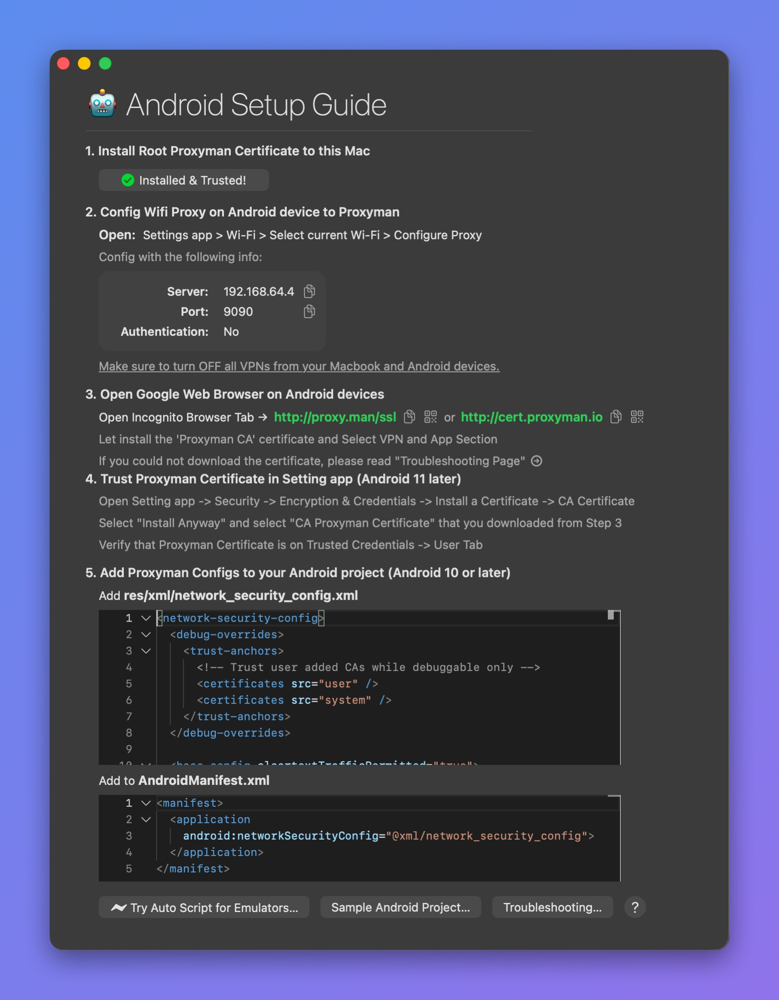

# Android Device & Emulator

This guide sends traffic from an Android device or emulator to Proxyman on your computer. It covers proxy configuration, certificate installation, and app certificate trust for HTTPS inspection.

Choose the setup that matches your device:

* **Physical Android device:** Follow the manual setup below. Your device must be able to reach the computer running Proxyman over the network.
* **Android Emulator:** Start with the [automatic setup script](automatic-script-for-android-emulator.md).
* **Google Play emulator image:** Follow the [Google Play and Magisk guide](google-play-android-emulator-with-magisk.md). The standard automatic setup does not cover every image.

To capture directly on a phone without a computer, use the [standalone Proxyman Android app](https://proxyman.com/android).

For desktop capture, open the matching guide in Proxyman:

* **Certificate** **Menu** -> **Install Certificate on Android -> Physical Devices…**
* **Certificate Menu -> Install Certificate on Android -> Emulators…**


Check out the [Mini Tutorial on how to set up Android devices & emulators](sample-android-project.md)



For the **Android Emulator**, check out the [Automatic Script for Android Emulator](automatic-script-for-android-emulator.md#1-whats-it)


## Video


Capture HTTPS from a native Android app (OkHttp) on the Android Emulator with API 36



Capture HTTP and HTTPS traffic on Android with the Proxyman for Android app


## 1. Android Setup Guide

For manual setup, configure the device proxy first, then install the certificate and configure certificate trust in your development app. Installing the certificate alone does not make every Android app trust it. Follow all steps below:

<figure><figcaption><p>Setup Guide for Android Devices</p></figcaption></figure>

Open the guide from **Certificate** menu -> **Install Certificate on Android** -> **Physical Devices…**, then follow these steps:

1. Install the **Root Proxyman Certificate** on your Mac: You can follow the [macOS Guide](../macos.md).
2. Get your Android device or emulator -> Open the Settings app -> Wi-Fi -> Select the current Wi-Fi -> Configure the HTTP Proxy with the values in this table.

| Name           | Value                                             |
| -------------- | ------------------------------------------------- |
| Server IP      | Your Mac's current IP address                     |
| Port           | The current port of Proxyman: 9090 is the default |
| Authentication | No                                                |


Some Samsung devices can't access the Internet after you set the HTTP Proxy. Please forget your current network and connect again.

If **you're using any VPN app**, please make sure to close it, since some VPN apps conflict with HTTP/HTTPS Proxy configs.


&#x20; 3\. Open [http://proxy.man/ssl](http://proxy.man/ssl) or http://cert.proxyman.io in the web browser on your Android device to install the Proxyman Certificate.

### **Android 11, Android 12 or later:**

* Visit http://proxy.man/ssl in the Google Chrome app to download the certificate.
* From Android 11 or later, you have to install the certificate manually in the Settings app.
* Settings app -> Security -> Encryption & Credentials -> Install a Certificate -> Select "CA Certificate" -> Select the Proxyman CA certificate in your storage.

### **Android 10 and below:**

* As soon as you visit http://proxy.man/ssl, your Android device downloads and installs it automatically. Make sure you select the **VPN and App Section**.


**On Android 12+**, if you see the warning "Can't install the Certificate: This file can't be used as a VPN & app user certificate", please select "CA Certificate" instead.&#x20;

Ref: [https://stackoverflow.com/a/70261393/3127477](https://stackoverflow.com/a/70261393/3127477)



**http://proxy.man/ssl** is a local website, served by the HTTP server inside Proxyman. If you can't open it, forget the Wi-Fi network, reconnect, and make sure the Proxyman app is open.


4\. On Android 11 or later, verify the certificate: open Settings -> Security -> Encryption & Credentials -> Trusted Credentials -> User tab.

Make sure you can see the **Proxyman CA** certificate, like in the screenshot below.

.png>)

&#x20;   5\. Open your app source code and add the following two `xml` files.

* Add **res/xml/network\_security\_config.xml**


```markup
<network-security-config>
  <debug-overrides>
    <trust-anchors>
      <!-- Trust user added CAs while debuggable only -->
      <certificates src="user" />
      <certificates src="system" />
    </trust-anchors>
  </debug-overrides>

  <base-config cleartextTrafficPermitted="true">
    <trust-anchors>
      <certificates src="system" />
      <certificates src="user" />
    </trust-anchors>
  </base-config>
</network-security-config>
```


* Add to **AndroidManifest.xml**


```markup
<?xml version="1.0" encoding="utf-8"?>
<manifest ... >
    <application android:networkSecurityConfig="@xml/network_security_config" ... >
    ...
    </application>
</manifest>
```



Find more information at [Network Security Configuration ](https://developer.android.com/training/articles/security-config.html)



Make sure that you **remove those configs in the Release build**. If not, your HTTP/HTTPS requests can be intercepted and leak your sensitive data in the Production build.


6\. If you use the Android Emulator, please restart the emulator

7\. Done ✅

## **2. Troubleshooting**

Please check out the [Android section of the device connection troubleshooting guide](../../troubleshooting/my-ios-devices-couldnt-connect-to-proxyman-via-proxy.md#android-devices-and-android-emulators).

## 3. Sample Android Project

If you have trouble with the XML settings, check out this simple project that we've already configured:

GitHub Link: [https://github.com/ProxymanApp/OKHTTP-Android-Sample](https://github.com/ProxymanApp/OKHTTP-Android-Sample)


[sample-android-project.md](sample-android-project.md)


## 4. React Native Android app

If you're using React Native for the Android app, please check out the [React Native Page](../react-native.md).

## 5. Intercept Traffic from embedding WebView

Some Android apps have an embedded WebView that needs extra steps to intercept HTTPS traffic.

1. Make sure you can see other HTTPS traffic from your Android app. It means that you've set up the certificate properly
2. Inject the following code into your WebView

```java
if (Build.VERSION.SDK_INT >= Build.VERSION_CODES.KITKAT) {
    WebView.setWebContentsDebuggingEnabled(true);
}

// The following two lines help with disabling asset caching
webView.getSettings().setAppCacheEnabled(false);
webView.getSettings().setCacheMode(WebSettings.LOAD_NO_CACHE);
```

&#x20; 3\. Open a new Chrome tab on your computer and navigate to `chrome://inspect`

4\. When you open the WebView, it appears in your Chrome tab. Click `inspect` to start using the remote debugger.

## 6. SSL Proxying using Root Device

> Credit for [Shirshak](https://github.com/shirshak55)

If your Android version is below 7, you don't need this step. From Android 7, Google added extra security that blocks man-in-the-middle tools from reading app traffic by default.

We don't bear any responsibility for problems caused by rooting phones. Please follow the guide at your own risk.


Newer Proxyman versions store the certificate at `~/Library/Application Support/com.proxyman.NSProxy/app-data/proxyman-ca.pem`. If the `~/.proxyman` folder does not exist on your Mac, use that folder instead, or export the certificate from the Certificate menu -> Export -> Root Certificate as PEM.


1. Root your phone with the `magisk` framework.
2. Install a root file browser so you can copy and paste files in a restricted system folder.
3.  Type the following script in the command line

    ```bash
    $ cd ~/.proxyman
    // We copy certificate to another file name just so we may need it later
    $ cp proxyman-ca.pem temp.pem
    $ hash=$(openssl x509 -inform PEM -subject_hash_old -in temp.pem | head -1)
    $ mv temp.pem "$hash.0"
    ```
4. In the `~/.proxyman` folder, you will see a file whose name starts with numbers and ends with `.0`
5. Copy that file to your Android device.
6. Use the root file browser to move that file to /system/etc/security/cacerts/
7. Enjoy proxying.


1) On Android phones, set the gateway to a wrong IP, so you can be sure all your traffic goes through the Proxyman proxy only.
2) You can use the macOS sharing feature to create a mobile hotspot. Then your Android phone can use the Proxyman proxy easily. This works better because the router sometimes blocks requests between the phone and the Mac.


## Additional Resources

* Mitmproxy has a useful tutorial on how to install a system-trusted CA certificate on the Android Emulator. The same steps work with the Proxyman certificate: [https://docs.mitmproxy.org/stable/howto-install-system-trusted-ca-android/](https://docs.mitmproxy.org/stable/howto-install-system-trusted-ca-android/)

## Learn more

* [How to install and trust self-signed certificates on Android 11](https://proxyman.com/posts/2020-09-29-Install-And-Trust-Self-Signed-Certificate-On-Android-11)
* [How to capture HTTPS traffic from Android Emulators with API 35](https://proxyman.com/posts/capture_https_android_emulators)
* [Proxyman is now available on Android](https://proxyman.com/posts/2026-05-25-Proxyman-is-now-available-on-Android)
* [Capture Android device HTTP/HTTPS traffic with Proxyman](https://proxyman.com/android-device) (Proxyman website)
