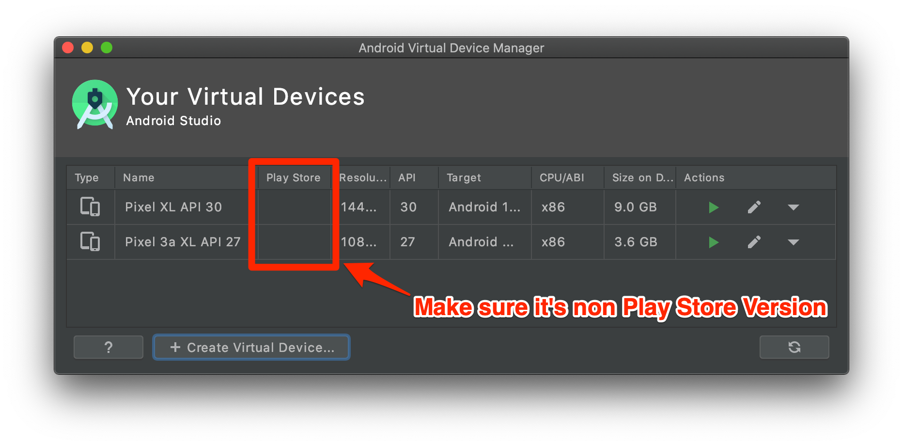
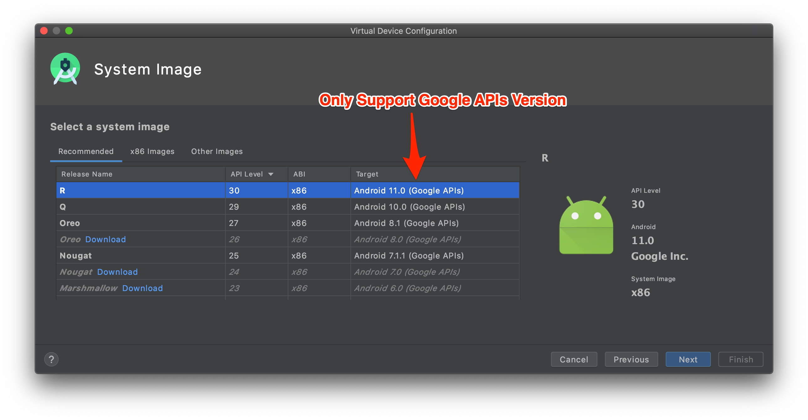

# Automatic Script for Android Emulator

## 1. What's it?

Manually overriding the HTTP Proxy, then installing and trusting the Proxyman Certificate on your Android Emulator, is complicated and error-prone.

Proxyman provides a built-in script that does it for you in seconds. You can open it from **Certificate Menu -> Install Certificate on Android -> Emulators…**


From Proxyman 5.16.0 or later, Proxyman can install the Proxyman certificate into the system-level store. This makes it possible to decrypt all HTTPS traffic from Android Emulators.



Proxyman now works with Google Play and non-Google Play Emulators. Override them in 1 click. See [google-play-android-emulator-with-magisk.md](google-play-android-emulator-with-magisk.md "mention")


<figure><figcaption></figcaption></figure>

## Video


Capture HTTPS from a native Android app (OkHttp) on the Android Emulator with API 36


## 2. Benefit?

**1 Click to:**

* **✅ Auto** Override / Revert HTTP Proxy
* **✅ Automatically** download, install, and trust the Proxyman Certificate in the system-level store. Decrypt all HTTPS from your Emulators. (Available on Proxyman 5.16.0 or later)
* No need for **network\_security\_config.xml**
* **✅** Less error-prone and done in a few clicks


Works with Android Emulators and Android Physical Devices via `adb` (Only for Proxyman v5.19.0+)


<div data-full-width="true"><figure><figcaption><p>Capture and decrypt HTTPS from Android Emulators with Proxyman</p></figcaption></figure></div>

* Install Proxyman Certificate to the system-level Store.

<figure><figcaption><p>Install Proxyman Certificate to the system-level Store.</p></figcaption></figure>

### ✅ Flutter / React Native app

From Proxyman macOS 6.4.0 or later, Proxyman can capture HTTPS traffic from Flutter apps without any code change.

See the [flutter.md](../flutter.md "mention") documentation to learn more.

## 3. How to use it?

1. Make sure the `adb` command is installed. If not, please install it

```bash
brew install android-platform-tools
```

2. Open your Android app with Android Studio
3. Create a new Emulator in the Android Virtual Device Manager. **Make sure it's not a Google Play image. It must be a Google APIs image.**



* ✅ NEW: Proxyman can now root Google Play Store Emulators. Please read [google-play-android-emulator-with-magisk.md](google-play-android-emulator-with-magisk.md "mention")



<figure><figcaption></figcaption></figure>

4. Open Proxyman -> Certificate Menu -> Install Certificate on Android -> Emulators… -> Click the Override All Emulators button

<figure><figcaption><p>Capture all HTTPS from Emulators with 1 click</p></figcaption></figure>

5. Wait until the Terminal script completes

<figure><figcaption></figcaption></figure>

6. Relaunch your Android app from Android Studio
7. Proxyman will capture all HTTPS data ✅


If you close Proxyman, make sure to click the Revert All Changes button. Otherwise, your Android Emulator cannot access the Internet.


## 4. ⚠️ Proxyman 5.15.0 or earlier

* Proxyman 5.15.0 or earlier can only install the Proxyman Certificate at the user level.
* It means you have to complete the next step:
* In your source code:
  * Add res/xml/network\_security\_config.xml

```xml
<network-security-config>
    <debug-overrides>
        <trust-anchors>
            <!-- Trust user added CAs while debuggable only -->
            <certificates src="user" />
            <certificates src="system" />
        </trust-anchors>
    </debug-overrides>

    <base-config cleartextTrafficPermitted="true">
        <trust-anchors>
            <certificates src="system" />
            <certificates src="user" />
        </trust-anchors>
    </base-config>
</network-security-config>
```

* Add to AndroidManifest.xml

<pre class="language-xml"><code class="lang-xml">&#x3C;?xml version="1.0" encoding="utf-8"?>
&#x3C;manifest xmlns:android="http://schemas.android.com/apk/res/android"
    xmlns:tools="http://schemas.android.com/tools">

    &#x3C;uses-permission android:name="android.permission.INTERNET" />

    &#x3C;application
        <a data-footnote-ref href="#user-content-fn-1">android:networkSecurityConfig="@xml/network_security_config"></a>
        &#x3C;activity
            ...
        &#x3C;/activity>
    &#x3C;/application>

&#x3C;/manifest>
</code></pre>

## 5. Advanced: Run the script manually

You can run the script manually in your Terminal app without granting the Automation permission in Privacy & Security.

### **Script path**:


```bash
/Applications/Proxyman.app/Contents/Frameworks/ProxymanCore.framework/Resources/install_certificate_android_emulator.sh
```


* For Proxyman 5.19.0 or later


```bash
Usage: /Applications/Proxyman.app/Contents/Frameworks/ProxymanCore.framework/Resources/install_certificate_android_emulator.sh -m <mode> [options]

Modes:
  all             Set proxy and install certificate
  proxy           Set proxy only
  revertProxy     Revert proxy settings only
  certificate     Install certificate only

Required Options based on Mode:
  -m, --mode <mode>              : Operation mode (all, proxy, revertProxy, certificate)
  -i, --ip <ip_address>          : IP address (required for all, proxy, certificate)
  -p, --port <port_number>       : Port number (required for all, proxy, certificate)
  -c, --cert <path_to_cert.pem>  : Path to Proxyman certificate (required for all, certificate)

Optional Options:
  --include-physical            : Include physical devices (default: only emulators)
  -h, --help                    : Show this help message
```


### Prepare the certificate

1. Open the Proxyman app
2. Find the current IP in the main toolbar
3. Certificate menu -> Export -> Root Certificate as PEM -> Save to the Desktop folder

### 5.1 Override HTTP Proxy and Install the Certificate to system-level Store

* Proxyman v5.19.0 or later (NEW)


```bash
bash /Applications/Proxyman.app/Contents/Frameworks/ProxymanCore.framework/Resources/install_certificate_android_emulator.sh --mode all --ip <current_ip> --port <port> --cert <certificate_path>
```


* Proxyman v5.18.0 or earlier


```bash
bash /Applications/Proxyman.app/Contents/Frameworks/ProxymanCore.framework/Resources/install_certificate_android_emulator.sh all <current_ip> <port> <certificate_path>
```


### 5.2 Only Override HTTP Proxy

* Proxyman v5.19.0 or later (NEW)


```bash
bash /Applications/Proxyman.app/Contents/Frameworks/ProxymanCore.framework/Resources/install_certificate_android_emulator.sh --mode proxy --ip <current_ip> --port <port>
```


* Proxyman v5.18.0 or earlier


```bash
bash /Applications/Proxyman.app/Contents/Frameworks/ProxymanCore.framework/Resources/install_certificate_android_emulator.sh proxy <current_ip> <port> 
```


### 5.3 Revert HTTP Proxy

* Proxyman v5.19.0 or later (NEW)


```bash
bash /Applications/Proxyman.app/Contents/Frameworks/ProxymanCore.framework/Resources/install_certificate_android_emulator.sh --mode revertProxy
```


* Proxyman v5.18.0 or earlier


```bash
bash /Applications/Proxyman.app/Contents/Frameworks/ProxymanCore.framework/Resources/install_certificate_android_emulator.sh revertProxy
```


## 6. Left certificate expiry date

6.1 Problem: You get this error when intercepting HTTPS from an Android WebView

❗️ Android WebView rejects with ERR\_CERT\_VALIDITY\_TOO\_LONG

You can change the leaf certificate's expiry in Proxyman Settings -> General -> **More** (next to the certificate) -> **Leaf Certificate Expiry**, then select a shorter expiry, such as 10 days.

<figure><figcaption></figcaption></figure>

* Ref: [https://github.com/ProxymanApp/Proxyman/issues/2751](https://github.com/ProxymanApp/Proxyman/issues/2751)

## Learn more

* [How to capture HTTPS traffic from Android Emulators with API 35](https://proxyman.com/posts/capture_https_android_emulators)
* [How to capture HTTPS traffic from Flutter apps on Android Emulators](https://proxyman.com/posts/Capture-https-flutter-android-emulator)
* [Capture Android Emulator HTTP/HTTPS traffic with Proxyman](https://proxyman.com/android-emulator) (Proxyman website)

[^1]: This line
