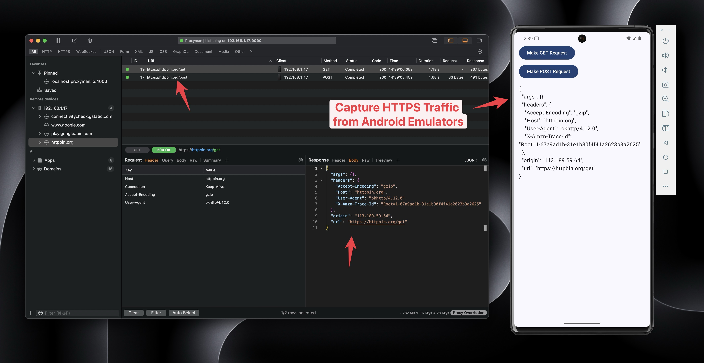

# Sample Android Project

## 1. What's it?

A sample Kotlin Android project that shows how Proxyman can capture and decrypt HTTPS data from the OkHttp library.

<figure><figcaption>
Capture and decrypt HTTPS traffic from Android
</figcaption></figure>

## 2. Download

Download it from [https://github.com/ProxymanApp/OKHTTP-Android-Sample](https://github.com/ProxymanApp/OKHTTP-Android-Sample)

## Video


Capture HTTPS from a native Android app (OkHttp) on the Android Emulator with API 36

