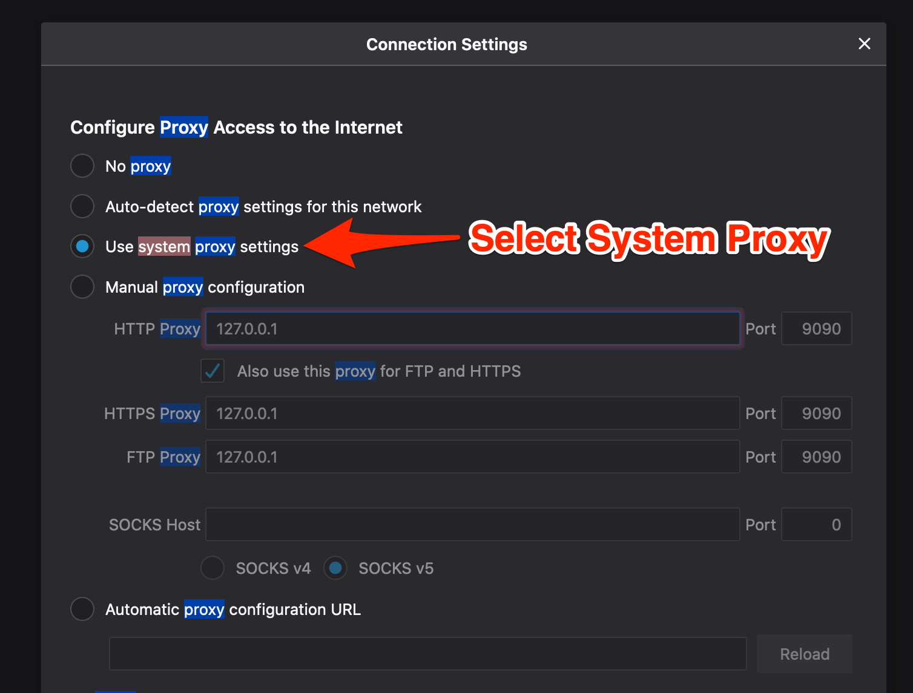
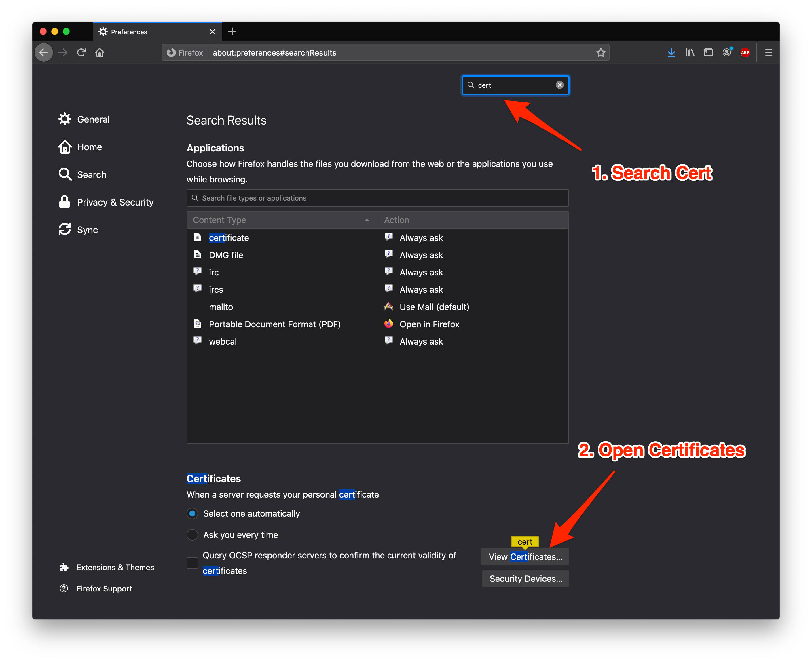
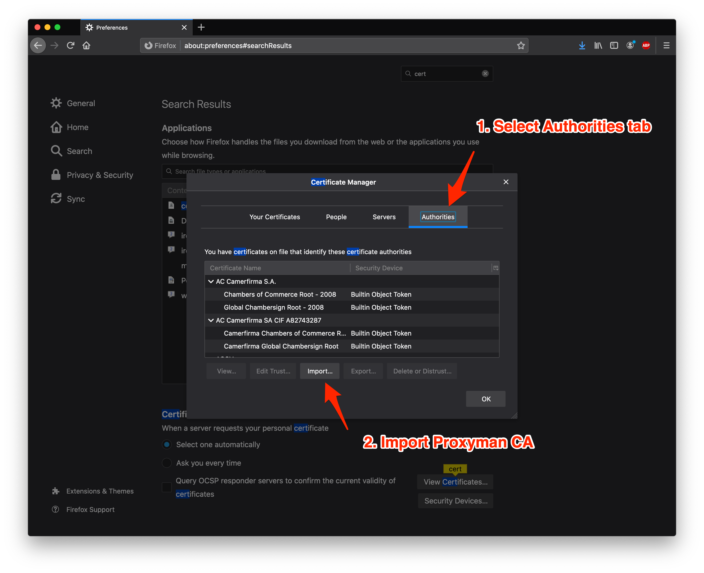
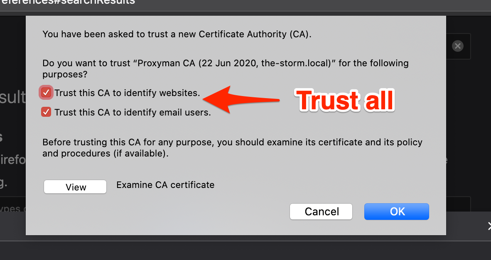

# Firefox

## ✅ New Solution (Proxyman v5.19.0 or later - recommended)

With Proxyman v5.19.0+, Proxyman can capture HTTPS requests and responses from Firefox with a 1-click setup.

1. Go to Setup Menu -> Automatic Setup
2. In the Web Browsers section -> Click the ⬇️ Arrow Button -> Select Firefox

<figure><figcaption>
Capture HTTPS requests and responses from Firefox with Proxyman
</figcaption></figure>

3. A new Firefox instance will open
4. ✅ Done. Proxyman captures all traffic from this Firefox instance

This setup makes Firefox or Google Chrome:

* Automatically use Proxyman as the HTTP proxy
* Automatically install and trust the Proxyman Certificate


Works with Google Chrome and Firefox


## ❌ Old Solution (Proxyman v5.18.0 or earlier)

To intercept HTTPS traffic from Firefox, you need extra steps to install the Proxyman CA into Firefox's trust store.

### 1. Install Proxyman CA on macOS machine

Before installing the Proxyman CA in Firefox, you have to install it properly on your Mac.

Check out the macOS guide:


[macos.md](macos.md)


If you've done this step, you can skip to the next step.

### 2. Set Proxy on Firefox

* Open Firefox Settings (CMD+,)
* Search for Proxy and open the proxy settings
* Select Use system proxy settings, or enter the Proxy IP and Port manually

### 3. Install Proxyman CA to Firefox

1. Open `http://proxy.man/ssl` in Firefox and download the certificate to your Downloads folder


http://proxy.man/ssl is a local HTTP server, for better security. Please make sure the Proxyman app is open when you access this domain.


2\. Open Firefox Settings (CMD+,) and open the View Certificates window

3\. Open the Authorities tab and click the Import button

4\. Select the Proxyman CA that you downloaded, and check all trust options.

5\. Reload the page that you need to intercept. Enjoy!

## Learn more

* [How to capture HTTPS traffic from Firefox Browser](https://proxyman.com/posts/how-to-capture-https-traffic-firefox-browser)
* [SSL debugging with Firefox](https://proxyman.com/posts/2020-01-22-Debug-With-Firefox)
