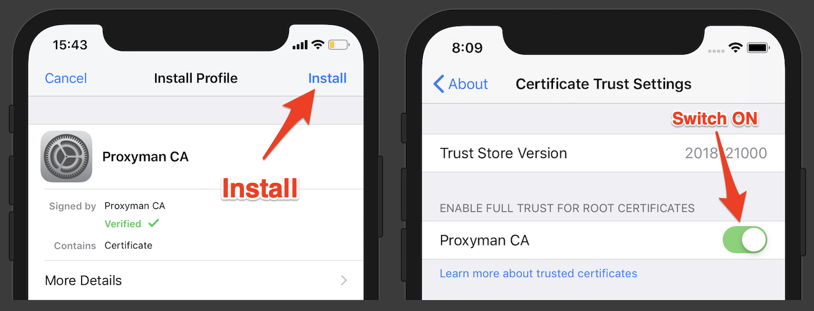

# iOS Device

To capture traffic from an iPhone or iPad, route its Wi-Fi traffic through Proxyman on your computer. HTTPS inspection also requires installing the Proxyman certificate and explicitly trusting it on the device. These are separate steps.

Keep Proxyman running and connect the device to a network that can reach your computer. Use the computer IP address and Proxyman port shown in the setup guide, rather than the device IP address.

Open the physical-device setup guide in Proxyman:

* **Certificate** **Menu** -> **Install Certificate on iOS -> Physical Devices...**


This setup guide works with all real physical devices, including iPhone, iPad, Apple Watch, Apple TV, and Apple Vision Pro.


## iOS Setup Guide

<figure><figcaption></figcaption></figure>

Follow these steps:

1. Install the **Root Proxyman Certificate** on your Mac: You can follow the [macOS Guide](macos.md).
2. On your iOS device, open the Settings app -> Wi-Fi -> Select the current Wi-Fi -> Configure the HTTP Proxy with the values in this table.

| Name           | Value                                             |
| -------------- | ------------------------------------------------- |
| Server IP      | Your Mac's current IP address                     |
| Port           | The current port of Proxyman: 9090 is the default |
| Authentication | No                                                |


If you're using any **VPN apps** on macOS or iOS devices, please close all of them, as they conflict with the HTTP Proxy configuration.


&#x20; 3\. Open [http://proxy.man/ssl](http://proxy.man/ssl) or [http://cert.proxyman.io](http://cert.proxyman.io/) in a **Safari Private tab** on your iOS device to download the Proxyman Certificate.


**http://proxy.man/ssl** and **http://cert.proxyman.io** are local websites, served by the HTTP server inside Proxyman. If you can't open them, forget the Wi-Fi network, reconnect, and make sure the Proxyman app is open.

If you still can't access it, please open a support ticket in the [Proxyman GitHub repo](https://github.com/ProxymanApp/Proxyman).


&#x20;   4\. From iOS 10.3, you have to explicitly install and trust the Proxyman CA in the Settings app.

#### **Install Proxyman CA**

* **iOS ≥ 12.2**: On your iPhone -> Open the Settings app > Profile Downloaded > Select Proxyman CA > Install

#### Trust Proxyman CA

Installing the profile does not enable full trust by itself. Complete this step before testing HTTPS traffic:

* Settings app > General > About > Certificate Trust Settings > Switch ON Proxyman CA.


Please make sure you **install** and **trust** the Proxyman CA on your iOS device. If you have any problem, email us at **support@proxyman.com** or open an issue on [**GitHub**](https://github.com/ProxymanApp/Proxyman)



After setup, enable [SSL Proxying](../basic-features/ssl-proxying.md) for the domain and make a new request. If no traffic appears, verify the Wi-Fi proxy IP and port, network connectivity, and VPN settings using the [device connection troubleshooting guide](../troubleshooting/my-ios-devices-couldnt-connect-to-proxyman-via-proxy.md). If requests appear but HTTPS fails, recheck certificate installation and trust.



Make sure that you **delete the certificate on your iPhone** when you're not debugging with Proxyman. If not, your HTTP/HTTPS requests can be intercepted and leak your sensitive data.


## Tutorial

See detailed steps on how to [debug an application on iOS device](https://proxyman.com/posts/2019-06-16-How-I-use-Proxyman-to-see-HTTP-requests-responses-on-my-iPhone) with Proxyman.

### Tired of manual config?

We understand that manually overriding the HTTP Proxy and installing and trusting Proxyman Certificates is painful. Check out Atlantis, a native iOS framework that does it for you automatically.


[atlantis-for-ios.md](../atlantis/atlantis-for-ios.md)


## Flutter app?

You might not be able to see the network traffic in Proxyman if your app is a Flutter app.

Flutter does not use the system-level proxy, so its requests do not go to Proxyman. To fix it, you must configure the HTTP client in your code to use a proxy. See the [Flutter guide](flutter.md) for the code samples.

You can also follow the solution "Getting Charles to work with Flutter" in [https://flutterigniter.com/debugging-network-requests/](https://flutterigniter.com/debugging-network-requests/)

To find your local IP, go to the Certificate menu -> Install Certificate on iOS -> Physical Devices… and get the Server IP and Port.

## Learn more

* [How to capture HTTP/HTTPS traffic from iPhone on iOS 26 or iPadOS 26](https://proxyman.com/posts/how-to-capture-https-iOS-26-update-2025)
* [How to capture HTTPS traffic from an iOS app with a company VPN](https://proxyman.com/posts/capture-https-ios-app-with-company-vpn)
* [Capture HTTPS traffic from iPhone and iPad with Proxyman](https://proxyman.com/iphone-device) (Proxyman website)
