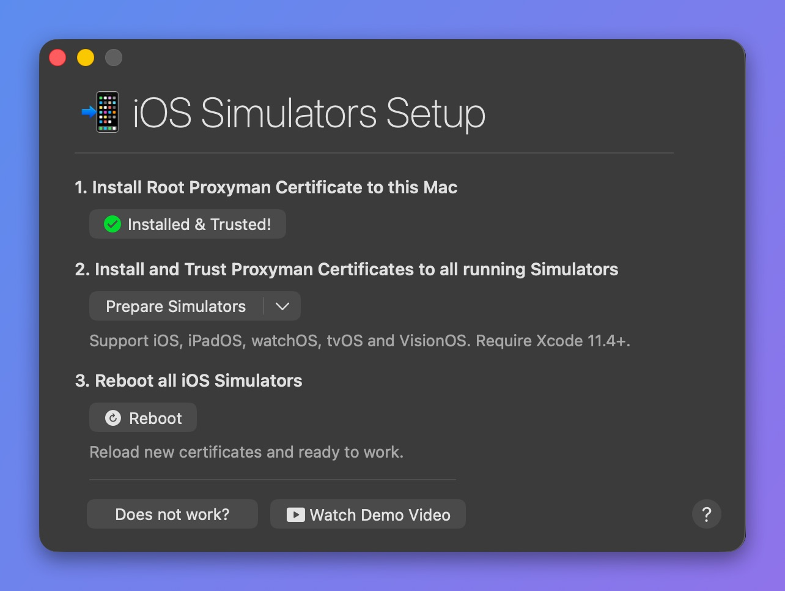

# iOS Simulator

Use Proxyman on your Mac to capture and inspect HTTP/HTTPS requests from iOS Simulator. Start with automatic certificate installation; use the manual steps below if installation fails.

Before you start, install Xcode and open the simulator you want to debug at least once. Keep Proxyman running while you reproduce requests in your app. For HTTPS inspection, install and trust the certificate, then enable [SSL Proxying](../basic-features/ssl-proxying.md) for the domain.

Open the simulator setup guide in Proxyman:

* **Certificate** **Menu** -> **Install Certificate on iOS -> Simulators**

## Video


Capture HTTPS traffic from an iOS Simulator



Capture HTTPS from a native iOS app on the iOS 26 Simulator with Xcode 26


## 1. iOS Simulator Setup Guide

<figure><figcaption>
iOS Simulators Setup
</figcaption></figure>


It works for iOS, iPadOS, tvOS, watchOS and visionOS.


The setup guide has three steps:

1. Install the **Root Proxyman Certificate** on your Mac: You can follow the [macOS Guide](macos.md).
2. Install the Proxyman Certificate on all available simulators that you have opened at least once (click **Prepare Simulators**).
3. **Reboot the simulators**: Proxyman reboots all simulators, so they load the new certificate.


From Proxyman 2.19.0+, Proxyman uses the [simctl](https://nshipster.com/simctl/) command line to perform these tasks.&#x20;

**simctl** comes with Xcode. It is more modern and reliable than the legacy approach (custom Python scripts).



This step only installs the certificate on simulators that you have opened at least once.

For instance, if you would like to debug on the iPhone X Simulator, please make sure to **open** the iPhone X Simulator first, then **install** the certificate in Step 2.&#x20;


### Xcode Preview (SwiftUI)

If you're using Xcode Previews for SwiftUI, you can install the certificate into the Xcode Preview simulator:

1. Open Xcode with the SwiftUI preview canvas.
2. Open Proxyman -> Certificate menu -> Install Certificate on iOS -> Simulators
3. In Step 2, click the ↓ button (next to the Prepare Simulators button) -> Install to Xcode Preview (SwiftUI)

You can read more in [GitHub issue #1568](https://github.com/ProxymanApp/Proxyman/issues/1568#issue-1610877870).

### Manually Install

In Proxyman v4.16.0 or later, you can manually install the certificate on your iOS Simulator in case the automatic solution doesn't work.

1. Certificate menu -> Install Certificate on iOS -> Simulators
2. In Step 2, click the ↓ button (next to the Prepare Simulators button) -> Install Manually…

<figure><figcaption>
Install the certificate manually
</figcaption></figure>

3. Drag and drop the certificate onto your iOS Simulator

<figure><figcaption>
Drag the certificate onto the simulator, then trust it
</figcaption></figure>

4. Open your iOS Simulator -> Settings app -> General -> About -> Certificate Trust Settings -> Find the Proxyman CA certificate and switch it ON
5. Done

## 2. Troubleshooting

If the request list is empty, first check recording, filters, and proxy settings using the [missing-traffic checklist](../troubleshooting/i-couldnt-see-any-traffics-on-proxyman.md). If requests appear but HTTPS fails, check certificate installation and SSL Proxying. The sections below cover installation errors and cached requests.

### 1. Unable to install the Certificate

If you get errors when you click the button in Step 2, open Xcode -> Settings -> Locations tab -> Select your Xcode in Command Line Tools.

### 2. Get SSL Error from HTTPS Response

* Open the Settings app -> General -> About -> Certificate Trust Settings and verify that the Proxyman Certificate is installed and trusted.

If it's not installed:

* Open the iOS Simulator Setup (Certificate menu -> Install Certificate on iOS -> Simulators) and click the button in Step 2.
* Or try the steps in [Manually install the certificate by exporting it](#manually-install-the-certificate-by-exporting-the-certificate) below.

### 3. Some HTTP/HTTPS Requests are missing from Proxyman

Alamofire or URLSession might use the cached response for your request. As a result, the actual request doesn't hit the server, so Proxyman cannot capture and display it.

Solution:&#x20;

* Disable the cache mechanism on URLSession or Alamofire.
* Use the [No Caching Tool](../advanced-features/no-caching.md) (⌥⌘N)

## Manually Install the Certificate by exporting the certificate

If you cannot install the certificate, you can do it **manually**:

1. Open Proxyman -> Certificate menu -> Export -> Root Certificate as DER -> Save to the Desktop folder
2. Open the Simulator, then **drag the certificate and drop it** on the Simulator screen
3. Open the Settings app (on the Simulator) -> General -> VPN & Device Management (Device Management on older iOS) -> Select the certificate -> Install
4. Settings app -> General -> About -> Certificate Trust Settings and verify that the Proxyman Certificate is installed and trusted.
5. Done ✅

## Tutorial

See detailed steps to [debug an application on iOS Simulator](https://proxyman.com/posts/2019-07-06-Debugging-on-iOS-Simulator-with-Proxyman) with Proxyman.

## Learn more

* [How to inspect network traffic from iOS 15 Simulator with Proxyman](https://proxyman.com/posts/2022-06-04-How-to-inspect-network-traffic-from-iOS-simulator-with-Proxyman)
* [Capture HTTPS requests from Vision Pro Simulator](https://proxyman.com/posts/2024-01-24-Capture-HTTPS-traffic-from-Vision-Pro-Simulator)
* [Capture iOS Simulator HTTP/HTTPS traffic with Proxyman](https://proxyman.com/ios-simulator) (Proxyman website)
