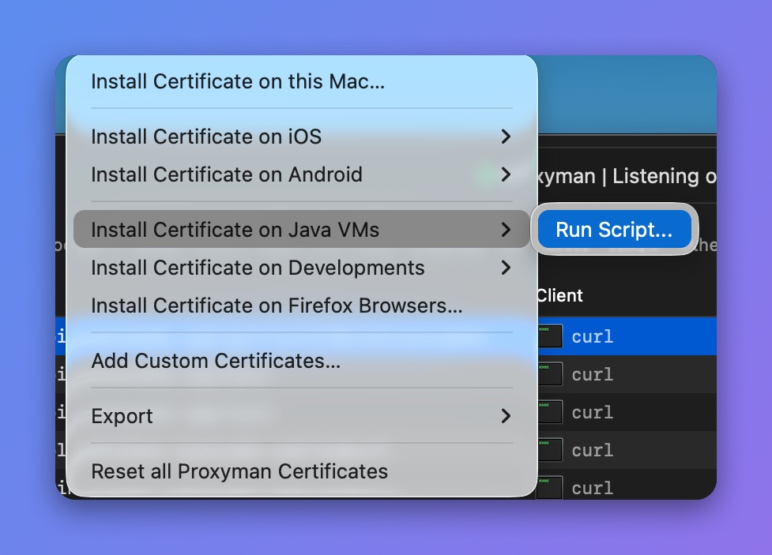

# Java VMs

To intercept HTTPS traffic from Java apps, you need extra steps to install the Proxyman CA Certificate into the Java KeyStore. For example, to:

* Intercept traffic from unit tests (written in Java or Kotlin)
* Intercept traffic from a Java app or CLI

## 1. Benefit

* Proxyman provides a script that automatically installs the Root Certificate into the Java KeyStore with 1 click ✅
* Supports `$JAVA_HOME`
* Supports `SDKMAN`
* Supports `/usr/libexec/java_home`

## 2. How to use?

### 1. Install Proxyman CA on your Mac

Before installing the Proxyman CA on Java VMs, you have to install it properly on your Mac.

Check out the macOS guide:


[macos.md](macos.md)


You can skip this step if you've already done it.

### 2. Install Proxyman CA to all Java Key Stores

* Certificate Menu -> Install Certificate on Java VMs -> Run Script...

<figure><figcaption>
Run the Java certificate script
</figcaption></figure>

* The script tries to find the KeyStore location from **JAVA\_HOME**, **SDKMAN**, or **$(/usr/libexec/java\_home)** and installs the CA Certificate if possible

<figure><figcaption>
Proxyman installs the certificate into all Java trust stores it can find
</figcaption></figure>


You can find the script at /Applications/Proxyman.app/Contents/Frameworks/ProxymanCore.framework/Versions/A/Resources/install-certificates-java.sh



The script might ask for Automation permission, because Proxyman uses [AppleScript](https://developer.apple.com/library/archive/documentation/AppleScript/Conceptual/AppleScriptLangGuide/introduction/ASLR_intro.html) to run it in the Terminal app with admin permission.


### Alternative solution

* If you get the following error, check out the solution from @[**yauheniprakapenka**](https://github.com/yauheniprakapenka): [https://github.com/ProxymanApp/Proxyman/issues/569#issuecomment-723588490](https://github.com/ProxymanApp/Proxyman/issues/569#issuecomment-723588490)&#x20;

`sun.security.validator.ValidatorException: PKIX path building failed: sun.security.provider.certpath.SunCertPathBuilderException: unable to find valid certification path to requested target javax.net.ssl.SSLHandshakeException: sun.security.validator.ValidatorException: PKIX path building failed: sun.security.provider.certpath.SunCertPathBuilderException: unable to find valid certification path to requested target`
