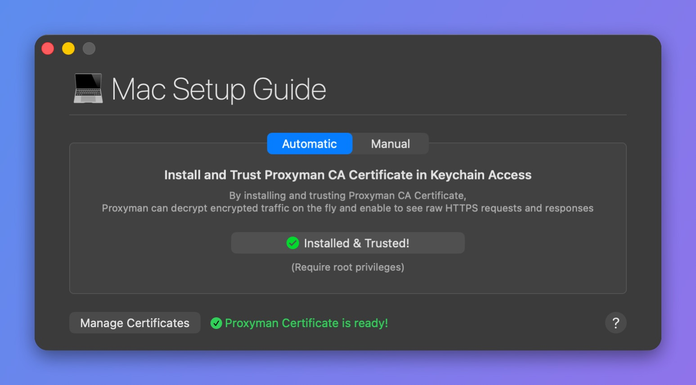
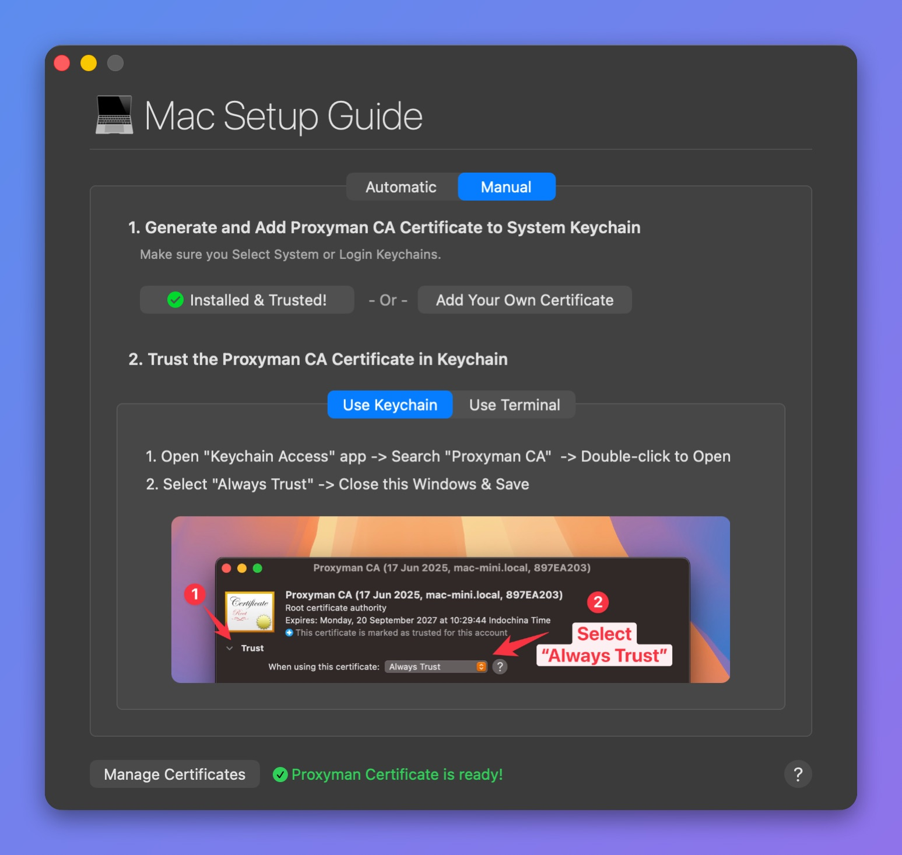

# macOS

To inspect HTTPS traffic on your Mac, install and trust the Proxyman CA certificate, then enable [SSL Proxying](../basic-features/ssl-proxying.md) for the domain you want to inspect. Start with automatic installation below, or use Manual Mode if you need to manage trust in Keychain Access yourself.

## Install & Trust Proxyman Certificates on your Mac

To intercept encrypted HTTPS messages (request or response), you have to install the **Proxyman CA Certificate** on your current machine. This step is also required for iOS devices, Android devices, iOS simulators, Java VMs, and Firefox.


The Proxyman Certificate is a self-signed certificate that is generated on your machine. Proxyman never stores or sends any personal data to Proxyman's servers or to third parties.

Please check out the [Privacy Statement](https://proxyman.com/privacy) to see what data Proxyman collects and what it does not.

If you'd like to generate a certificate on your machine yourself and add it to Proxyman, please check out the [Custom Certificate Doc](../advanced-features/custom-certificates.md#6-how-to-generate-self-signed-certificates-for-custom-root-certificate-that-comply-with-new-apples-security-requirements).



Proxyman's certificate is stored locally at **\~/Library/Application\ Support/com.proxyman.NSProxy/app-data/**


## 1. Automatic mode (recommended)

Proxyman can **automatically** install and trust the certificate in Keychain. Follow these steps:

1. Open the **Certificate** menu
2. Select **Install Certificate on this Mac…**
3. In the **Automatic** tab, click **Install & Trust Certificate** and enter your Mac's password (root privileges)
4. Verify the status: ✅ `Installed & Trusted` in the button (If not, try the Manual tab, or contact us for further support)
5. Done :white\_check\_mark:

To verify capture, make a new HTTPS request from your browser with Proxyman running and SSL Proxying enabled for that domain. Confirm that you can read the request and response. If nothing appears, use the [missing-traffic checklist](../troubleshooting/i-couldnt-see-any-traffics-on-proxyman.md); if certificate installation fails, continue with Manual Mode below.

<figure><figcaption><p>Certificate installed and trusted</p></figcaption></figure>


**Automatic mode** requires **root privileges** to run the installation script. If you're not sure, please consider using Manual mode.


### How does it work?

In automatic mode, Proxyman performs two steps:

1. Generate a local Proxyman Certificate at `~/Library/Application\ Support/com.proxyman.NSProxy/app-data/proxyman-ca.pem`
2. Install and trust the certificate in the System keychain. It requires root privileges to run the following command:&#x20;


```bash
sudo security add-trusted-cert -d -r trustRoot -k /Library/Keychains/System.keychain ~/Library/Application\ Support/com.proxyman.NSProxy/app-data/proxyman-ca.pem
```


## 2. Manual Mode (Advanced)

Manual mode gives advanced users more control if they want to install and trust the certificate themselves.&#x20;

1. Open the **Certificate** menu
2. Select **Install Certificate on this Mac…** -> Select the **Manual** tab
3. Click the **Generate and Add…** button (Proxyman generates the certificate locally and adds it to Keychain, but does not trust it. No password required)
4. In some cases, macOS asks which keychain to use -> Select **System Keychain**
5. Open the Keychain Access app on your Mac -> Search "Proxyman CA" -> Open it -> Select "Always Trust" -> Close the window and save


If you've done it correctly, Proxyman will display the " ✅ Installed and Trusted" status.


<figure><figcaption><p>Manual mode: trust the certificate in Keychain</p></figcaption></figure>


If you'd like to use your own custom Root Certificate, please check out the [Custom Certificate Doc](../advanced-features/custom-certificates.md#6-how-to-generate-self-signed-certificates-for-custom-root-certificate-that-comply-with-new-apples-security-requirements)


If you're not sure how to trust the certificate in the Keychain Access app, open the Terminal app and run this command:


```bash
sudo security add-trusted-cert -d -r trustRoot -k /Library/Keychains/System.keychain ~/Library/Application\ Support/com.proxyman.NSProxy/app-data/proxyman-ca.pem
```



Make sure that you **delete the Proxyman Certificate in the Keychain Access app** if you're not using Proxyman anymore. If not, anyone who has the Proxyman Certificate can intercept HTTP/HTTPS requests from your Mac.


## 3. Uninstall Proxyman Certificate

1. Open the **Certificate** menu
2. Select **Reset all Proxyman Certificates**
3. Enter your Mac password and done

## Video


Capture HTTP and HTTPS traffic with Proxyman

