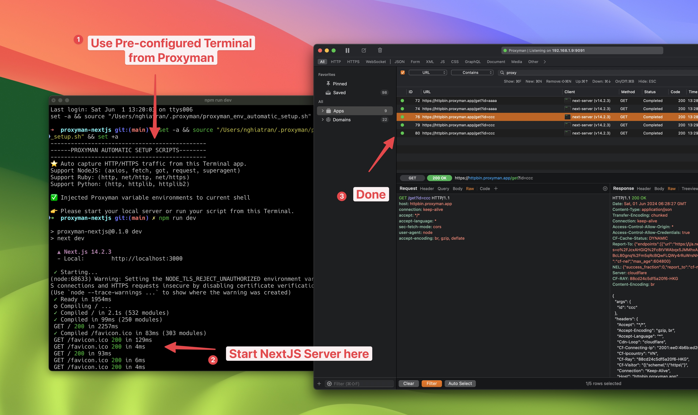

# NextJS (fetch)

## 1. Problem

* Proxyman can't capture any traffic from `use server` code in NextJS
* It's because `fetch` in NextJS doesn't respect the system HTTP proxy. Therefore, no traffic goes through the Proxyman app.

## 2. Solution

1. Start the pre-configured Terminal: Setup menu -> Automatic Setup -> Click "Open New Terminal"
2. A new Terminal opens -> Start your NextJS server in this Terminal. For example: `npm run dev`
3. Use `no-cache` on `fetch`

```js
export default async function MyPage() {
  const res = await fetch('https://httpbin.org/anything', { cache: 'no-cache' }) // no cache, or no request is sent to Proxyman
  return <div>My Page{res.text()}</div>
}
```

4. Reload your website
5. Done ✅ The Proxyman app captures your HTTP traffic

<figure><figcaption><p>Capture NextJS fetch on Proxyman</p></figcaption></figure>

## 3. Reference:

* [https://github.com/ProxymanApp/Proxyman/issues/2038](https://github.com/ProxymanApp/Proxyman/issues/2038)

## Learn more

* [Capture HTTP requests from the server side on NextJS](https://proxyman.com/posts/2024-06-10-Capture-HTTPS-From-NextJS-Server-Components)
