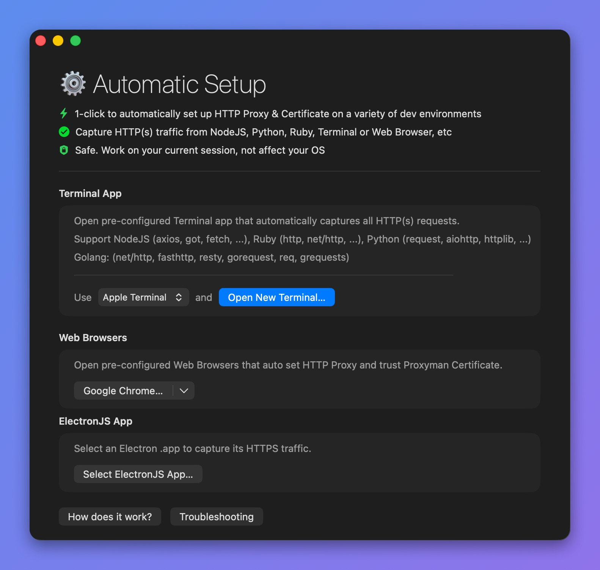

# NodeJS

## 1. New Automatic Solution (v4.7.0 or later) ✅

Proxyman v4.7.0 or later can capture HTTP/HTTPS traffic from NodeJS with 1 click.

* 1-click solution: No need to set the HTTP Proxy config or trust the self-signed certificate manually.
* Supports many NodeJS libraries: axios, got, superagent, fetch, and node-fetch

### How to use:

1. Open Proxyman -> Setup Menu -> Automatic Setup
2. Click "Open New Terminal"
3. Accept the AppleScript permission prompt if needed
4. A new Terminal window opens -> Start your NodeJS backend server or run your scripts there => Proxyman captures all traffic automatically.
5. For example:&#x20;

```
$ npm start
```

Done ✅

<figure><figcaption><p>Capture NodeJS Traffic</p></figcaption></figure>

Please check out the Automatic Setup page:


[automatic-setup.md](../automatic-setup/automatic-setup.md)


## 2. Old Solution (Not recommended) ❌

There are common problems when using NodeJS + Proxyman:

### 1. Proxyman could not capture http://localhost:3000 requests to my NodeJS Server

If you're using NodeJS to serve a localhost website (e.g. http://localhost:3000), Proxyman might not work. For example: you use ExpressJS to serve an API server at http://localhost:3000

#### Solution:

Please check out [I could not see any requests from my localhost server](../troubleshooting/couldnt-see-any-request-from-localhost-server.md).

### 2. Proxyman could not capture HTTP requests, which are called from my NodeJS local server.

* Requests from [fetch](https://www.npmjs.com/package/node-fetch) or [axios](https://github.com/axios/axios) don't show in the Proxyman app
* I get an SSL error from HTTPS requests

#### Solution

By default, HTTP/HTTPS requests from your NodeJS libraries don't go through the HTTP proxy server, so Proxyman cannot capture the traffic.

#### 2.1 node-fetch

1. Install the [global-agent](https://github.com/gajus/global-agent) package

```bash
npm install global-agent
```

2\. At the top of your NodeJS code, add the following code:

```javascript
import { bootstrap } from 'global-agent';
bootstrap();
process.env['NODE_TLS_REJECT_UNAUTHORIZED'] = '0';
```

3\. Add this env to your current shell. Make sure Proxyman is listening on port 9090

```
export GLOBAL_AGENT_HTTP_PROXY=http://127.0.0.1:9090
```

4\. Done ✅&#x20;

Run your NodeJS script again and the HTTP/HTTPS requests will appear in the Proxyman app.

#### Sample code

```javascript
import fetch from 'node-fetch';

// Setup global-agent
import { bootstrap } from 'global-agent';
bootstrap();
process.env['NODE_TLS_REJECT_UNAUTHORIZED'] = '0';

// fetch the data
const response = await fetch('https://httpbin.org/get?id=123');
const data = await response.json();

// Done
console.log(data);
```

#### 2.2 Axios

According to the Axios documentation, you can set the HTTP\_PROXY and HTTPS\_PROXY environment variables.

1. Click the Proxyman icon in the menu bar -> Listen on \<IP>:\<Port>
2. Click Copy Shell Command

<figure><figcaption></figcaption></figure>

3. Open the Terminal and paste the command. For example: export https\_proxy=http://192.168.1.103:9090 http\_proxy=http://192.168.1.103:9090
4. In the same Terminal -> Start your NodeJS server with axios.
5. Axios will send the traffic through Proxyman.
6. Done ✅

#### 2.3 I use a different NodeJS library

If you're not using fetch or axios, the configuration might be different. Please check your library's documentation to see how to set the proxy and trust the Proxyman certificate.

* Discussion at [https://github.com/ProxymanApp/Proxyman/issues/236](https://github.com/ProxymanApp/Proxyman/issues/236)

## Learn more

* [Capture HTTP/HTTPS requests from axios (NodeJS)](https://proxyman.com/posts/2023-05-14-Capture-HTTP-HTTPS-Request-From-Axios-NodeJS)
* [Debug OpenAI APIs in NodeJS with Proxyman](https://proxyman.com/posts/2025-03-30-Debug-OpenAPI-NodeJS)
* [Capture HTTP/HTTPS traffic from NodeJS with Proxyman](https://proxyman.com/nodejs) (Proxyman website)
