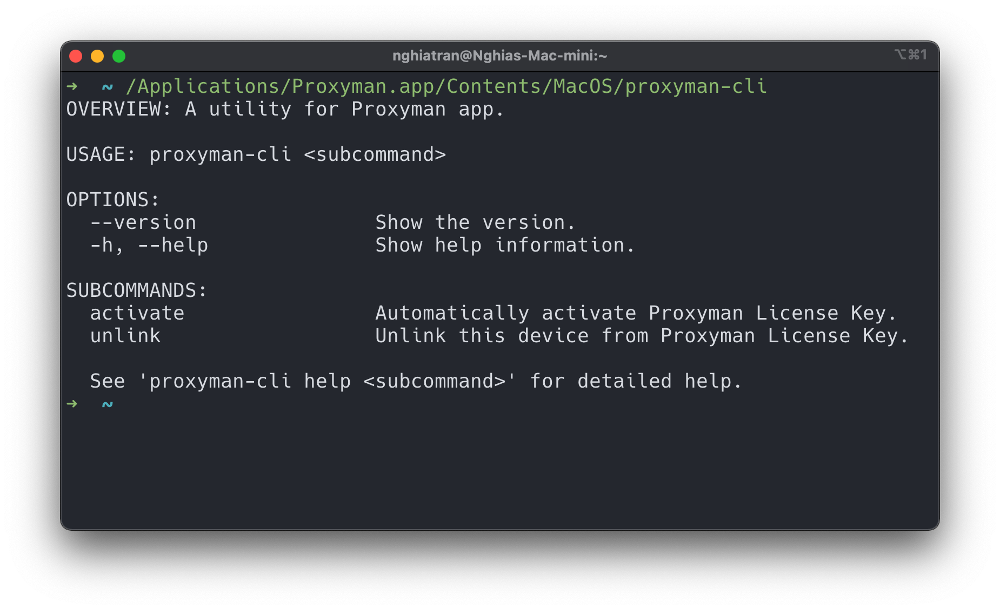

# License

## Proxyman Pro

You can try all debugging tools with the Trial version, which is limited to 2 pinned domains, 2 rules for each debugging tool, and no new tabs.

The **Pro version** comes with:

* A year’s worth of macOS, Windows, and Linux updates
* 1 Mac device per seat
* Premium [Proxyman for iOS](https://proxyman.com/ios) (2 devices per seat)
* [Tab View](basic-features/multiple-tabs.md)
* [Split View](basic-features/split-view.md) for macOS
* Unlimited Pinned Domains / Apps
* Unlimited rules for all Advanced Debugging Tools (e.g., [SSL Proxying List](basic-features/ssl-proxying.md), [Map Local](advanced-features/map-local.md), [Map Remote](advanced-features/map-remote.md), [Breakpoint](advanced-features/breakpoint.md), [Allow/Block List](advanced-features/blacklist.md), [Protobuf](advanced-features/protobuf.md), [Scripting](scripting/script.md), [Network Conditions](advanced-features/network-throttling.md), [Multiple Filters](advanced-features/multiple-filters.md), [Reverse Proxy](advanced-features/reverse-proxy.md), [Request/Response Diff](advanced-features/diff.md), etc).

## Trial Evaluation Duration

* Personal Purpose: No time limit.
* Business Purpose: 2 weeks. After that, please consider buying a license.

## Demo Key

If you're a team or a company, you can request a 2-week demo key. Please contact support@proxyman.com.

## Buy Proxyman License

Go to the [Proxyman Pricing page](https://proxyman.com/pricing) to buy Proxyman licenses.

## Manage Proxyman License&#x20;

If you're the owner of the Proxyman license key, you can manage your devices by using the [License Manager](license-manager.md).

## Activate License

### macOS/Windows/Linux app

1. After you buy a Proxyman license, you will receive a license key by email.&#x20;
2. To activate it, open the Proxyman app (macOS/Windows/Linux) -> Proxyman Menu -> Buy Proxyman Pro.
3. Click the "Activate License" button and enter your license key.

<figure><figcaption><p>Activate License Key on macOS/Windows/Linux app</p></figcaption></figure>

### Activate the License key with your Corporate proxy

* Available from Proxyman macOS 5.5.0 or later
* Some companies use a Corporate Proxy, so Proxyman can't reach the license server to activate the key. To fix it, follow these steps:

1. Open Tools -> Proxy Settings -> External Proxy Settings…
2. Check "Enable External Proxy Tool"
3. Check the HTTP and HTTPS checkboxes
4. For each of HTTP and HTTPS: Enter your Proxy Host and Port.
5. If your corporate proxy needs authentication, enter the username and password.
6. Done ✅
7. Try to activate the License Key again.

<figure><figcaption><p>How to use External Proxy to Activate Proxyman License key</p></figcaption></figure>

### iOS app

Your Proxyman license key also works with the Proxyman iOS app. 1 seat can be activated on 2 iOS devices.

1. Download the iOS app from the App Store: [https://apps.apple.com/us/app/proxyman-network-debug-tool/id1551292695](https://apps.apple.com/us/app/proxyman-network-debug-tool/id1551292695)
2. Open the More Tab (on the Right-Bottom TabBar) -> Face ID & Passcode -> Unlock -> Enter your license key.
3. Done

## Activate License by CLI (macOS Only)

If you have many licenses, you can activate them automatically from the command line.

1. Download the Proxyman app and copy it to the `/Applications` folder
2. **Open and close the app at least once.** This sets up some required configuration.
3. Open Terminal and run the following command:

To **Activate**:

```bash
$ /Applications/Proxyman.app/Contents/MacOS/proxyman-cli activate <key>
```

To **Unlink** device:

```bash
$ /Applications/Proxyman.app/Contents/MacOS/proxyman-cli unlink
```



See the [Proxyman command-line tool](command-line.md) page for all `proxyman-cli` commands.

### Activate by URL

You can also activate a Proxyman license with a URL:

1. Download and open Proxyman at least once.
2. Open the URL in Safari or Google Chrome.

&#x20; `proxyman://activate?key=<key>`

### Remove License

You can remove your license from your devices and then activate it on your new devices as long as you have enough available seats.

#### From your current devices

On macOS, open Proxyman -> Proxyman Menu -> Proxyman Pro… -> click the "More" button -> "Revoke this Device…".

#### With License Manager

1. Open the [License Manager](https://proxyman.com/license-manager/access-link)
2. Enter the email address that you used to buy the license
3. Open the access link from your email.
4. Click on the device to remove it.

### Activate License with Corporate Proxy Server

From Proxyman 4.12.0 or later, you can make Proxyman use your Corporate Proxy in Tools Menu -> Proxy Settings -> External Proxy Settings… -> Set the HTTP / HTTPS Proxy. See [Activate the License key with your Corporate proxy](#activate-the-license-key-with-your-corporate-proxy) for the steps.
