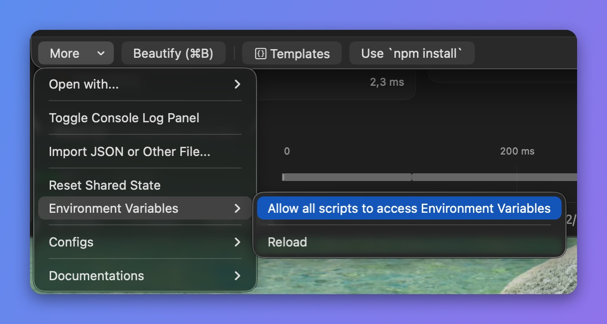

# Environment Variables

## 1. Shared State


Shared State works on all macOS versions that Proxyman supports (**macOS 14 Sonoma or later**).


You can share state between **onRequest()** and **onResponse()**, and between **different scripts**, with the global object **sharedState**.

* **sharedState** is a JS Object (Dictionary). You can assign any keys and values in **onRequest()**, then read the data in **onResponse()** or in **different scripts**.

The following code shows how to:

* Get the global counter and increase it each time the script runs
* Share data between Request and Response

```javascript
function onRequest(context, url, request) {

  // Save some state to sharedState
  sharedState.url = url;
  sharedState.data = "custom";
  sharedState.info = {"username": "Proxyman"};
  
  // Increase the global counter
  var count = sharedState.count ?? 0;
  count += 1;
  sharedState.count = count;
  
  // Log
  console.log(sharedState);
  return request;
}

function onResponse(context, url, request, response) {

  // Receive it
  console.log("Custom data = " + sharedState.data);
  console.log("sharedState.count = " + sharedState.count);
  
  // Done
  return response;
}
```


From Proxyman 2.25.0+, **sharedState** is available across different scripts. It is only released when you quit Proxyman or call the \`clearSharedState()\` function.



Before Proxyman 2.24.0, **sharedState** only lives in the current flow that runs the script, and it's released when the script finishes.


To clear all data, use the \`clearSharedState()\` function.

```javascript
// Clear all data from sharedState object
clearSharedState();
```

## 2. Environment Variables

The Environment Variables feature is available from **Proxyman 3.8.0** or later.

* Scripts can read system environment variables.
* Supports bash and zsh.

### How to use

1. Define an env in your `~/.zshrc` or `~/.bashrc`

```bash
export ACCESS_TOKEN=AAABBBCCC
export PROXYMAN_PATH=/Users/my_user/Desktop/file-mapper
```

2\. Open any script -> **More** button -> **Environment Variables** -> **Allow all scripts to access Environment Variables**.

3\. Click **Reload** to load the latest env changes.

<figure><figcaption><p>Allow scripts to read Environment Variables</p></figcaption></figure>

4\. Access an env variable in your script with the `$` prefix

```javascript
async function onResponse(context, url, request, response) {
  console.log($PATH);
  console.log($ACCESS_TOKEN);
  console.log($PROXYMAN_PATH);
 
  // Done
  return response;
}
```

## 3. Additions

* Manually reload the system env (Proxyman macOS 4.15.0 or later). Enable the permission first: **More** button -> **Environment Variables** -> **Allow all scripts to access Environment Variables**.

```javascript
async function onRequest(context, url, request) {
  // manually reload to get the latest changes
  _reloadEnv();
  
  // get env
  console.log($PROXYMAN_ID)
  
  // Done
  return request;
}

```
