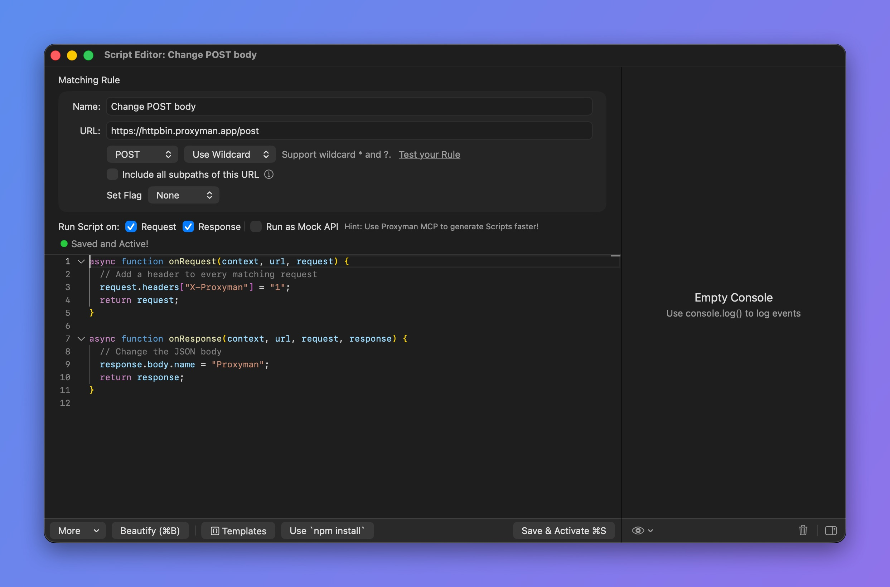

# Scripting

## 1. What's it?

Proxyman offers a Scripting tool. You can write JavaScript code to change the request and response in a flexible way.

## 2. Benefits

* Implement Map Local / Map Remote / Breakpoint with JS code. **100x Faster**
* Change the **Request Content**, including Domain, Host, Scheme, Port, Path, HTTP Method, HTTP Headers, Query, Body (Encoded-Form, JSON, plain-text)
* Log and inspect WebSocket messages with `onWebsocket` (**macOS Proxyman 26.1.0 or later**).
* Change the **Response Content**, including HTTP Status Code, HTTP Headers, and Body (JSON, Encoded-Form, plain-text, binary...)
* Plenty of built-in addons and libraries for common tasks, such as Hashing, Encode/Decode, JSON-Text transformer, Beautify, ...
* **Write your own JS Addons or Libraries**
* Designed to replace Rewrite GUI Tool from Charles Proxy
* Share state between scripts in the current session with [Shared State or Environment Variables](environment-variables.md)

<figure><figcaption><p>Scripting Tool</p></figcaption></figure>


[snippet-code.md](snippet-code.md)


## 3. How to use it?

You can access the Scripting Tool by:

* **Scripting** menu -> **Script List…** (⌥⌘I)
* Right-click a flow -> **Tools** -> **Scripting…**

Check out the [Snippet Code](snippet-code.md) page for a collection of JS snippets for the Scripting Tool.

## 4. Scripting with GraphQL Requests

From Proxyman 2.27.0+, the Scripting Tool can match a GraphQL request by its QueryName. Check out the following GraphQL document.


[graphql.md](../advanced-features/graphql.md)


## 4.1 Scripting with Websocket

From Proxyman 6.2.0 for macOS, use `onRequest` and `onResponse` to modify the WebSocket request URL and handshake headers. See [Change the WebSocket URL and headers](snippet-code.md#change-websocket-url-requests-response-header).

### Log messages with onWebsocket


`onWebsocket` is available **only in macOS Proxyman 26.1.0 or later**. It is not available on Windows, Linux, or iOS.


Use `onWebsocket(context, url, request, response, message)` to inspect and log captured messages from both the client and the server:

```javascript
function onWebsocket(context, url, request, response, message) {
  console.log(`[${message.from}] ${message.type}: ${message.data}`);
}
```

This hook is **read-only**. Proxyman forwards the message before running the script. Changing its arguments or returning a value does not modify the traffic or captured messages. No return statement is required.

**How to use it**

1. Capture a WebSocket connection. For `wss://`, enable SSL Proxying for the host so Proxyman can read its messages.
2. Right-click the captured flow and select **Tools → Scripting**. The generated script includes `onWebsocket` below `onResponse`.
3. Add your logging code and click **Save & Activate**.
4. Reconnect the WebSocket, send messages, and check the script's **Console Log**.

The rule must be active when the connection opens. Reconnect after creating a rule or adding `onWebsocket` to a script that did not have it when the connection opened. The ordinary new-script template does not include this hook; you can add it manually.

**Arguments**

Keep all five arguments in order. `context` and `url` describe the flow and matching rule. `request` and `response` contain the final handshake, including changes made by `onRequest`, `onResponse`, or Breakpoint. `message` contains:

| Field | Value |
| --- | --- |
| `message.type` | `"text"`, `"binary"`, `"ping"`, `"pong"`, or `"close"`. |
| `message.from` | `"client"` or `"server"`. |
| `message.data` | Always a string. Binary data is shown as UTF-8 text when possible, otherwise `Binary (length=N)`. Optional WebSocket tab decoders are not applied. |
| `message.rawData` | A copied `Uint8Array`, available only for binary messages. Log it explicitly; it is not included when enumerating `message`. |
| `message.closeCode` | A number, available only for close messages, such as `1000`. |

**Notes**

* Fragmented text and binary frames are reassembled before the hook runs. You receive one complete message, not a separate callback for each continuation frame.
* Ping/pong payloads and close reasons are not exposed.
* Synchronous and `async` hooks are supported, along with helpers such as `console.log`, `require`, `sharedState`, and `$http`.
* Edits to an existing hook and rule/folder/tool enabled state are checked at most once per second as messages arrive. Calls already queued may finish.
* The Console Log keeps the latest 200 log entries. If scripts cannot keep up, hook calls may be skipped with a warning while traffic continues. Use it for debugging, not as a complete traffic archive.

See [WebSocket message snippets](snippet-code.md#log-websocket-messages-with-onwebsocket) for text, JSON, binary, ping/pong, and close examples.

## 5. Examples

The following guide shows how to write JS code to change the request domain from production to localhost and change the response body.

1. Make sure you enable SSL Proxying for this domain before creating the script.
2. Open the Scripting Tool and create a new Script Entry (⌘N). You can also right-click the request -> Tools -> Scripting… => Proxyman creates a script for you.
3. Give it a name and define a Matching Rule.
4. Ex: **Name**=Test on Localhost endpoint, **URL**=https://proxyman.io
5. Enable the **Request** and **Response** checkboxes in **Run Script on**
6. Start writing JS code for `onRequest` function

**onRequest(context, url, request) {}**

```javascript
// Import UUID addons
const { uuidv4 } = require("@addons/UUID.js");

function onRequest(context, url, request) {
  // print log
  console.log(request);

  // Change Production domain -> Localhost
  request.method = "GET";
  request.scheme = "http";
  request.host = "localhost";
  request.port = 8000;
  
  // Add new header
  request.headers["X-New-Header"] = "Hello From Scripting feature";
  request.headers["UUID"] = uuidv4(); // generate random UUIDv4
  delete request.headers["Key-Need-Delete"];

  // Update or Add a new Query
  request.queries["name"] = "Proxyman";

  // Update Body
  var body = request.body;
  body["name"] = "Proxyman";
  request.body = body;
  
  // Or Map the body with a local file (Proxyman 2.25.0+)
  // request.bodyFilePath = "~/Desktop/mockdata.json";
  
  // Done
  return request;
}
```

## onRequest() Object Format

`context`, `url` and `request` Objects are defined by:

```javascript
// context (readonly)
{
    "scriptName": "<String> Your Script Name",
    "matchingRule": "<String> Your Matching Rule",
    "matchingMethod": "<String> Method",
    "isEnableOnRequest": "Bool",
    "isEnableOnResponse": "Bool",
    "filePath": "<String> Script path",
    "flow": { // Available from 2.16.0+
        "serverPort": "443",
        "serverIpAddress": "104.18.230.83",
        "clientIpAddress": "192.168.0.102",
        "remoteDeviceName": "iPhone XR",
        "remoteDeviceIP": "192.168.0.102",
        "id": "51",
        "clientPath": null,
        "clientPort": "51494",
        "clientName": null,
        "mapRemoteOriginalURL": "<String> Original URL before Map Remote modification (nullable)"
    },
}

// url (readonly)
url: String // => Present the full URL

// request
{
    "method": "<String> HTTP Method. Accept string method. Ex: GET, POST, ...",
    "scheme": "<String> Accept http or https",
    "host": "<String> Host of the request. Ex: api.proxyman.io, localhost, ...",
    "path": "<String>: Path of the URL. Ex: /v1/data",
    "port": "<Int> Accept int port number. Ex: 443, 8080, ..",
    "queries": "<[String: Any]> A JS Object (Dictionary) contains key values of the query",
    "headers": "<[String: Any]> A JS Object (Dictionary) contains key values of the header",
    "body": "Depend on the Content-Type header. It might be a dictionary for JSON and form, Plain Text or Uint8Array",
    "bodyFilePath": "<String><Optional> Set a body with a local file. See example in Snippet Code Page"
    "rawBody": "<Readonly>: A raw body String or Uint8Array",
    "preserveHostHeader": "<Bool> Preserve the Host",
    "isURLEncoding": "<Bool> Determine if Proxyman will perform URLEncoding when constructing the final URL. Default is True",
    "upstream": "<Object><Optional> Upstream TLS ALPN and HTTP/2 settings. Proxyman v26.0.0 or later for macOS."
}

```


You can change any value of the request obj except `rawBody`


Set `request.upstream` in `onRequest`. See [Upstream ALPN and HTTP/2 settings](snippet-code.md#upstream-alpn-and-http2-settings) for an example and supported fields.


If the **body** has an invalid format because of an incorrect Content-Type header, use **rawBody** and parse the string manually.


The type of `request.body` depends on the Content-Type header.

| Content-Type Header                                                                 | request.body      |
| ----------------------------------------------------------------------------------- | ----------------- |
| application/json or JSON families                                                   | Javascript Object |
| application/x-www-form-urlencoded                                                   | Javascript Object |
| plain-text or text-based Content-Type, Ex: application/js, text/css, text/html, ... | String            |
| The rest: Binary Data (application/zip, application/octet-stream)                   | Uint8Array        |

Check out common JS code on the Snippet Code page:


[snippet-code.md](snippet-code.md)


7\. Start writing code on `onResponse` function

```javascript
function onResponse(context, url, request, response) {
  console.log(response);

  // Update or Add a new header
  response.headers["Content-Type"] = "application/json";

  // Update status Code
  response.statusCode = 500;

  // Update Body
  var body = response.body;
  body["new-key"] = "Proxyman";
  response.body = body;

  // Or Map the body with a local file (Proxyman 2.25.0+)
  // response.bodyFilePath = "~/Desktop/mockdata.json";
  
  // Done
  return response;
}
```

## onResponse() Objects Format

`context`, `url`, `request`, and `response` objects are defined by:

```javascript
// context (readonly): Same with onRequest

// url (readonly): Same with onRequest

// request (readonly): Same with onRequest

// response
{
    "statusCode": "<Int> Status Code. Ex: 200, 400, 404,...",
    "httpVersion": "<String><Readonly> The HTTP Version",
    "statusPhrase": "<String><Readonly> HTTP Status Phrase. Ex Not Found, OK, ...",
    "headers": "<[String: Any]> A JS Object (Dictionary) contains key values of the header",
    "body": "Depend on the Content-Type header. It might be a dictionary for JSON and form, PlainText or Uint8Array",
    "rawBody": "<Readonly>: A raw body String or Uint8Array",
    "bodyFilePath": "<String><Optional> Set a body with a local file. See example in Snippet Code Page"
}
```


You can change `statusCode`, `headers` and `body` from the response Obj



If the **body** has an invalid format because of an incorrect Content-Type header, use **rawBody** and parse the string manually.


The type of `response.body` depends on the Content-Type header.

| Content-Type Header                                                                 | response.body     |
| ----------------------------------------------------------------------------------- | ----------------- |
| application/json or JSON families                                                   | Javascript Object |
| application/x-www-form-urlencoded                                                   | Javascript Object |
| plain-text or text-based Content-Type, Ex: application/js, text/css, text/html, ... | String            |
| The rest (application/zip, application/octet-stream)                                | Uint8Array        |


You must return the `request` and `response` objects in the `onRequest` and `onResponse` functions.


## 6. Built-in Addons and Libraries

Proxyman provides plenty of addons and libraries for common tasks: Hashing, Encode/Decode, ...


[addons.md](addons.md)



[built-in-js-libraries.md](built-in-js-libraries.md)



[snippet-code.md](snippet-code.md)


## 7. Debugging JS Error

Sometimes you might get JavaScript errors because of syntax errors, invalid code, etc. You can debug by reading the error messages in the console or by using `console.log()`.

## 8. Use Scripting as a Mock API

From Proxyman 2.32.0, you can use the Scripting Tool as a Mock API. Your request never hits the server, and you define the response body yourself. This works the same way as Map Local.

This is useful when the real REST API is not available yet. You can define and test it locally.

To enable the Mock API:

1. Open the Scripting Tool -> Select the Script
2. Enable the **Run as Mock API** checkbox, next to the **Request** and **Response** checkboxes in the Script Editor (see the Script Editor screenshot above).

Then you can define a Response as usual:

```javascript
function onResponse(context, url, request, response) {

  // Init new body
  var body = {};
  body["new-key"] = "Proxyman";
  response.body = body;

  // Or map from a file
  // response.bodyFilePath = "~/Desktop/myfile.json"
  
  // Done
  return response;
}
```

## 9. Notes

* You must return the `request` and `response` objects in the `onRequest` and `onResponse` functions.
* **Proxyman 4.16.0 or later**: Proxyman now converts the Binary Data to **Uint8Array**
* Proxyman 4.15.0 or earlier: JavaScript doesn't have a Data type, so a binary body is converted to a **Base64 Encoded String** in JavaScript. To pass a Uint8Array, blob, or ArrayBuffer to the body, convert it to a **Base64 Encoded String** first.

## Learn more

* [How to map a Local Response for GraphQL Requests?](https://proxyman.com/posts/2021-01-24-How-To-Map_Response_For_GraphQL_Requests)
* [How to by-pass CORS Policy](https://proxyman.com/posts/2020-08-31-How-to-by-pass-CORS-policy)
