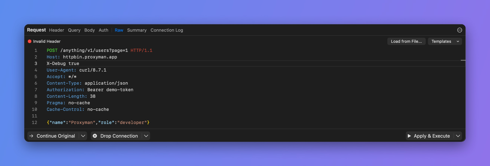

# \[Breakpoint] Modify Request/Response by Raw Message

When you edit a request or response in the **Raw** tab of a [Breakpoint](../advanced-features/breakpoint.md), Proxyman checks the HTTP message as you type. If the syntax is wrong, it shows an error at the bottom of the editor, such as **Invalid Header**, **Invalid Request HTTP Message** or **Invalid Response HTTP Message**. Your change is not applied until the message is valid again.

<figure><figcaption>
A header line without a colon is invalid
</figcaption></figure>

## How to fix it

* The first line of a request is the method, the path and the HTTP version, for example `GET /get?id=123 HTTP/1.1`.
* The first line of a response is the HTTP version and the status, for example `HTTP/1.1 200 OK`.
* Put each header on its own line, as `Name: Value`.
* Leave one empty line between the headers and the body.
* To turn off a header without deleting it, start its line with `//`.
* To start over, use **Reset to the Original** to restore the original message.

## Video


Modify requests and responses with Breakpoint

