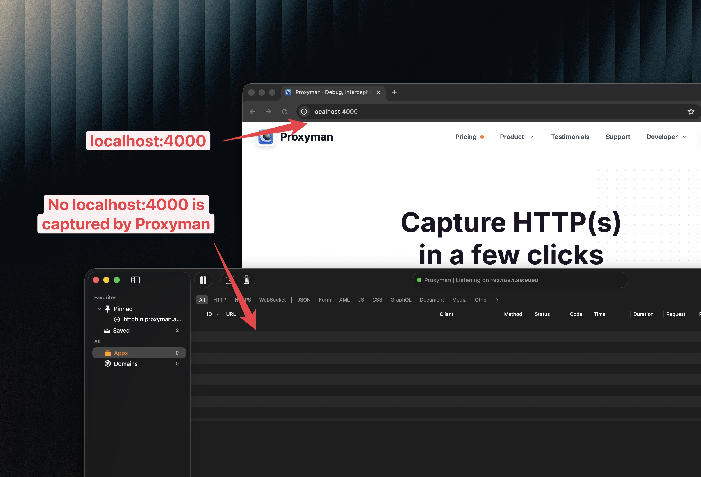
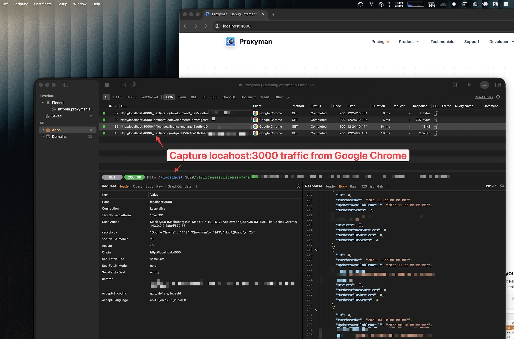

# I could not see any requests from my localhost server

## 1. Problem

I develop a local NodeJS, Ruby, or Python backend at **http://localhost:3000**, but when I visit **http://localhost:3000** in Google Chrome or Safari, there is no traffic in the Proxyman app.

**Why does this happen?** By default, on macOS, localhost requests don't go through the system HTTP proxy. Therefore, Proxyman doesn't record any traffic.

<figure><figcaption><p>localhost traffic doesn't appear in Proxyman by default</p></figcaption></figure>

## 2. Solution

### 2.1 ✅ New solution for v6.3.0

From Proxyman macOS v6.3.0, Proxyman can:

* Capture `http://localhost:3000` or any localhost traffic in Google Chrome / Firefox without changing the /etc/hosts file
* Works with a single click
* Tutorial: [How to capture HTTP localhost traffic from Google Chrome](https://proxyman.com/posts/how-to-capture-http-localhost-traffic-from-google-chrome)

#### How to do it

1. In Proxyman, open the **Setup** menu -> **Automatic Setup…** -> In the Web Browsers section, click **Google Chrome…**
2. A new Google Chrome window appears.
3. Done. Visit http://localhost:3000 and Proxyman captures it.

<figure><figcaption><p>Capture localhost traffic from Google Chrome</p></figcaption></figure>

### 2.2 Old solution

There are two solutions. Follow either one of them.

#### Solution 1: Map **localhost** to a domain name in `/etc/hosts`&#x20;

1. Open the `/etc/hosts` file with Vim or VS Code.

```
$ sudo vim /etc/hosts
```

2\. Add a domain name for both **IPv4** and **IPv6** (you can replace `proxyman.debug` with any name)

```
127.0.0.1 proxyman.debug
::1 proxyman.debug
```

<figure><figcaption><p>Add proxyman.debug in /etc/hosts</p></figcaption></figure>

3\. Save the file with `sudo` permission.

4\. Access your localhost server at **http://proxyman.debug:3000** (replace 3000 with your localhost port).&#x20;

5\. Enjoy debugging!


If you use `local` as a suffix, for example proxyman.local, make sure to remove `*.local` from the Bypass Proxy List ([how to do it](.local-doesnt-appear-in-proxyman.md#2.-solution)).


#### Solution 2: Use **localhost.proxyman.io** instead of **localhost**

Proxyman uses Cloudflare and sets the DNS of **localhost.proxyman.io** to 127.0.0.1 (localhost). As a result, Proxyman can capture the local traffic as usual ✅&#x20;

For example:

<table data-header-hidden><thead><tr><th width="374">Old URL</th><th>New URL</th></tr></thead><tbody><tr><td>Old URL</td><td>New URL</td></tr><tr><td>localhost:3000</td><td>localhost.proxyman.io:3000</td></tr><tr><td>localhost:8080</td><td>localhost.proxyman.io:8080</td></tr><tr><td>...</td><td>...</td></tr></tbody></table>
