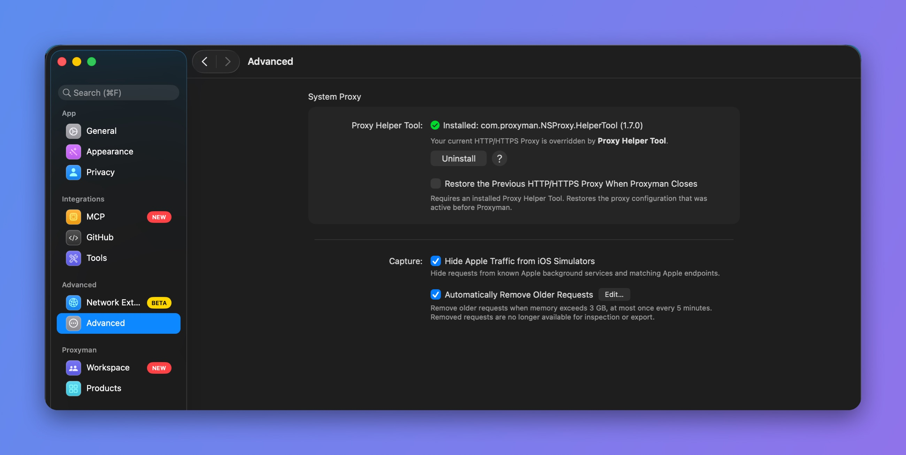

# I couldn't see any traffics on Proxyman

An empty request list usually means traffic is not reaching Proxyman, recording is paused, or a filter hides the requests. Check the proxy and capture settings first, then test for VPN conflicts and cached responses.

## 1. Problems

* After launching the app, the request list is empty.
* Proxyman doesn't capture any requests.
* I don't see any requests in the app.
* I can see some requests from my Mac, but no requests from my remote devices (iOS, Android).


For remote devices (iOS or Android), see [My remote devices could not connect to Proxyman](my-ios-devices-couldnt-connect-to-proxyman-via-proxy.md).



If an app on your Mac ignores the system proxy, try [Network Extension](../advanced-features/network-extension.md). Open Proxyman -> Settings -> Network Extension, enable it, then restart the app and make a new request.

Network Extension is BETA and requires Proxyman PRO on macOS 26 or later.


## 2. Solution

Work through these checks in order, making a fresh request after each change:

1. **Check the proxy:** Confirm that your client uses the computer and port where Proxyman is listening. For local Mac traffic, check the HTTP and HTTPS system proxy values below. For an iOS or Android device, use the computer IP address from its Proxyman setup guide.
2. **Check capture settings:** Make sure recording is on (**Tools** -> **Toggle Recording**) and clear any active request filters. If HTTP appears but HTTPS cannot be read, verify certificate trust and [SSL Proxying](../basic-features/ssl-proxying.md) for the domain.
3. **Check VPN interaction:** Temporarily disconnect the VPN if possible, then recheck proxy settings and repeat the request. Some VPN clients overwrite the proxy configuration.
4. **Check cached requests:** Repeat an action that sends a new network request, or try the No Caching tool described below. A response served entirely from the app cache will not pass through the proxy.

The sections below explain the proxy, VPN, helper-tool, and caching checks in more detail.

### 2.1 Turn OFF all VPN apps on your Mac

Some VPN apps revert the HTTP proxy in the network settings as soon as Proxyman overrides it. As a result, HTTP traffic doesn't go through the Proxyman port 9090.

Close all VPN apps if possible and relaunch Proxyman. If you need your VPN, see [Proxyman does not work with VPN apps](proxyman-does-not-work-with-vpn-apps.md).

### 2.2 Double-check the HTTP proxy in Network settings

Proxyman overrides the HTTP proxy at launch and reverts it when it quits, but some apps can change it back.

Open System Settings -> Network -> Wi-Fi -> Details… -> Proxies:

* Check **Web proxy (HTTP)** and **Secure web proxy (HTTPS)**
* Make sure the port is the same as the Proxyman port
* The server is **127.0.0.1**

Click OK and check the requests in Proxyman.

### 2.3 Install the Proxy Helper Tool

By default, Proxyman overrides the system HTTP proxy with the `networksetup` command line tool, but it can fail in some cases.

\=> Install the Proxy Helper Tool. It overrides the system HTTP proxy properly. Open Proxyman **Settings** -> **Advanced** -> **Proxy Helper Tool** -> **Install**.

<figure><figcaption>
Proxy Helper Tool installed
</figcaption></figure>

### 2.4 Some HTTP/HTTPS requests are missing from Proxyman

Alamofire or URLSession might use a cached response for your request. As a result, the request never reaches the server, so Proxyman can't capture and show it.

Solution:&#x20;

* Turn off caching in URLSession or Alamofire.
* Use the [No Caching tool](../advanced-features/no-caching.md) (⌥⌘N).

## Video


Capture HTTP and HTTPS traffic with Proxyman

