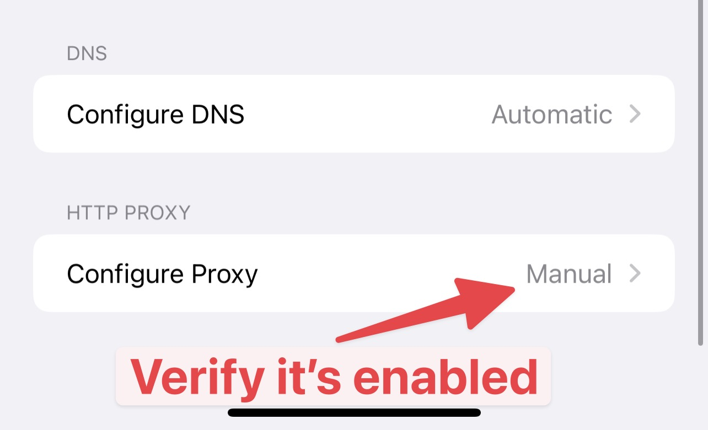

# iOS 16 and iOS 17 issues

## 1. Problem

* iOS 16 or iOS 17 physical devices can't set the HTTP proxy to Proxyman in Settings app -> Wi-Fi -> Your Wi-Fi -> Configure Proxy -> Manual.
* Proxyman might not capture the traffic from iOS 16/17 devices.

\=> It's an Apple bug.


This issue happens with **Charles Proxy**, Wireshark, Fiddler Everywhere, and other web debugging proxy apps too.



Some users report that it's fixed on iOS 16.3 and later ✅&#x20;

iOS 17 might have the same problem. **Forget This Network** might fix it.

The same test and fix apply to iOS 18 and iOS 26. The Wi-Fi proxy settings are in the same place, so follow the same steps.

See [Section 4](ios-16-devices-issues.md#4.-solution-for-ios-16.3-ios-17-or-later) for details.


## 2. How do I know it's a bug from Apple, not Proxyman?

You can test it with these steps:

1. Quit the Proxyman app.
2. On your iPhone (iOS 16 or later), open the Settings app -> Wi-Fi -> Your Wi-Fi -> Configure Proxy -> Manual.
3. Set any random IP, for example 192.168.3.111.
4. Set any random port, for example 9999.
5. Save.
6. Open the Safari app and visit https://google.com.
7. Check whether you can access the internet.

The IP and port are **invalid**, so the page should not load. If you can still access the internet, the iPhone is ignoring the proxy, which means it's Apple's bug 🆘

## 3. Solution for iOS 16.3 or earlier

* Forget the Wi-Fi network and restart the device. It might help.
* Use the [Atlantis framework](https://github.com/ProxymanApp/atlantis) to inspect the network.
* Try an iOS 15 physical device.
* Try the iOS 16 **Simulator**.

## 4. Solution for iOS 16.3, iOS 17 or later

These steps also work on iOS 18 and iOS 26.

1. Settings app -> Wi-Fi -> Your Wi-Fi -> <mark style="color:red;">**Forget This Network.**</mark>
2. Connect to the Wi-Fi again. Then open Settings app -> Wi-Fi -> Your Wi-Fi -> Configure Proxy -> Manual -> enter the IP and port -> Save.
3. Double-check the Configure Proxy setting.

<figure><figcaption>
Configure Proxy must show Manual
</figcaption></figure>

4. Make sure it shows `Manual`. If it shows `Off`, set it again and save. Sometimes, the proxy setting is not saved.

## 5. Further discussions

* [GitHub issue #1293](https://github.com/ProxymanApp/Proxyman/issues/1293)
